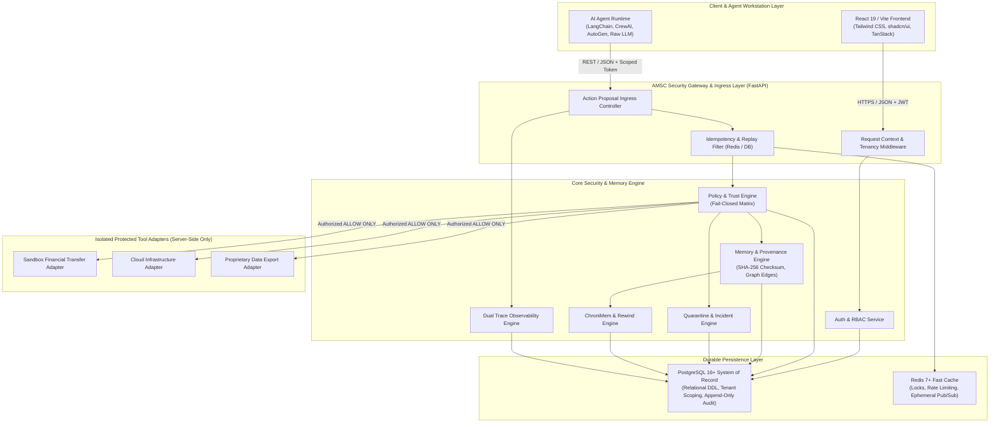
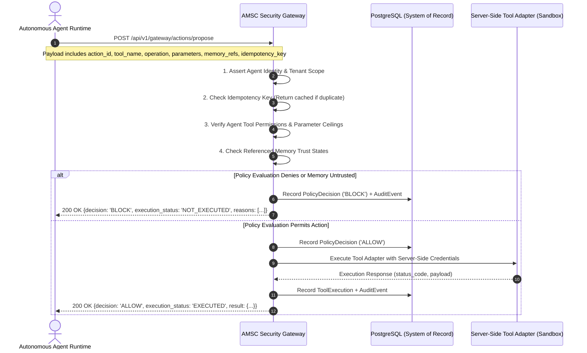
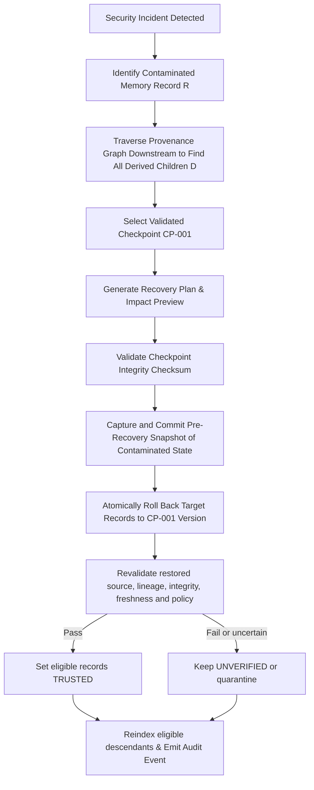

# Agent Memory Security Center (AMSC)
## Document 02: Combined Technical Requirements Document & Software Requirements Specification (TRD/SRS)

**Document Identifier:** `AMSC-DOC-002`  
**Version:** 1.0.0  
**Status:** Approved Technical Specification  
**Architecture Classification:** High-Assurance Security Gateway & Distributed Provenance Engine  
**Author:** Lead Software Architect & Backend Engineering Council  
**Repository Target:** https://github.com/9m2usman/ChronoCongiSec

---

## 1. Technical Overview

The Agent Memory Security Center (AMSC) is a multi-tenant, zero-trust security and governance platform purpose-built for autonomous AI agent ecosystems. It mediates all interactions between persistent agent memory and real-world tool execution adapters.

AMSC solves the fundamental security vulnerability of autonomous systems: the vulnerability where an agent acts upon corrupted, poisoned, or drifted memory to perform unauthorized, high-impact external actions. AMSC establishes an authoritative, server-side security boundary that validates memory provenance, enforces parameter ceiling constraints, checks cryptographic integrity, and mediates tool invocations through a fail-closed gateway.

---

## 2. System Architecture & Component Topology

AMSC is architected as a modular monolith optimized for zero-latency, in-process policy decisions and high-integrity data consistency during its initial operational phase, with clean service boundaries designed for distributed decomposition.



---

## 3. Core Architecture Principles

1. **Complete Mediation (Saltzer-Schroeder Invariant):**
   - Every protected tool proposal must pass through the server-side Security Gateway before execution.
   - Agents never receive tool credentials or direct network routes to protected tool adapters.
2. **Fail-Closed Security Posture:**
   - If any security dependency (Policy Engine, Memory Trust Evaluator, Database, or Redis) times out, encounters an exception, or becomes partitioned, the system defaults to `BLOCK`.
3. **Durable System of Record:**
   - PostgreSQL is the sole durable authority for memory records, provenance edges, policy decisions, checkpoints, and audit trails.
   - Redis is strictly utilized for transient caching, distributed locks, and rate limiting. Redis is never the sole repository of critical evidence.
4. **Cryptographic Provenance & Tamper Evident Lineage:**
   - Every memory record version has a canonical SHA-256 checksum computed over normalized UTF-8 payload bytes.
   - Relationships between raw sources, parent chunks, and derived summaries are preserved as immutable directed graph edges.
5. **Strict Multi-Tenant Boundary Enforcement:**
   - Every entity in the persistence tier is bounded by a mandatory, non-nullable `tenant_id`.
   - Data queries at the repository layer enforce tenant scoping. Cross-tenant access attempts result in immediate rejection and security alerts.

---

## 4. Technology Stack & Rationale

| Layer | Component | Selected Technology | Technical Rationale |
|---|---|---|---|
| **Frontend Framework** | UI Architecture | React 19 / TypeScript / Vite | Industry-standard component model, sub-second HMR, absolute static type safety. |
| **Frontend Styling** | Design System | Tailwind CSS v3.4+ / shadcn/ui | High technical information density, accessible Radix primitives, consistent tokens. |
| **Frontend Routing** | Client Navigation | TanStack Router v1+ | Type-safe search parameters, nested route layouts, persistent inspector drawers. |
| **Frontend State** | Data Synchronization | TanStack Query v5+ | Asynchronous server-state caching, automatic refetching, mutation lifecycle hooks. |
| **Frontend State** | Client UI State | Zustand v5+ | Lightweight client-only state (drawer toggles, timeline scrub position). |
| **Frontend Graphs** | Topological Canvas | React Flow (@xyflow/react) | Node-edge rendering, progressive expansion, zoom/pan navigation for Knowledge Graph. |
| **Frontend Charts** | Visual Analytics | Recharts v2+ | Clean, composable SVG charts for Gateway posture and incident trends. |
| **Frontend Forms** | Form Management | React Hook Form + Zod | Schema-driven client validation matching backend OpenAPI contracts. |
| **Backend Framework** | API Gateway | Python 3.12+ / FastAPI | High asynchronous throughput, native OpenAPI generation, Pydantic type validation. |
| **Backend ORM** | Data Persistence | SQLAlchemy 2.0+ (AsyncIO) | Type-safe relational mapping, explicit transaction control, migration support. |
| **Database Migrations** | Schema Versioning | Alembic 1.13+ | Deterministic, version-controlled database schema evolution. |
| **Database Engine** | System of Record | PostgreSQL 16+ | ACID transactions, foreign key integrity, JSONB support, row-level security. |
| **Fast Cache / Locks**| Ephemeral Store | Redis 7+ | Sub-millisecond idempotency locks, rate limiting, and pub/sub trace distribution. |
| **Testing Harness** | Quality Assurance | pytest / pytest-asyncio / httpx | Asynchronous test execution, ASGI test transport, end-to-end integration coverage. |

---

## 5. Technology Compatibility & Version-Freeze Policy

To prevent dependency drift across the seven-person team, the development baseline is strictly pinned:

```text
Python: 3.12.x / 3.14.x
Node.js: v20.x / v22.x / v24.x (LTS recommended)
npm: 10.x / 11.x
PostgreSQL: 16.2+
Redis: 7.2+

Core Backend Manifest:
  fastapi == 0.162.4
  uvicorn == 0.54.0
  pydantic == 2.14.3
  pydantic-settings == 2.16.2
  sqlalchemy == 2.1.8
  aiosqlite == 0.22.1 (for local zero-dependency testing)
  asyncpg == 0.29.0 (for PostgreSQL production)
  httpx == 0.28.1
  pytest == 9.2.0
  pytest-asyncio == 1.4.1.post1

Core Frontend Manifest:
  react == ^19.0.0
  react-dom == ^19.0.0
  vite == ^6.0.0
  typescript == ^5.6.0
  tailwindcss == ^3.4.0
  lucide-react == ^0.460.0
  @tanstack/react-query == ^5.60.0
  @tanstack/react-table == ^8.20.0
  zustand == ^5.0.0
```

**Version-Freeze Rules:**
1. All developers must develop against identical runtime and library baselines.
2. Package manifests (`requirements.txt`, `pyproject.toml`, `package.json`, `package-lock.json`) are committed to version control.
3. No team member may independently bump a minor or major library version without written agreement from M1 (Backend Lead) and M5 (Frontend Lead).

---

## 6. Frontend Architecture

The frontend is structured as a high-density, multi-panel technical security workstation.

### 6.1 Layout Shell & Workspace Isolation
- **Collapsible Global Sidebar:** Grouped navigation with real-time incident counters and route indicators.
- **Top Navigation Bar:** Tenant switcher dropdown (Company A, B, C), W3C Trace context indicator, global search palette, theme toggle.
- **Main Viewport:** High-density data tables, synchronized split timelines, and topological graph canvases.
- **Contextual Inspector Drawer:** Slides out from the right margin upon selecting any table row, trace span, or graph node, exposing complete raw JSON payloads, cryptographic SHA-256 hashes, parent provenance trees, and authorized action triggers.

### 6.2 State Management Rules
- **Server State (TanStack Query):** All data fetched from backend APIs (agents, memory, incidents, traces, audit logs) is managed exclusively via TanStack Query with standard stale-time and cache-invalidation policies.
- **Client State (Zustand):** Client-only UI states (e.g., active inspector drawer item, temporal timeline scrub position, graph filter toggles) reside in isolated Zustand stores.
- **Form State (React Hook Form + Zod):** All user input forms (agent registration, permission updating, quarantine notes, recovery overrides) are validated using Zod schemas matching backend Pydantic models.

---

## 7. Backend Architecture & Service Responsibilities

The backend adopts an asynchronous, service-oriented modular architecture organized under `backend/app/`:

1. **`core/`:** Configuration (`config.py`), database engine setup (`database.py`), cryptographic utilities and JWT hashing (`security.py`).
2. **`tenancy/`:** Multi-tenant context models (`models.py`), dependency injection middleware (`context.py`).
3. **`agents/`:** Agent lifecycle registry, tool registration schemas, and agent-tool permission constraints.
4. **`knowledge/`:** Knowledge source catalogs, documents, entity-relationship models for the knowledge graph.
5. **`memory/`:** Ingestion controller, cryptographic content hasher, versioning, provenance graph traversals, quarantine status.
6. **`gateway/`:** Action proposal ingress controller, idempotency manager, server-side tool adapter execution.
7. **`security/`:** Policy engine, rule matrix evaluator, memory trust validator.
8. **`incidents/`:** Security incident tickets, evidence linker, drift observation models.
9. **`recovery/`:** Checkpoint snapshots, blast-radius calculator, pre-recovery state preservation, atomic rollback engine.
10. **`audit/`:** Append-only forensic event recorder with W3C trace correlation.

---

## 8. Database Architecture & Persistence Invariants

1. **Relational System of Record:** PostgreSQL 16+ enforces data consistency using strict primary keys (UUIDv4), foreign key constraints with explicit `ON DELETE CASCADE` or `SET NULL`, and unique constraints.
2. **Tenant Scoping at Data Layer:**
   - All tenant-owned tables contain `tenant_id VARCHAR(36) NOT NULL REFERENCES tenants(id)`.
   - Every database query in repositories must include `WHERE tenant_id = :current_tenant_id`.
3. **Composite Unique Constraints:**
   - `uq_tenant_user`: (tenant_id, user_id)
   - `uq_tenant_tool_name`: (tenant_id, name)
   - `uq_agent_tool_perm`: (agent_id, tool_id)
   - `uq_record_version`: (record_id, version)
   - `uq_tenant_idemp_key`: (tenant_id, idempotency_key)
4. **Append-Only Immutability:**
   - `audit_events` and `policy_decisions` tables have no `UPDATE` or `DELETE` API endpoints. Once committed, they are permanent forensic records.

---

## 9. Redis Responsibilities & Boundaries

Redis is strictly scoped to non-authoritative, high-performance ephemeral workloads:
- **Distributed Idempotency Locks:** `SET amsc:idemp:{tenant_id}:{idempotency_key} "LOCKED" NX EX 3600` prevents concurrent execution of duplicate financial or system proposals.
- **Rate Limiting:** Sliding-window rate limit counters per agent and user token.
- **Live Event Fan-Out:** Ephemeral pub/sub channels for pushing live gateway decisions and trace spans to connected analyst frontends.

**Prohibited Redis Workloads:** Redis must **never** be used as the sole storage for:
- Memory record text or versions.
- Provenance relationship edges.
- Checkpoint snapshots.
- Policy decisions or authorization audit trails.

---

## 10. Background Job Architecture

Where asynchronous background processing is required (e.g., deep graph re-indexing, large document batch chunking):
- **Transactional Outbox Pattern:** Database transactions write task intents into an `outbox_events` table within the same transaction that updates business state.
- **Worker Execution:** A dedicated worker polls or listens for outbox events, executes the task idempotently, and updates the task status.
- **Fail-Safe Recovery:** If a background worker terminates unexpectedly, unacknowledged outbox events remain pending and are picked up upon worker restart without data loss.

---

## 11. Authentication & Authorization (RBAC)

1. **Authentication Handlers:**
   - Standard OAuth2 / Bearer JWT containing user ID, tenant context, and assigned role.
   - High-entropy API Keys for autonomous agent runtimes (`amsc_ak_live_...`).
2. **Role Hierarchy:**
   - `PLATFORM_ADMIN`: Superuser access across platform configuration (restricted).
   - `TENANT_ADMIN`: Full administrative control over users, agents, tools, and policies within a single tenant.
   - `SECURITY_ANALYST`: Forensic triage, alert review, memory quarantine, trace correlation, rollback execution.
   - `AI_DEVELOPER`: Agent configuration, knowledge ingestion, action proposal submission, trace inspection.
   - `AUDITOR`: Read-only access to audit events, verified checkpoints, and compliance exports.
3. **Server-Side Tenant Resolution:**
   - Client-provided headers (`X-Tenant-ID`) are never trusted in isolation. The server verifies that the authenticated user possesses an active `Membership` in the specified tenant before executing any request.

---

## 12. Multi-Tenant Architecture & Data Isolation

Multi-tenancy in AMSC is enforced through defense-in-depth across multiple application layers:

```
[Layer 1: Network & Ingress]
  Verify Authorization Header -> Extract Principal -> Verify Active Tenant Membership in DB
        |
[Layer 2: Request Context]
  Inject TenantContext(tenant_id, user_id, role, trace_id) into Coroutine Local Scope
        |
[Layer 3: Repository / Query Layer]
  Append mandatory 'WHERE tenant_id = :tenant_id' to EVERY SELECT, UPDATE, DELETE statement
        |
[Layer 4: Relational Database Layer]
  Composite Foreign Keys and Unique Constraints prevent cross-tenant record linkages
        |
[Layer 5: Cache & Key-Value Layer]
  Keys strictly namespaced: 'amsc:tenant:{tenant_id}:{resource}:{id}'
```

**Negative Test Guarantee:** Cross-tenant access attempts (e.g., Tenant A requesting Tenant B's agent or memory record) must trigger `HTTP 403 Forbidden` or `HTTP 404 Not Found` and emit an immediate security alert.

---

## 13. Agent Runtime Integration Protocol

AMSC integrates cleanly with diverse external agent frameworks (LangChain, CrewAI, AutoGen, or custom Python/TypeScript LLM applications) without requiring framework-specific hacks.

### Protocol Steps:
1. **Agent Bootstrapping:** Agent is registered in the AMSC Agent Registry, receiving an `agent_id` and an agent bearer token.
2. **Context Retrieval:** Agent queries the AMSC Memory Service (`GET /api/v1/memory?agent_id=...`). The server returns only eligible `TRUSTED` records for that authenticated tenant, agent and purpose; all other trust states are excluded from normal agent context.
3. **Action Proposal:** When the agent decides to invoke an external tool (e.g., send wire, restart VM), it does **not** call the tool directly. It posts an `ActionProposal` payload to the AMSC Security Gateway (`POST /api/v1/gateway/actions/propose`).
4. **Gateway Mediation:** The Gateway evaluates identity, permissions, and memory trust, returning a signed decision response.
5. **Execution or Denial:** If allowed, the Gateway invokes the tool adapter and returns the result to the agent. If blocked, the Gateway returns `decision: BLOCK` along with human-readable security reasons.

---

## 14. Tool Execution Security & The Single Ingress Boundary



**Key Invariant:** The agent runtime **never** possesses credentials for external APIs. Credentials reside exclusively inside the server-side adapter execution layer.

---

## 15. Memory & Provenance Architecture

### 15.1 Cryptographic Content Hashing and Authenticity Boundary
Upon ingestion of any memory chunk, AMSC calculates a SHA-256 hash:
$$\text{Checksum} = \text{SHA256}(\text{UTF8}(\text{Strip}(\text{Content})))$$
This checksum is stored in `memory_versions.checksum` and is recomputed on retrieval and checkpoint creation to detect content mismatch against the recorded expected digest. **A plain SHA-256 checksum is not an authenticity signature:** an attacker able to modify both content and checksum can recompute it. If the threat model includes database-writer compromise, protect expected digests/checkpoint roots using a separately controlled KMS/HSM-backed signature or keyed MAC, and verify the signature against an independently protected key. Do not claim that SHA-256 alone detects an attacker who can rewrite both fields.

### 15.2 Version Lineage & Provenance Edges
- **Memory Records:** Represent the persistent concept (`memory_records`).
- **Memory Versions:** Represent the immutable revision history (`memory_versions`), starting at version 1 and incrementing on every modification.
- **Provenance Edges:** Track directional lineage (`provenance_edges`):
  - `DERIVED_FROM`: Child record generated from parent summary or source document.
  - `TRANSFORMED_INTO`: Transformation applied by an extraction or summarization pipeline.
  - `SUPERSEDES`: Newer version invalidating an older record.

### 15.3 Dynamic Trust States
Memory records exist in one of six explicit states:
1. `UNVERIFIED`: Default state for every newly ingested source or memory. It is not eligible for normal agent retrieval or protected-action justification.
2. `TRUSTED`: Explicitly validated and approved by the authorized trust workflow; eligible for retrieval subject to tenant, purpose, sensitivity and current policy checks. A valid checksum alone never promotes a record.
3. `SUSPICIOUS`: Flagged by detection or analyst triage; excluded from normal agent retrieval and protected-action justification. It remains available only through separately authorized forensic workflows.
4. `QUARANTINED`: Confirmed or high-probability poisoned memory; strictly excluded from all normal agent retrieval pipelines and action justification.
5. `REJECTED`: Permanently invalidated or malicious; excluded from normal retrieval and action justification, retained only as permitted forensic evidence.
6. `SUPERSEDED`: Replaced by a newer validated record/version; excluded from current-state retrieval and action justification unless an authorized historical/forensic query explicitly requests it.

**State-transition rule:** ingestion creates `UNVERIFIED`; a separate authorized validation process evaluates source identity/authority, integrity, derivation lineage, freshness, sensitivity, contradictions and policy scope before it can promote the record to `TRUSTED`. Detection or analyst decisions may move records to `SUSPICIOUS` or `QUARANTINED`; recovery must not automatically set a record to `TRUSTED` without revalidation. Every transition records actor/process, reason, evidence, policy version and timestamp in durable audit history.

---

## 16. Security Policy Architecture & Rule Engine

The Policy Engine evaluates action proposals against a multi-stage deterministic rule matrix:

```
[Proposal Ingress]
       |
[Check 1: Agent Status] ---> Is agent status == 'ISOLATED'? ---> YES: Return BLOCK ('AGENT_ISOLATED')
       | NO
[Check 2: Tool Whitelist] ---> Is tool assigned in permissions? ---> NO: Return BLOCK ('TOOL_NOT_ASSIGNED')
       | YES
[Check 3: Operation Whitelist] -> Is operation in allowed_operations? -> NO: Return BLOCK ('OPERATION_DENIED')
       | YES
[Check 4: Parameter Ceilings] --> Does parameter exceed max limit? --> YES: Return BLOCK ('CEILING_EXCEEDED')
       | NO
[Check 5: Approval Thresholds] -> Does parameter exceed approval limit? -> YES: Return REQUIRES_APPROVAL
       | NO
[Check 6: Memory Trust Check] --> Are all referenced memories currently TRUSTED and eligible for this purpose?
       |                           |--> NO: Return BLOCK ('REFERENCED_UNTRUSTED_MEMORY')
       | YES
[Decision: ALLOW] --------------> Proceed to Server-Side Tool Adapter Execution
```

---

## 17. Incident & Quarantine Architecture

1. **Triggering Conditions:**
   - Security Gateway blocks an action proposal due to untrusted memory reference.
   - Drift Monitor identifies anomalous divergence between memory versions.
   - Security Analyst manually flags a record during investigation.
2. **Quarantine Execution:**
   - Analyst posts to `/api/v1/memory/{id}/quarantine`.
   - Record trust state is immediately updated to `QUARANTINED`.
   - An immutable `audit_events` record is emitted.
3. **Retrieval Exclusion Enforcement:**
   - All normal agent retrieval queries return only records in the `TRUSTED` state and eligible for the requesting tenant, agent, purpose and sensitivity policy.
   - `UNVERIFIED`, `SUSPICIOUS`, `QUARANTINED`, `REJECTED` and `SUPERSEDED` records are excluded from normal agent retrieval; forensic access is a separate permissioned path.
   - This exclusion does not delete the records or their forensic lineage.

---

## 18. Recovery Architecture & ChroniMem Rewind Engine



### Critical Recovery Invariants:
- **Pre-Recovery State Preservation:** The system **must** capture a complete snapshot of the contaminated records before modifying any database state. This ensures that forensic evidence is preserved and accidental recovery errors can be reversed.
- **Honest Outcome Classification:** Rollback restores internal memory records. The system explicitly records that external real-world actions executed prior to rollback remain irreversible and require human compensation.

---

## 19. Event & Observability Architecture (Dual Trace)

AMSC correlates telemetry across two synchronized streams using W3C Trace Context:

| Telemetry Stream | Captured Events | Correlation Attributes |
|---|---|---|
| **Execution Stream** | Agent prompt, action proposed, gateway policy check, approval grant, tool adapter invocation, response status, duration. | `trace_id`, `span_id`, `tenant_id`, `agent_id`, `action_id`, `timestamp` |
| **Memory Stream** | Vector lookup, memory retrieval, content checksum validation, prompt injection detection, trust state update, rollback. | `trace_id`, `span_id`, `tenant_id`, `agent_id`, `record_id`, `timestamp` |

In the Dual Trace UI view, selecting an execution span highlights the exact memory chunks present in the agent context during that execution slice.

---

## 20. Reliability & Failure Handling (Fail-Closed Matrix)

| Subsystem Failure | System Behavior | Gateway Response | Safety Audit Action |
|---|---|---|---|
| **Policy Engine Unreachable** | Gateway fails closed | `HTTP 503` / Decision: `BLOCK` | Logs `CRITICAL_POLICY_SERVICE_OFFLINE` to audit trail. |
| **Database Connection Lost** | Gateway fails closed | `HTTP 500` / Decision: `BLOCK` | Prevents uncommitted action execution. |
| **Redis Cache Unavailable** | Bypasses cache; queries DB directly | Continues with DB; or `BLOCK` if lock fails | Emits warning alert; degrades to slower DB queries. |
| **Memory Trust Evaluator Crashes** | Gateway fails closed | `HTTP 200` / Decision: `BLOCK` | Logs `MEMORY_TRUST_UNAVAILABLE`. Action rejected. |
| **Referenced Memory is Quarantined** | Gateway blocks proposal | `HTTP 200` / Decision: `BLOCK` | Dispatches urgent incident alert to Security Center. |
| **Cross-Tenant ID in Request** | Gateway rejects request | `HTTP 403 Forbidden` | Dispatches `CROSS_TENANT_BREACH_ATTEMPT` security alert. |
| **Tool Adapter Returns Error (500)** | Gateway logs failure | `HTTP 200` / Decision: `ALLOW`, Exec: `FAILED` | Records error payload in `tool_executions`. |

---

## 21. Specific Security Requirements (SEC)

- **SEC-001:** Action proposal gateway is the single authorized ingress for protected tool calls.
- **SEC-002:** Referenced memories with `SUSPICIOUS`, `QUARANTINED`, or `REJECTED` status trigger immediate `BLOCK`.
- **SEC-003:** Parameter ceiling violations trigger immediate `BLOCK`.
- **SEC-004:** Fail-closed default on any internal policy evaluation error.
- **SEC-005:** Normal agent retrieval returns only eligible `TRUSTED` records; non-trusted and superseded records require a separate authorized forensic path.
- **SEC-006:** All tool adapter credentials stored strictly server-side; never sent to agent runtimes.
- **SEC-007:** Pre-recovery state snapshot must be persisted before any recovery rollback executes.
- **SEC-008:** Tenant resolution is validated against authenticated membership server-side.
- **SEC-009:** Idempotency keys prevent re-execution of identical proposals.
- **SEC-010:** Audit events are append-only; no update or delete routes exist.
- **SEC-011:** Passwords stored using deterministic salted SHA-256 (or bcrypt in production).
- **SEC-012:** CORS headers restrict API access to authorized frontend origins.

---

## 22. Performance & Scalability Requirements

- **Gateway Evaluation Latency:** P95 latency < 50ms for local policy evaluations.
- **Database Indexing:** Indexed lookups on `(tenant_id, id)`, `(tenant_id, agent_id)`, `(tenant_id, idempotency_key)`, and `(record_id, version)`.
- **Bounded Graph Depth:** Graph traversals restricted to configurable depth limits ($\le 5$) to prevent denial-of-service on deeply nested provenance graphs.
- **Paginated List APIs:** Standard page size 50, maximum limit 100 on all entity listing endpoints.

---

## 23. Testing Strategy

1. **Unit Testing:** Policy rule evaluation, SHA-256 checksum verification, idempotency token handling, diff generation.
2. **Integration Testing:** FastAPI endpoints + PostgreSQL database session lifecycles, authentication handlers, proposal-to-execution pipeline.
3. **Security & Penetration Testing:**
   - Automated cross-tenant data leakage tests (asserting 403 on forged headers).
   - Gateway bypass attacks (asserting inability to execute adapters directly).
   - Quarantined retrieval leak tests.
4. **End-to-End Workflow Testing:**
   - Full execution of Demo 1 (Virtual Company memory poisoning, triage, and rollback).
   - Full execution of Demo 2 (External sandbox API protection).
   - Full execution of Demo 3 (Three-company tenant isolation).

---

## 24. Deployment Architecture

The MVP deployment is containerized using Docker and Docker Compose:
- **`amsc-backend`:** FastAPI ASGI application running under Uvicorn.
- **`amsc-frontend`:** React/Vite application served via high-performance Nginx.
- **`amsc-db`:** PostgreSQL 16 relational database with persistent named volumes.
- **`amsc-cache`:** Redis 7 in-memory cache and pub/sub broker.

---

## 25. Technical Assumptions and Unresolved Decisions

| Item | Status | Technical Details & Resolution Path |
|---|---|---|
| **Database Engine** | **Approved Baseline** | PostgreSQL 16+ for production; SQLite+aiosqlite supported for zero-dependency local testing. |
| **Authentication Standard** | **Approved Baseline** | Bearer JWT with HMAC-SHA256 signatures; tenant ID verified server-side. |
| **Audit Log Tamper Evident Backing** | **Proposed (Phase 2)** | Evaluating RFC 6962 Merkle tree log sealing for enterprise compliance hardening. |
| **Distributed Task Queue** | **To Be Confirmed** | Celery / Redis evaluated; simple transactional outbox pattern preferred for MVP simplicity. |
| **Vector Embedding Storage** | **Requires Team Approval** | pgvector extension inside PostgreSQL vs. external Qdrant container. Baseline MVP uses relational content hashing and string-level semantic mock scoring. |
