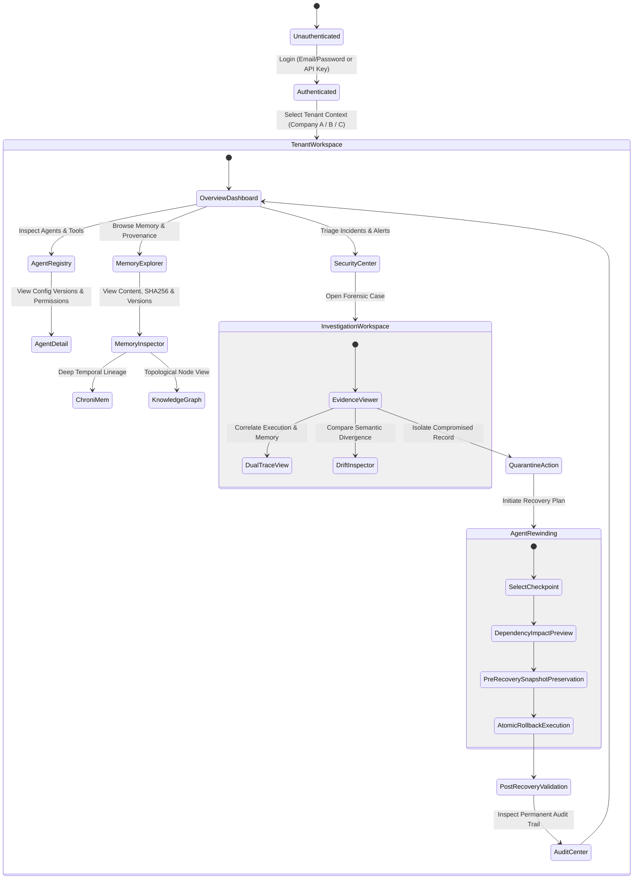
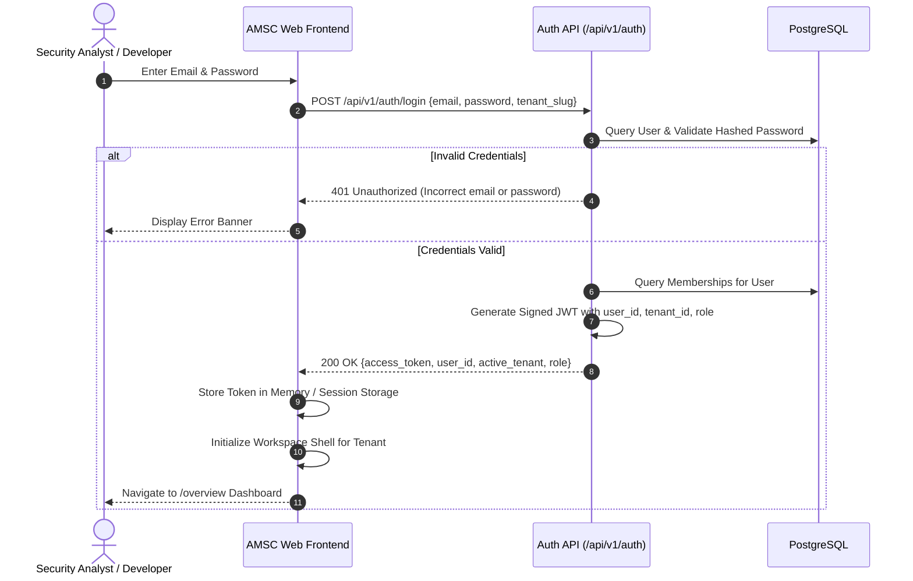
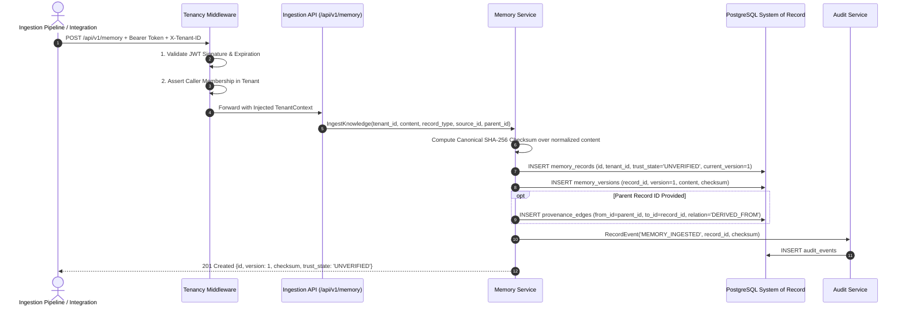
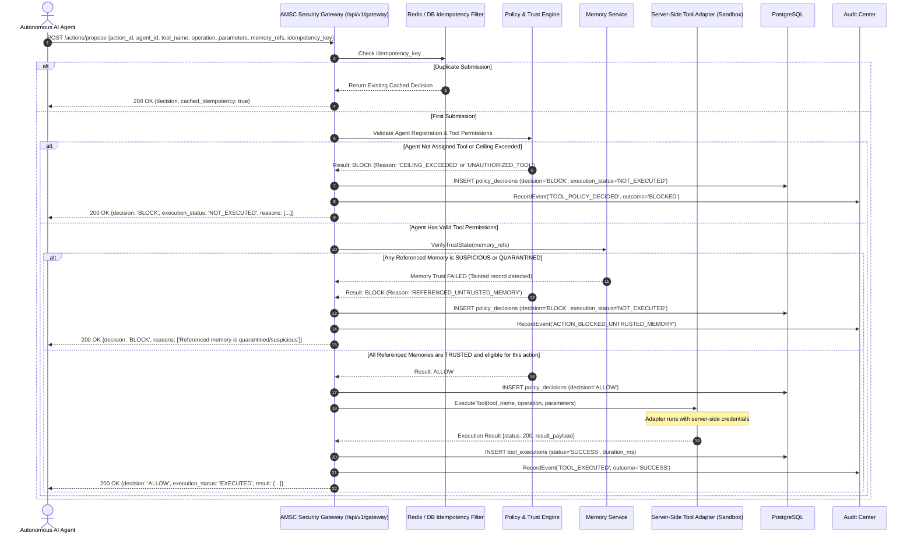
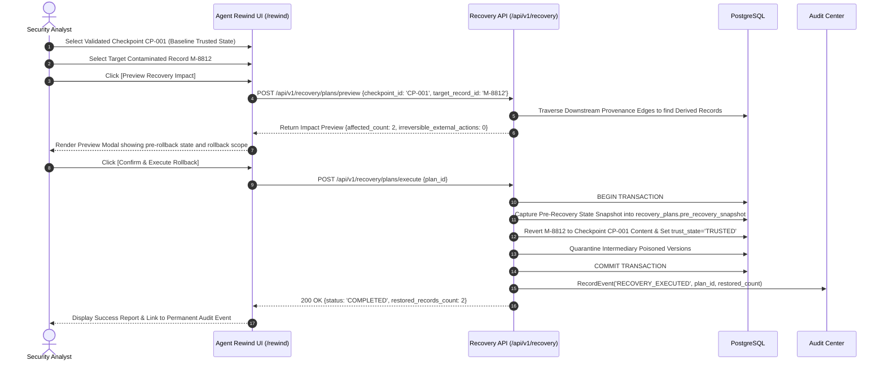
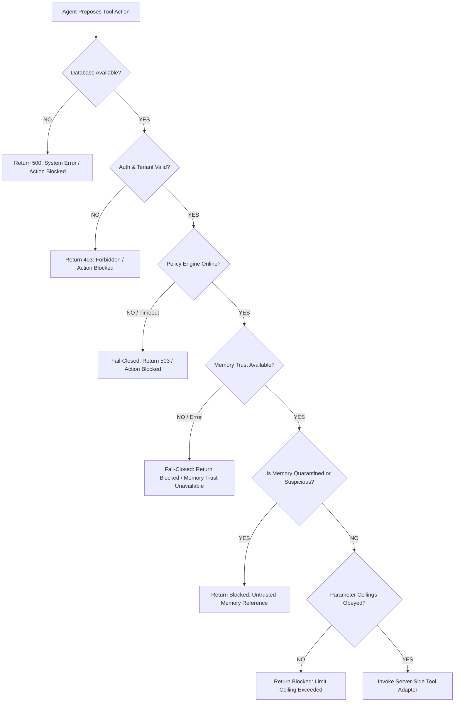

# Agent Memory Security Center (AMSC)
## Document 03: Application Flow & System Workflows

**Document Identifier:** `AMSC-DOC-003`  
**Version:** 1.0.0  
**Status:** Approved System Flow Specification  
**Focus:** User Journeys, Screen Transitions, State Machines & Ingress Sequences  
**Author:** Lead UX Architect & Technical Systems Council  
**Repository Target:** https://github.com/9m2usman/ChronoCongiSec

---

## 1. Global User Journey & System State Machine

The AMSC user journey flows from multi-tenant authentication through real-time observability, alert triage, deep forensic trace investigation, and authorized memory recovery.



---

## 2. Authentication & Tenant Workspace Selection



---

## 3. Screen-to-Screen Navigation Matrix

| Starting Screen | User Action / Trigger | Destination Screen | Data Context Passed |
|---|---|---|---|
| **Overview** | Click "Active Agents" metric card | Agent Registry (`/agents`) | Filter: `status=ACTIVE` |
| **Overview** | Click "Quarantined Records" counter | Memory Explorer (`/memory`) | Filter: `trust_state=QUARANTINED` |
| **Overview** | Click Critical Alert item | Security Center (`/security`) | Select: `incident_id` |
| **Agent Registry** | Click "Configure Permissions" | Agent Detail Modal | Agent ID, Tool Permissions |
| **Agent Registry** | Click "Inspect Memory" | Memory Explorer (`/memory`) | Filter: `agent_id` |
| **Memory Explorer** | Click Table Row | Contextual Inspector Drawer | Record ID, Versions, Checksum |
| **Memory Explorer** | Click "View Version Diff" in Drawer | ChroniMem (`/chronimem`) | Record ID, `v_from=1`, `v_to=2` |
| **Memory Explorer** | Click "View in Graph" in Drawer | Knowledge Graph (`/knowledge-graph`) | Focus Node: `record_id` |
| **Security Center** | Click "Investigate Incident" | Investigation Workspace | Incident ID, Evidence JSON |
| **Security Center** | Click "Correlate Trace" | Dual Trace (`/traces`) | Trace ID: `trace_id` |
| **Security Center** | Click "Quarantine Record" | Quarantine Confirmation Modal | Record ID, Incident ID |
| **Security Center** | Click "Start Rewind" | Agent Rewinding (`/rewind`) | Target Record ID, Incident ID |
| **Agent Rewinding** | Click "Preview Impact" | Recovery Preview Panel | Checkpoint ID, Affected Children |
| **Agent Rewinding** | Click "Confirm Rollback" | Recovery Result View | Plan ID, Pre-Snapshot ID |
| **Any Screen** | Click Audit Icon on any item | Audit Center (`/audit`) | Filter: `resource_id` |

---

## 4. Critical Ingress Sequence: Memory Ingestion & Hash Verification



---

## 5. Critical Ingress Sequence: Protected Tool Action & Security Gateway

This represents the non-negotiable security boundary where agents are mediated before executing tools.



---

## 6. Security Alert Investigation & Quarantine Workflow

```mermaid
sequenceDiagram
    autonumber
    actor Analyst as Security Analyst
    participant UI as Security Center UI
    participant SecAPI as Security API (/api/v1/security)
    participant MemAPI as Memory API (/api/v1/memory)
    participant DB as PostgreSQL
    participant Audit as Audit Center

    Analyst->>UI: Open Security Center (/security)
    UI->>SecAPI: GET /api/v1/security/incidents
    SecAPI-->>UI: Return Open Incidents (e.g. INC-001: Wire Diversion Injection)
    Analyst->>UI: Select INC-001 & Review Injected Text
    Analyst->>UI: Click [Quarantine Record M-8812]
    UI->>MemAPI: POST /api/v1/memory/M-8812/quarantine {reason: 'Verified Prompt Injection'}
    MemAPI->>DB: UPDATE memory_records SET trust_state='QUARANTINED' WHERE id='M-8812'
    MemAPI->>Audit: RecordEvent('MEMORY_QUARANTINED', record_id='M-8812')
    MemAPI-->>UI: 200 OK {trust_state: 'QUARANTINED'}
    UI-->>Analyst: Show Confirmation Badge: "Record Quarantined and Excluded from Agent Retrieval"
    
    Note over Analyst, DB: Normal agent retrieval returns only eligible TRUSTED records; forensic retrieval is separately authorized
```

---

## 7. Dual Trace Synchronization Workflow

1. **Trigger:** Analyst selects a trace identifier (`trace_id = "tr-forensic-demo-01"`) from the Security Center or Gateway logs.
2. **API Request:** Frontend calls `GET /api/v1/traces/tr-forensic-demo-01/dual-trace`.
3. **Execution Lane Assembly:** The backend aggregates:
   - Action Proposal span (`span-prop-xxxx`).
   - Policy Evaluation span (`span-dec-xxxx`) showing `ALLOW` or `BLOCK` and evaluated reasons.
   - Tool Execution span (`span-exec-xxxx`) showing duration in milliseconds and adapter response.
4. **Memory Lane Assembly:** The backend aggregates:
   - Retrieval events matching `trace_id` (`span-mem-ret-xxxx`).
   - Verified memory trust status spans for all referenced memory IDs (`span-mem-state-xxxx`).
5. **Interactive Scrubbing:** Clicking any span in Lane 1 highlights the linked memory chunks active in agent context at that precise timestamp.

---

## 8. ChroniMem Temporal Version Comparison Workflow

1. **Trigger:** User opens ChroniMem for record `M-8812` to inspect historical modifications.
2. **Timeline View:** System fetches `GET /api/v1/chronimem/timeline?agent_id=...` rendering revision milestones.
3. **Version Comparison:** User selects Version 1 (original trusted policy) and Version 2 (poisoned update).
4. **Diff Generator:** Backend executes `GET /api/v1/chronimem/records/M-8812/compare?v_from=1&v_to=2`.
5. **UI Rendering:** Side-by-side diff view renders red strikethroughs for deleted terms and green highlights for inserted adversarial instructions (e.g., replacement of legitimate account `ACC-VENDOR-VALID` with `ACC-ATTACKER-999`).

---

## 9. Knowledge Graph Progressive Expansion Workflow

1. **Initial Load:** Frontend calls `GET /api/v1/knowledge/graph?max_depth=3`.
2. **Topology Rendering:** React Flow canvas renders nodes color-coded by entity type:
   - *Document Sources:* Navy square nodes.
   - *Memory Chunks:* Circular nodes color-coded by trust state (Green: Trusted, Amber: Suspicious, Red: Quarantined).
   - *Agents:* Hexagonal nodes.
3. **Edge Traversal:** Directed arrows represent:
   - `DERIVED_FROM`: Solid blue line from source to chunk.
   - `TRANSFORMED_INTO`: Dashed cyan line between chunk revisions.
   - `REFERENCES`: Dotted grey line between agents and memories.
4. **Interactive Expansion:** Double-clicking any memory chunk queries downstream descendants up to bounded depth 5, visually revealing the blast radius of contaminated child facts.

---

## 10. Agent Rewinding & Atomic Recovery Workflow



---

## 11. Error & Failure Workflows (Fail-Closed Handling)



### Specific Failure Responses:
1. **Database Unreachable:** System logs local critical event. Gateway refuses action proposals. No uncommitted action is executed.
2. **Policy Service Timeout:** If policy rule evaluation exceeds 2000ms, the timer aborts the check and returns `decision: BLOCK` with reason `POLICY_EVALUATION_TIMEOUT`.
3. **Cross-Tenant Access Attempt:** Any attempt by Tenant A to query Tenant B's data halts immediately with `HTTP 403 Forbidden`, emitting a high-priority security incident.
4. **Missing Idempotency Key:** Gateway returns `HTTP 400 Bad Request` with message `Missing required header or parameter: idempotency_key`.
