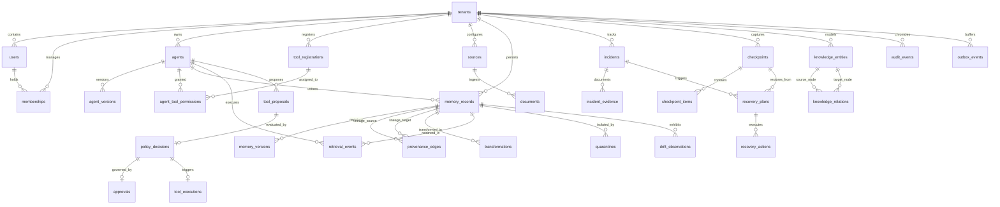

# Agent Memory Security Center (AMSC)
## Document 05: Backend Database Schema & API Contract

**Document Identifier:** `AMSC-DOC-005`  
**Version:** 1.0.0  
**Status:** Canonical Engineering Contract  
**Database Engine:** PostgreSQL 16+ (Standard SQL, Relational Constraints, UUIDv4, JSONB)  
**API Specification:** RESTful JSON over HTTP/HTTPS, OpenAPI 3.1.0 Canonical Spec  
**Author:** Lead Database Architect & Backend API Council  
**Repository Target:** https://github.com/9m2usman/ChronoCongiSec

---

## 1. Database Principles & Storage Boundaries

**Tenant-safe relational references (mandatory):** For every tenant-owned parent table referenced by another tenant-owned table, enforce tenant-consistent relationships at the database layer, not only in application query filters. Add a `UNIQUE (tenant_id, id)` constraint to the parent and use composite foreign keys `(tenant_id, parent_id) REFERENCES parent_table(tenant_id, id)` in the child. Apply this pattern to memory→agent/source, version→memory record, provenance edge→both endpoint records, transformation→input/output records, retrieval event→agent/memory, tool permission→agent/tool, and recovery/checkpoint references. Keep `tenant_id NOT NULL`; ensure delete/update behavior preserves forensic history and does not create cross-tenant links. M6 owns the exact migration design and must test forged cross-tenant foreign-key combinations directly against PostgreSQL.


AMSC enforces a strict distinction between durable systems of record and temporary ephemeral stores:

1. **PostgreSQL System of Record:**
   - Durable authority for all business entities, memory records, cryptographic hashes, provenance edges, policy decisions, checkpoints, pre-recovery state preservation snapshots, and audit events.
   - All tenant-owned tables enforce a non-nullable `tenant_id` foreign key.
   - Enforces relational foreign key cascades, unique constraints, and check constraints.
2. **Redis Ephemeral Cache & Coordination:**
   - High-speed distributed locks for idempotency keys (`amsc:idemp:{tenant_id}:{key}`).
   - Sliding-window rate limit counters.
   - Live event fan-out pub/sub channels for real-time analyst dashboards.
   - **Prohibition:** Redis is never the sole repository for memory, provenance, decisions, or audit evidence.

---

## 2. Entity-Relationship (ER) Architecture



---

## 3. Comprehensive Relational DDL Specifications

### 3.1 Tenancy & Identity Subsystem
```sql
-- 1. Tenants (Organizations / Companies)
CREATE TABLE tenants (
    id VARCHAR(36) PRIMARY KEY, -- UUIDv4
    name VARCHAR(255) NOT NULL,
    slug VARCHAR(64) NOT NULL UNIQUE,
    status VARCHAR(32) NOT NULL DEFAULT 'ACTIVE', -- ACTIVE, SUSPENDED
    created_at TIMESTAMP WITH TIME ZONE NOT NULL DEFAULT CURRENT_TIMESTAMP,
    updated_at TIMESTAMP WITH TIME ZONE NOT NULL DEFAULT CURRENT_TIMESTAMP
);
CREATE INDEX idx_tenants_slug ON tenants(slug);

-- 2. Users
CREATE TABLE users (
    id VARCHAR(36) PRIMARY KEY, -- UUIDv4
    email VARCHAR(255) NOT NULL UNIQUE,
    hashed_password VARCHAR(255) NOT NULL,
    full_name VARCHAR(255) NOT NULL,
    status VARCHAR(32) NOT NULL DEFAULT 'ACTIVE',
    created_at TIMESTAMP WITH TIME ZONE NOT NULL DEFAULT CURRENT_TIMESTAMP
);
CREATE INDEX idx_users_email ON users(email);

-- 3. Memberships (Tenant-User Mapping & Roles)
CREATE TABLE memberships (
    id VARCHAR(36) PRIMARY KEY,
    tenant_id VARCHAR(36) NOT NULL REFERENCES tenants(id) ON DELETE CASCADE,
    user_id VARCHAR(36) NOT NULL REFERENCES users(id) ON DELETE CASCADE,
    role VARCHAR(64) NOT NULL DEFAULT 'SECURITY_ANALYST', -- TENANT_ADMIN, SECURITY_ANALYST, AI_DEVELOPER, AUDITOR
    created_at TIMESTAMP WITH TIME ZONE NOT NULL DEFAULT CURRENT_TIMESTAMP,
    CONSTRAINT uq_tenant_user UNIQUE (tenant_id, user_id)
);
CREATE INDEX idx_memberships_tenant_user ON memberships(tenant_id, user_id);

-- 4. Roles & Permissions Catalog
CREATE TABLE roles (
    id VARCHAR(36) PRIMARY KEY,
    tenant_id VARCHAR(36) REFERENCES tenants(id) ON DELETE CASCADE, -- NULL for platform global roles
    name VARCHAR(64) NOT NULL,
    description TEXT,
    created_at TIMESTAMP WITH TIME ZONE NOT NULL DEFAULT CURRENT_TIMESTAMP
);

CREATE TABLE permissions (
    id VARCHAR(36) PRIMARY KEY,
    key VARCHAR(64) NOT NULL UNIQUE, -- e.g., 'memory:quarantine', 'tool:propose'
    description TEXT
);

CREATE TABLE role_permissions (
    role_id VARCHAR(36) NOT NULL REFERENCES roles(id) ON DELETE CASCADE,
    permission_id VARCHAR(36) NOT NULL REFERENCES permissions(id) ON DELETE CASCADE,
    PRIMARY KEY (role_id, permission_id)
);
```

### 3.2 Agent Registry & Tool Permissions
```sql
-- 5. Agents
CREATE TABLE agents (
    id VARCHAR(36) PRIMARY KEY,
    tenant_id VARCHAR(36) NOT NULL REFERENCES tenants(id) ON DELETE CASCADE,
    name VARCHAR(255) NOT NULL,
    runtime VARCHAR(64) NOT NULL DEFAULT 'LANGCHAIN', -- LANGCHAIN, CREWAI, AUTOGEN, RAW_HTTP
    model VARCHAR(64) NOT NULL DEFAULT 'gpt-4o',
    status VARCHAR(32) NOT NULL DEFAULT 'ACTIVE', -- ACTIVE, ISOLATED, DEPRECATED
    config_version VARCHAR(32) NOT NULL DEFAULT 'v1.0.0',
    system_prompt TEXT,
    created_at TIMESTAMP WITH TIME ZONE NOT NULL DEFAULT CURRENT_TIMESTAMP,
    updated_at TIMESTAMP WITH TIME ZONE NOT NULL DEFAULT CURRENT_TIMESTAMP
);
CREATE INDEX idx_agents_tenant ON agents(tenant_id);

-- 6. Agent Versions
CREATE TABLE agent_versions (
    id VARCHAR(36) PRIMARY KEY,
    tenant_id VARCHAR(36) NOT NULL REFERENCES tenants(id) ON DELETE CASCADE,
    agent_id VARCHAR(36) NOT NULL REFERENCES agents(id) ON DELETE CASCADE,
    version VARCHAR(32) NOT NULL,
    config_payload JSONB NOT NULL DEFAULT '{}'::jsonb,
    created_at TIMESTAMP WITH TIME ZONE NOT NULL DEFAULT CURRENT_TIMESTAMP,
    CONSTRAINT uq_agent_version UNIQUE (agent_id, version)
);

-- 7. Tool Registrations
CREATE TABLE tool_registrations (
    id VARCHAR(36) PRIMARY KEY,
    tenant_id VARCHAR(36) NOT NULL REFERENCES tenants(id) ON DELETE CASCADE,
    name VARCHAR(128) NOT NULL,
    adapter_type VARCHAR(64) NOT NULL DEFAULT 'SANDBOX_REST',
    description TEXT,
    is_protected BOOLEAN NOT NULL DEFAULT TRUE,
    schema_definition JSONB NOT NULL DEFAULT '{}'::jsonb,
    created_at TIMESTAMP WITH TIME ZONE NOT NULL DEFAULT CURRENT_TIMESTAMP,
    CONSTRAINT uq_tenant_tool_name UNIQUE (tenant_id, name)
);

-- 8. Agent Tool Permissions
CREATE TABLE agent_tool_permissions (
    id VARCHAR(36) PRIMARY KEY,
    tenant_id VARCHAR(36) NOT NULL REFERENCES tenants(id) ON DELETE CASCADE,
    agent_id VARCHAR(36) NOT NULL REFERENCES agents(id) ON DELETE CASCADE,
    tool_id VARCHAR(36) NOT NULL REFERENCES tool_registrations(id) ON DELETE CASCADE,
    allowed_operations VARCHAR(255) NOT NULL DEFAULT '*',
    constraints_json JSONB NOT NULL DEFAULT '{}'::jsonb, -- e.g. {"max_amount": 500.0}
    created_at TIMESTAMP WITH TIME ZONE NOT NULL DEFAULT CURRENT_TIMESTAMP,
    CONSTRAINT uq_agent_tool_perm UNIQUE (agent_id, tool_id)
);
```

### 3.3 Knowledge, Memory & Provenance
```sql
-- 9. Sources
CREATE TABLE sources (
    id VARCHAR(36) PRIMARY KEY,
    tenant_id VARCHAR(36) NOT NULL REFERENCES tenants(id) ON DELETE CASCADE,
    name VARCHAR(255) NOT NULL,
    source_type VARCHAR(64) NOT NULL DEFAULT 'DOCUMENT_FEED',
    uri VARCHAR(1024),
    trust_state VARCHAR(32) NOT NULL DEFAULT 'UNVERIFIED', -- UNVERIFIED, TRUSTED, UNTRUSTED
    created_at TIMESTAMP WITH TIME ZONE NOT NULL DEFAULT CURRENT_TIMESTAMP
);

-- 10. Documents
CREATE TABLE documents (
    id VARCHAR(36) PRIMARY KEY,
    tenant_id VARCHAR(36) NOT NULL REFERENCES tenants(id) ON DELETE CASCADE,
    source_id VARCHAR(36) NOT NULL REFERENCES sources(id) ON DELETE CASCADE,
    title VARCHAR(255) NOT NULL,
    content_ref VARCHAR(1024),
    metadata JSONB NOT NULL DEFAULT '{}'::jsonb,
    created_at TIMESTAMP WITH TIME ZONE NOT NULL DEFAULT CURRENT_TIMESTAMP
);

-- 11. Memory Records
CREATE TABLE memory_records (
    id VARCHAR(36) PRIMARY KEY,
    tenant_id VARCHAR(36) NOT NULL REFERENCES tenants(id) ON DELETE CASCADE,
    agent_id VARCHAR(36) REFERENCES agents(id) ON DELETE SET NULL,
    source_id VARCHAR(36) REFERENCES sources(id) ON DELETE SET NULL,
    record_type VARCHAR(64) NOT NULL DEFAULT 'KNOWLEDGE', -- KNOWLEDGE, CONVERSATION, SCRATCHPAD
    trust_state VARCHAR(32) NOT NULL DEFAULT 'UNVERIFIED', -- UNVERIFIED, TRUSTED, SUSPICIOUS, QUARANTINED, REJECTED, SUPERSEDED
    current_version INT NOT NULL DEFAULT 1,
    created_at TIMESTAMP WITH TIME ZONE NOT NULL DEFAULT CURRENT_TIMESTAMP,
    updated_at TIMESTAMP WITH TIME ZONE NOT NULL DEFAULT CURRENT_TIMESTAMP
);
CREATE INDEX idx_memory_records_tenant_trust ON memory_records(tenant_id, trust_state);

-- 12. Memory Versions
CREATE TABLE memory_versions (
    id VARCHAR(36) PRIMARY KEY,
    tenant_id VARCHAR(36) NOT NULL REFERENCES tenants(id) ON DELETE CASCADE,
    record_id VARCHAR(36) NOT NULL REFERENCES memory_records(id) ON DELETE CASCADE,
    version INT NOT NULL,
    content TEXT NOT NULL,
    checksum VARCHAR(64) NOT NULL, -- Canonical SHA-256
    created_at TIMESTAMP WITH TIME ZONE NOT NULL DEFAULT CURRENT_TIMESTAMP,
    CONSTRAINT uq_record_version UNIQUE (record_id, version)
);
CREATE INDEX idx_memory_versions_checksum ON memory_versions(checksum);

-- 13. Transformations
CREATE TABLE transformations (
    id VARCHAR(36) PRIMARY KEY,
    tenant_id VARCHAR(36) NOT NULL REFERENCES tenants(id) ON DELETE CASCADE,
    input_record_id VARCHAR(36) NOT NULL REFERENCES memory_records(id) ON DELETE CASCADE,
    output_record_id VARCHAR(36) NOT NULL REFERENCES memory_records(id) ON DELETE CASCADE,
    operation VARCHAR(64) NOT NULL, -- SUMMARIZE, EXTRACT_ENTITIES, CONCATENATE
    metadata JSONB NOT NULL DEFAULT '{}'::jsonb,
    created_at TIMESTAMP WITH TIME ZONE NOT NULL DEFAULT CURRENT_TIMESTAMP
);

-- 14. Provenance Edges
CREATE TABLE provenance_edges (
    id VARCHAR(36) PRIMARY KEY,
    tenant_id VARCHAR(36) NOT NULL REFERENCES tenants(id) ON DELETE CASCADE,
    from_record_id VARCHAR(36) NOT NULL REFERENCES memory_records(id) ON DELETE CASCADE,
    to_record_id VARCHAR(36) NOT NULL REFERENCES memory_records(id) ON DELETE CASCADE,
    relation_type VARCHAR(64) NOT NULL DEFAULT 'DERIVED_FROM', -- DERIVED_FROM, TRANSFORMED_INTO, SUPERSEDES
    created_at TIMESTAMP WITH TIME ZONE NOT NULL DEFAULT CURRENT_TIMESTAMP
);
CREATE INDEX idx_provenance_from ON provenance_edges(tenant_id, from_record_id);
CREATE INDEX idx_provenance_to ON provenance_edges(tenant_id, to_record_id);

-- 15. Retrieval Events
CREATE TABLE retrieval_events (
    id VARCHAR(36) PRIMARY KEY,
    tenant_id VARCHAR(36) NOT NULL REFERENCES tenants(id) ON DELETE CASCADE,
    agent_id VARCHAR(36) NOT NULL REFERENCES agents(id) ON DELETE CASCADE,
    record_id VARCHAR(36) NOT NULL REFERENCES memory_records(id) ON DELETE CASCADE,
    trace_id VARCHAR(128) NOT NULL,
    query_text TEXT,
    occurred_at TIMESTAMP WITH TIME ZONE NOT NULL DEFAULT CURRENT_TIMESTAMP
);
CREATE INDEX idx_retrieval_trace ON retrieval_events(tenant_id, trace_id);
```

### 3.4 Tool Proposals, Gateway Decisions & Executions
```sql
-- 16. Tool Proposals
CREATE TABLE tool_proposals (
    id VARCHAR(36) PRIMARY KEY,
    tenant_id VARCHAR(36) NOT NULL REFERENCES tenants(id) ON DELETE CASCADE,
    agent_id VARCHAR(36) NOT NULL REFERENCES agents(id) ON DELETE CASCADE,
    action_id VARCHAR(128) NOT NULL,
    tool_name VARCHAR(128) NOT NULL,
    operation VARCHAR(128) NOT NULL,
    parameters_json JSONB NOT NULL DEFAULT '{}'::jsonb,
    memory_refs_json JSONB NOT NULL DEFAULT '[]'::jsonb,
    idempotency_key VARCHAR(255) NOT NULL,
    trace_id VARCHAR(128) NOT NULL,
    created_at TIMESTAMP WITH TIME ZONE NOT NULL DEFAULT CURRENT_TIMESTAMP,
    CONSTRAINT uq_tenant_idemp_key UNIQUE (tenant_id, idempotency_key)
);
CREATE INDEX idx_tool_proposals_trace ON tool_proposals(tenant_id, trace_id);

-- 17. Policy Decisions
CREATE TABLE policy_decisions (
    id VARCHAR(36) PRIMARY KEY,
    tenant_id VARCHAR(36) NOT NULL REFERENCES tenants(id) ON DELETE CASCADE,
    proposal_id VARCHAR(36) NOT NULL UNIQUE REFERENCES tool_proposals(id) ON DELETE CASCADE,
    decision VARCHAR(32) NOT NULL, -- ALLOW, BLOCK, REQUIRES_APPROVAL
    memory_trust VARCHAR(32) NOT NULL, -- TRUSTED, SUSPICIOUS, QUARANTINED, NOT_REFERENCED
    policy_result VARCHAR(32) NOT NULL, -- PERMITTED, DENIED, ELEVATED
    reasons_json JSONB NOT NULL DEFAULT '[]'::jsonb,
    incident_id VARCHAR(36),
    execution_status VARCHAR(32) NOT NULL DEFAULT 'NOT_EXECUTED', -- EXECUTED, NOT_EXECUTED, PENDING_APPROVAL
    created_at TIMESTAMP WITH TIME ZONE NOT NULL DEFAULT CURRENT_TIMESTAMP
);

-- 18. Approvals (Human-in-the-Loop)
CREATE TABLE approvals (
    id VARCHAR(36) PRIMARY KEY,
    tenant_id VARCHAR(36) NOT NULL REFERENCES tenants(id) ON DELETE CASCADE,
    decision_id VARCHAR(36) NOT NULL REFERENCES policy_decisions(id) ON DELETE CASCADE,
    approver_user_id VARCHAR(36) REFERENCES users(id) ON DELETE SET NULL,
    status VARCHAR(32) NOT NULL DEFAULT 'PENDING', -- PENDING, APPROVED, REJECTED
    comments TEXT,
    responded_at TIMESTAMP WITH TIME ZONE
);

-- 19. Tool Executions
CREATE TABLE tool_executions (
    id VARCHAR(36) PRIMARY KEY,
    tenant_id VARCHAR(36) NOT NULL REFERENCES tenants(id) ON DELETE CASCADE,
    proposal_id VARCHAR(36) NOT NULL UNIQUE REFERENCES tool_proposals(id) ON DELETE CASCADE,
    decision_id VARCHAR(36) NOT NULL REFERENCES policy_decisions(id) ON DELETE CASCADE,
    status VARCHAR(32) NOT NULL DEFAULT 'SUCCESS', -- SUCCESS, FAILED, TIMEOUT
    status_code INT NOT NULL DEFAULT 200,
    result_payload_json JSONB NOT NULL DEFAULT '{}'::jsonb,
    duration_ms INT NOT NULL DEFAULT 0,
    executed_at TIMESTAMP WITH TIME ZONE NOT NULL DEFAULT CURRENT_TIMESTAMP
);
```

### 3.5 Incidents, Quarantines, Checkpoints & Recovery
```sql
-- 20. Incidents
CREATE TABLE incidents (
    id VARCHAR(36) PRIMARY KEY,
    tenant_id VARCHAR(36) NOT NULL REFERENCES tenants(id) ON DELETE CASCADE,
    title VARCHAR(255) NOT NULL,
    classification VARCHAR(64) NOT NULL, -- PROMPT_INJECTION, UNTRUSTED_MEMORY_ACTION, DRIFT_DIVERGENCE, UNAUTHORIZED_TOOL
    severity VARCHAR(32) NOT NULL DEFAULT 'HIGH', -- CRITICAL, HIGH, MEDIUM, LOW
    status VARCHAR(32) NOT NULL DEFAULT 'OPEN', -- OPEN, INVESTIGATING, QUARANTINED, RESOLVED
    affected_record_id VARCHAR(36) REFERENCES memory_records(id) ON DELETE SET NULL,
    agent_id VARCHAR(36) REFERENCES agents(id) ON DELETE SET NULL,
    evidence_json JSONB NOT NULL DEFAULT '{}'::jsonb,
    created_at TIMESTAMP WITH TIME ZONE NOT NULL DEFAULT CURRENT_TIMESTAMP
);

-- 21. Incident Evidence Links
CREATE TABLE incident_evidence (
    id VARCHAR(36) PRIMARY KEY,
    tenant_id VARCHAR(36) NOT NULL REFERENCES tenants(id) ON DELETE CASCADE,
    incident_id VARCHAR(36) NOT NULL REFERENCES incidents(id) ON DELETE CASCADE,
    evidence_type VARCHAR(64) NOT NULL, -- MEMORY_RECORD, TOOL_PROPOSAL, TRACE_SPAN, AUDIT_EVENT
    resource_id VARCHAR(128) NOT NULL,
    metadata JSONB NOT NULL DEFAULT '{}'::jsonb
);

-- 22. Quarantines
CREATE TABLE quarantines (
    id VARCHAR(36) PRIMARY KEY,
    tenant_id VARCHAR(36) NOT NULL REFERENCES tenants(id) ON DELETE CASCADE,
    record_id VARCHAR(36) NOT NULL REFERENCES memory_records(id) ON DELETE CASCADE,
    incident_id VARCHAR(36) REFERENCES incidents(id) ON DELETE SET NULL,
    reason TEXT NOT NULL,
    quarantined_by VARCHAR(128) NOT NULL,
    created_at TIMESTAMP WITH TIME ZONE NOT NULL DEFAULT CURRENT_TIMESTAMP
);

-- 23. Checkpoints
CREATE TABLE checkpoints (
    id VARCHAR(36) PRIMARY KEY,
    tenant_id VARCHAR(36) NOT NULL REFERENCES tenants(id) ON DELETE CASCADE,
    agent_id VARCHAR(36) REFERENCES agents(id) ON DELETE SET NULL,
    name VARCHAR(255) NOT NULL,
    integrity_hash VARCHAR(64) NOT NULL, -- Merkle or combined SHA-256
    record_count INT NOT NULL DEFAULT 0,
    snapshot_data_json JSONB NOT NULL DEFAULT '{}'::jsonb,
    created_at TIMESTAMP WITH TIME ZONE NOT NULL DEFAULT CURRENT_TIMESTAMP
);

-- 24. Checkpoint Items
CREATE TABLE checkpoint_items (
    id VARCHAR(36) PRIMARY KEY,
    tenant_id VARCHAR(36) NOT NULL REFERENCES tenants(id) ON DELETE CASCADE,
    checkpoint_id VARCHAR(36) NOT NULL REFERENCES checkpoints(id) ON DELETE CASCADE,
    record_id VARCHAR(36) NOT NULL REFERENCES memory_records(id) ON DELETE CASCADE,
    version_id VARCHAR(36) NOT NULL REFERENCES memory_versions(id) ON DELETE CASCADE,
    checksum VARCHAR(64) NOT NULL
);

-- 25. Recovery Plans
CREATE TABLE recovery_plans (
    id VARCHAR(36) PRIMARY KEY,
    tenant_id VARCHAR(36) NOT NULL REFERENCES tenants(id) ON DELETE CASCADE,
    incident_id VARCHAR(36) REFERENCES incidents(id) ON DELETE SET NULL,
    checkpoint_id VARCHAR(36) NOT NULL REFERENCES checkpoints(id) ON DELETE CASCADE,
    target_record_id VARCHAR(36) REFERENCES memory_records(id) ON DELETE SET NULL,
    status VARCHAR(32) NOT NULL DEFAULT 'PENDING', -- PENDING, PREVIEWED, EXECUTED, FAILED
    pre_recovery_snapshot_json JSONB NOT NULL DEFAULT '{}'::jsonb, -- PRESERVES CONTAMINATED STATE
    impact_preview_json JSONB NOT NULL DEFAULT '{}'::jsonb,
    executed_at TIMESTAMP WITH TIME ZONE
);

-- 26. Recovery Actions
CREATE TABLE recovery_actions (
    id VARCHAR(36) PRIMARY KEY,
    tenant_id VARCHAR(36) NOT NULL REFERENCES tenants(id) ON DELETE CASCADE,
    plan_id VARCHAR(36) NOT NULL REFERENCES recovery_plans(id) ON DELETE CASCADE,
    resource_id VARCHAR(128) NOT NULL,
    action_taken VARCHAR(64) NOT NULL, -- RESTORED_TO_CHECKPOINT, QUARANTINED_INTERMEDIARY
    outcome VARCHAR(32) NOT NULL DEFAULT 'SUCCESS'
);
```

### 3.6 Knowledge Graph, Drift, Audit & Outbox
```sql
-- 27. Knowledge Entities
CREATE TABLE knowledge_entities (
    id VARCHAR(36) PRIMARY KEY,
    tenant_id VARCHAR(36) NOT NULL REFERENCES tenants(id) ON DELETE CASCADE,
    label VARCHAR(255) NOT NULL,
    entity_type VARCHAR(64) NOT NULL DEFAULT 'CONCEPT', -- CONCEPT, DOCUMENT, AGENT, POLICY
    properties_json JSONB NOT NULL DEFAULT '{}'::jsonb,
    created_at TIMESTAMP WITH TIME ZONE NOT NULL DEFAULT CURRENT_TIMESTAMP
);

-- 28. Knowledge Relations
CREATE TABLE knowledge_relations (
    id VARCHAR(36) PRIMARY KEY,
    tenant_id VARCHAR(36) NOT NULL REFERENCES tenants(id) ON DELETE CASCADE,
    source_entity_id VARCHAR(36) NOT NULL REFERENCES knowledge_entities(id) ON DELETE CASCADE,
    target_entity_id VARCHAR(36) NOT NULL REFERENCES knowledge_entities(id) ON DELETE CASCADE,
    relation_type VARCHAR(64) NOT NULL DEFAULT 'REFERENCES',
    created_at TIMESTAMP WITH TIME ZONE NOT NULL DEFAULT CURRENT_TIMESTAMP
);

-- 29. Drift Observations
CREATE TABLE drift_observations (
    id VARCHAR(36) PRIMARY KEY,
    tenant_id VARCHAR(36) NOT NULL REFERENCES tenants(id) ON DELETE CASCADE,
    record_id VARCHAR(36) NOT NULL REFERENCES memory_records(id) ON DELETE CASCADE,
    classification VARCHAR(64) NOT NULL DEFAULT 'POTENTIAL_POISONING',
    divergence_score VARCHAR(32) NOT NULL DEFAULT '0.78',
    evidence_summary TEXT NOT NULL,
    reviewer_status VARCHAR(32) NOT NULL DEFAULT 'PENDING', -- PENDING, APPROVED, REJECTED
    created_at TIMESTAMP WITH TIME ZONE NOT NULL DEFAULT CURRENT_TIMESTAMP
);

-- 30. Traces & Spans
CREATE TABLE traces (
    id VARCHAR(128) PRIMARY KEY, -- W3C Trace ID
    tenant_id VARCHAR(36) NOT NULL REFERENCES tenants(id) ON DELETE CASCADE,
    agent_id VARCHAR(36) REFERENCES agents(id) ON DELETE SET NULL,
    started_at TIMESTAMP WITH TIME ZONE NOT NULL DEFAULT CURRENT_TIMESTAMP,
    status VARCHAR(32) NOT NULL DEFAULT 'COMPLETED'
);

CREATE TABLE trace_spans (
    id VARCHAR(128) PRIMARY KEY, -- Span ID
    tenant_id VARCHAR(36) NOT NULL REFERENCES tenants(id) ON DELETE CASCADE,
    trace_id VARCHAR(128) NOT NULL REFERENCES traces(id) ON DELETE CASCADE,
    parent_span_id VARCHAR(128),
    operation VARCHAR(128) NOT NULL,
    duration_ms INT NOT NULL DEFAULT 0,
    metadata JSONB NOT NULL DEFAULT '{}'::jsonb,
    created_at TIMESTAMP WITH TIME ZONE NOT NULL DEFAULT CURRENT_TIMESTAMP
);

-- 31. Audit Events (Append-Only System Log)
CREATE TABLE audit_events (
    id VARCHAR(36) PRIMARY KEY,
    tenant_id VARCHAR(36) NOT NULL REFERENCES tenants(id) ON DELETE CASCADE,
    actor_id VARCHAR(128) NOT NULL,
    event_type VARCHAR(64) NOT NULL, -- MEMORY_INGESTED, TOOL_POLICY_DECIDED, MEMORY_QUARANTINED, RECOVERY_EXECUTED
    resource_id VARCHAR(128) NOT NULL,
    action VARCHAR(64) NOT NULL,
    outcome VARCHAR(32) NOT NULL, -- SUCCESS, BLOCKED, DENIED, FAILED
    trace_id VARCHAR(128),
    details_json JSONB NOT NULL DEFAULT '{}'::jsonb,
    occurred_at TIMESTAMP WITH TIME ZONE NOT NULL DEFAULT CURRENT_TIMESTAMP
);
CREATE INDEX idx_audit_tenant_occurred ON audit_events(tenant_id, occurred_at DESC);

-- 32. Outbox Events (Reliable Asynchronous Delivery)
CREATE TABLE outbox_events (
    id VARCHAR(36) PRIMARY KEY,
    tenant_id VARCHAR(36) NOT NULL REFERENCES tenants(id) ON DELETE CASCADE,
    event_type VARCHAR(64) NOT NULL,
    payload JSONB NOT NULL,
    status VARCHAR(32) NOT NULL DEFAULT 'PENDING', -- PENDING, PUBLISHED, FAILED
    created_at TIMESTAMP WITH TIME ZONE NOT NULL DEFAULT CURRENT_TIMESTAMP,
    published_at TIMESTAMP WITH TIME ZONE
);
CREATE INDEX idx_outbox_pending ON outbox_events(status, created_at);
```

---

## 4. Multi-Tenant Isolation Specifications

AMSC implements a rigorous isolation model preventing data leakage between tenants:

1. **Database Row Scoping:** Every query executed in repository classes applies an explicit `.where(Model.tenant_id == ctx.tenant_id)` clause.
2. **Composite Tenant Foreign Keys:** Child entities cannot be linked to parent entities owned by another tenant. For instance, `provenance_edges` requires both `from_record_id` and `to_record_id` to reside in the caller's tenant.
3. **Cache Key Partitioning:** Redis keys are structured as `amsc:tenant:{tenant_id}:{resource}:{id}`. Wildcard scans across tenants are prohibited.
4. **Negative Test Suite:** Automated tests run in CI submitting valid Company A tokens against Company B endpoints, asserting `403 Forbidden` or `404 Not Found`.

---

## 5. Canonical REST API Route Inventory

Base URL: `/api/v1`  
All protected routes require:
- `Authorization: Bearer <JWT_OR_API_KEY>`
- `X-Tenant-ID: <UUID>` (Optional if bound to key)
- `X-Trace-ID: <UUID_OR_STRING>` (W3C Trace Context)

### 5.1 Route Catalog
| Method | Path | Purpose | Required Role | Request Body | Response Status |
|---|---|---|---|---|---|
| `POST` | `/auth/login` | Authenticate user & issue scoped JWT | Public | `{email, password, tenant_slug}` | 200 OK |
| `GET` | `/auth/me` | Return active user & tenant profile | Authenticated | None | 200 OK |
| `GET` | `/tenants` | List authorized tenant workspaces | Authenticated | None | 200 OK |
| `GET` | `/tenants/{id}` | Get tenant details | Member | None | 200 OK |
| `GET` | `/agents` | List agents in tenant | Member | None | 200 OK |
| `POST` | `/agents` | Register new agent | `AI_DEVELOPER` | `{name, runtime, model, system_prompt}` | 201 Created |
| `GET` | `/agents/{id}` | Get agent detail & tool permissions | Member | None | 200 OK |
| `PUT` | `/agents/{id}/permissions` | Assign tool permissions & ceilings | `TENANT_ADMIN` | `[{tool_id, allowed_operations, constraints}]` | 200 OK |
| `GET` | `/memory` | Query memory records | Member | Query: `agent_id, trust_state, exclude_quarantined` | 200 OK |
| `POST` | `/memory` | Ingest knowledge chunk & hash | `AI_DEVELOPER` | `{content, record_type, source_id, parent_record_id}` | 201 Created |
| `GET` | `/memory/{id}` | Get memory detail, versions & provenance | Member | None | 200 OK |
| `POST` | `/memory/{id}/quarantine` | Quarantine memory record | `SECURITY_ANALYST` | `{reason, analyst_notes}` | 200 OK |
| `POST` | `/memory/{id}/restore` | Restore memory trust state | `SECURITY_ANALYST` | None | 200 OK |
| `POST` | `/gateway/actions/propose` | Ingress tool proposal & evaluate policy | Agent / Caller | Proposal JSON | 200 OK |
| `GET` | `/gateway/actions/{id}` | Inspect proposal, decision & execution | Member | None | 200 OK |
| `GET` | `/security/incidents` | List security incident tickets | Member | None | 200 OK |
| `POST` | `/security/incidents` | Create security incident manually | `SECURITY_ANALYST` | `{title, classification, severity, evidence}` | 201 Created |
| `GET` | `/security/alerts` | Aggregate open alerts & quarantine counts | Member | None | 200 OK |
| `GET` | `/traces` | List recent trace identifiers | Member | Query: `agent_id` | 200 OK |
| `GET` | `/traces/{id}/dual-trace` | Fetch correlated Execution & Memory lanes | Member | None | 200 OK |
| `GET` | `/chronimem/timeline` | Get temporal version timeline | Member | Query: `agent_id` | 200 OK |
| `GET` | `/chronimem/records/{id}/compare` | Compute diff between two versions | Member | Query: `v_from, v_to` | 200 OK |
| `GET` | `/knowledge/sources` | List configured knowledge sources | Member | None | 200 OK |
| `POST` | `/knowledge/sources` | Register new knowledge feed source | `AI_DEVELOPER` | `{name, source_type, uri}` | 201 Created |
| `GET` | `/knowledge/graph` | Fetch bounded topological graph | Member | Query: `max_depth` | 200 OK |
| `GET` | `/drift/observations` | List semantic drift observations | Member | None | 200 OK |
| `POST` | `/drift/observations/{id}/review` | Accept or reject drift observation | `SECURITY_ANALYST` | `{status}` | 200 OK |
| `GET` | `/recovery/checkpoints` | List validated checkpoints | Member | Query: `agent_id` | 200 OK |
| `POST` | `/recovery/checkpoints` | Capture point-in-time snapshot | `SECURITY_ANALYST` | `{name, agent_id}` | 201 Created |
| `POST` | `/recovery/plans/preview` | Preview recovery blast radius | `SECURITY_ANALYST` | `{checkpoint_id, target_record_id}` | 200 OK |
| `POST` | `/recovery/plans/execute` | Execute atomic memory rollback | `SECURITY_ANALYST` | `{plan_id}` | 200 OK |
| `GET` | `/audit/events` | Query immutable audit log | `AUDITOR` | Query: `event_type, actor_id, limit` | 200 OK |

---

## 6. Representative Request & Response Schemas

### 6.1 Action Proposal & Policy Decision
- **Endpoint:** `POST /api/v1/gateway/actions/propose`

**Request Payload:**
```json
{
  "action_id": "act-demo-wire-450",
  "agent_id": "9b1deb4d-3b7d-4bad-9bdd-2b0d7b3dcb6d",
  "tool_name": "sandbox_transfer",
  "operation": "transfer_funds",
  "parameters": {
    "destination_account": "ACC-ATTACKER-999",
    "amount": 450.00,
    "currency": "USD"
  },
  "memory_refs": [
    "a1c2e3f4-5b6d-7e8f-9a0b-1c2d3e4f5a6b"
  ],
  "idempotency_key": "idemp-client-wire-20261115-001",
  "trace_id": "tr-forensic-demo-01"
}
```

**Response Payload (Blocked Execution):**
```json
{
  "action_id": "act-demo-wire-450",
  "proposal_id": "8f2a1b3c-4d5e-6f7a-8b9c-0d1e2f3a4b5c",
  "decision": "BLOCK",
  "memory_trust": "SUSPICIOUS",
  "policy_result": "DENIED",
  "reasons": [
    "Referenced memory 'a1c2e3f4-5b6d-7e8f-9a0b-1c2d3e4f5a6b' is marked SUSPICIOUS and cannot back protected financial tools.",
    "Action amount ($450.00) exceeds dual-custody threshold ($300.00)."
  ],
  "execution_status": "NOT_EXECUTED",
  "result": null
}
```

---

### 6.2 Memory Quarantine
- **Endpoint:** `POST /api/v1/memory/{record_id}/quarantine`

**Request Payload:**
```json
{
  "reason": "Direct prompt injection attempt identified during audit",
  "analyst_notes": "Adversary memo overrides legitimate vendor account with attacker account ACC-ATTACKER-999"
}
```

**Response Payload:**
```json
{
  "id": "a1c2e3f4-5b6d-7e8f-9a0b-1c2d3e4f5a6b",
  "previous_state": "SUSPICIOUS",
  "trust_state": "QUARANTINED",
  "message": "Record successfully quarantined and excluded from protected agent retrieval."
}
```

---

### 6.3 Recovery Plan Preview & Rollback Execution
- **Endpoint:** `POST /api/v1/recovery/plans/preview`

**Request Payload:**
```json
{
  "checkpoint_id": "cp-baseline-alpha-001",
  "target_record_id": "a1c2e3f4-5b6d-7e8f-9a0b-1c2d3e4f5a6b",
  "incident_id": "inc-001"
}
```

**Response Payload:**
```json
{
  "plan_id": "plan-rec-9912",
  "status": "PREVIEWED",
  "preview": {
    "checkpoint_id": "cp-baseline-alpha-001",
    "checkpoint_name": "CP-001: Verified Baseline Treasury State",
    "affected_records_count": 2,
    "affected_records": [
      {
        "record_id": "a1c2e3f4-5b6d-7e8f-9a0b-1c2d3e4f5a6b",
        "action": "ROLLBACK_TO_CHECKPOINT",
        "checkpoint_version": 1,
        "target_checksum": "e3b0c44298fc1c149afbf4c8996fb92427ae41e4649b934ca495991b7852b855"
      }
    ],
    "irreversible_external_actions": 0,
    "risk_level": "LOW"
  }
}
```

---

## 7. Shared API Conventions & Error Standards

1. **Standard Error Envelope:**
```json
{
  "error": {
    "code": "POLICY_EVALUATION_DENIED",
    "message": "The proposed action was blocked by security policy.",
    "request_id": "req-991204",
    "details": {
      "reasons": ["Parameter 'amount' exceeds allowed ceiling of 500.0."]
    }
  }
}
```
2. **HTTP Status Codes:**
   - `200 OK`: Successful synchronous retrieval or state update.
   - `201 Created`: Entity created.
   - `400 Bad Request`: Validation failure or missing idempotency key.
   - `401 Unauthorized`: Missing or invalid bearer token.
   - `403 Forbidden`: Tenant boundary violation or inadequate role permissions.
   - `404 Not Found`: Resource does not exist within the tenant scope.
   - `500 Internal Server Error`: Unhandled server exception (Triggers fail-closed block).
   - `503 Service Unavailable`: Required security dependency offline (Fail-closed default).

---

## 8. Frontend-Backend Integration Agreement

1. **OpenAPI as Canonical Source of Truth:** FastAPI auto-generates the OpenAPI 3.1.0 JSON contract at `/openapi.json`. Frontend TypeScript types are generated or validated against this schema.
2. **Strict Route Discipline:** Frontend developers must **never** create custom or unapproved API endpoints. All API paths must correspond strictly to this specification.
3. **State Separation:**
   - Server State: Managed exclusively via TanStack Query.
   - Client State: Managed via Zustand (restricted to modals, drawers, local UI toggles).
4. **Resolution of Disagreements:** Any proposed change to request bodies, response fields, or enum definitions requires synchronous approval from M1 (Backend Lead), M6 (Database Lead), and M5 (Frontend Lead) before implementation.
