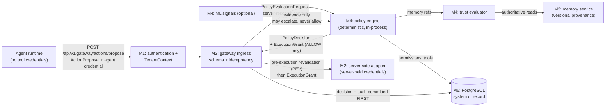
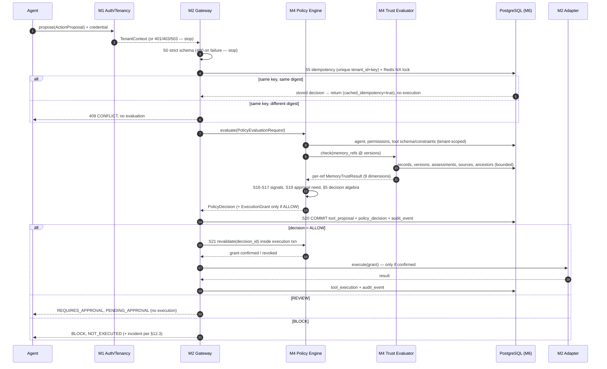
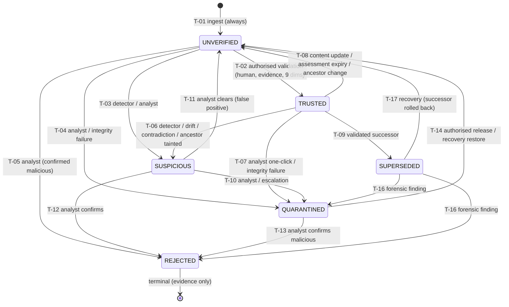

# M4 Day 1 — Deterministic Policy Evaluation Matrix & Memory Trust-Check Protocol

**Document ID:** AMSC-SEC-001
**Owner:** M4 — Security Engine & Incident Response Lead
**Status:** DRAFT v0.1 — submitted for review. Exit criterion "fail-closed default logic approved" is **pending sign-off** (see §18).
**Policy version described:** `amsc-policy/1.0.0-draft`
**Date:** 2026-11-17
**Plan reference:** `docs/06-TEAM-IMPLEMENTATION-PLAN.md` §3, Day 1, M4 row — *"Design deterministic policy state machine and memory trust check protocol"* → deliverable *Policy evaluation matrix*; dependency *M2 Proposal schema*; exit *Fail-closed default logic approved*.

> This is a design and contract document. It doesn't implement anything. Implementation follows the plan: trust state machine on Day 3, `security/policy.py` on Day 4, quarantine/recovery on Day 5 and fail-closed suite on Day 7. Where this document needs something another member owns, it states the requirement and names the owner (§19); it does not define a competing interface.

---

## Table of contents

1. Purpose and scope
2. Architecture context
3. Security evaluation sequence
4. Deterministic policy evaluation matrix
5. ALLOW / REVIEW / BLOCK precedence
6. Fail-closed behaviour matrix
7. Memory trust-check protocol
8. Trust-state transition matrix
9. Multidimensional trust model
10. ActionProposal integration requirements (M2)
11. Policy decision response contract
12. Audit and evidence requirements
13. Tenant and branch isolation requirements
14. Human approval requirements
15. ML security boundaries
16. Research-backed design rationale
17. Threat scenarios, bypass attempts and test specification
18. Day 1 acceptance criteria
19. Dependencies, findings and open integration questions
20. References

---

## 1. Purpose and scope

### 1.1 Purpose

This document defines how AMSC decides, deterministically and server-side, whether a protected agent action may execute. That decision answers PRD §1 questions 1 and 2:

- *Can this agent trust the memory it is using?*
- *Can this agent perform the action it is requesting?*

It also defines the protocol by which a memory record moves between trust states. That protocol is what makes question 1 answerable.

### 1.2 In scope

- The ordered evaluation stages, every rule, its reason code, severity and audit duty (§3–§4).
- The decision algebra and precedence: ALLOW only when every mandatory rule positively passes (§5).
- Fail-closed behaviour for every dependency and error class, mapped to M1's existing error contract (§6).
- The memory trust state machine, eligibility, inheritance, quarantine, forensic access and recovery revalidation (§7–§9).
- The data M4 needs from M2, M1, M3 and M6, and the decision response M4 returns (§10–§11).
- Testable security properties and threat scenarios (§17).

### 1.3 Out of scope (Day 1)

- Python implementation of the engine, the trust engine, quarantine, recovery or ML. These come on later plan days.
- Changes to the database schema. Requirements go to M6 (§19), and migrations are M6's exclusively.
- Changes to the gateway route, adapters or ActionProposal model. These are M2's, and requirements go to M2 (§10).
- Any claim of production effectiveness. Nothing in this document has been measured yet (Doc 07 §2.11).

### 1.4 Authority and conflict handling

The documents are authoritative in this order:

1. Doc 01 PRD
2. Doc 02 TRD/SRS
3. Doc 03 Application Flow
4. Doc 05 DB/API
5. Doc 06 Plan
6. Doc 07 Research Standard
7. Doc 08 Gap Register

Where those documents disagree, this design takes the **more restrictive** reading and records the conflict in §19.3. It does not resolve the conflict silently (Doc 07 §1). The three material conflicts are:

| # | Conflict | This design follows |
|---|---|---|
| C-1 | Doc 06 (M4 constraint) blocks only `SUSPICIOUS`/`QUARANTINED`. FR-014 and SEC-002 block **every** non-`TRUSTED` state. | FR-014 / SEC-002: every non-eligible state ⇒ BLOCK |
| C-2 | TRD §16 places *Check 5: approval threshold* (returns `REQUIRES_APPROVAL`) **before** *Check 6: memory trust*. Read literally, a proposal backed by quarantined memory could stop at REVIEW instead of BLOCK. | All stages evaluated; BLOCK dominates REVIEW (§5) |
| C-3 | PRD Story 3 AC-6 says restored records are "marked `TRUSTED`". TRD §15.3, §18 and Doc 03 §10 require revalidation. | Recovery yields `UNVERIFIED`; promotion only through T-02 with fresh evidence (§7.9) |

---

## 2. Architecture context

### 2.1 Where the policy engine sits



### 2.2 Responsibilities at the boundary

| Concern | Owner | What M4 relies on |
|---|---|---|
| Credential verification, `TenantContext` (`tenant_id`, `user_id`, `role`) | M1 (`backend/app/tenancy/context.py`) | Already implemented for user JWTs. Agent API-key principals and branch context are **not** implemented yet (§19, D-04). |
| Error envelope, `PolicyDeniedError`, `SecurityDependencyError` | M1 (`backend/app/core/exceptions.py`) | Reused unchanged (§6.2). |
| `require_roles()` hook | M1 (`backend/app/core/dependencies.py`) | M4 role/permission evaluation plugs in here. No parallel RBAC. |
| ActionProposal schema, gateway route, idempotency handling, adapters | M2 | Fields required in §10. |
| Memory records, versions, checksum, provenance, retrieval | M3 (`backend/app/memory/`) | Authoritative current state, read through the tenant-scoped repository. |
| Tables `tool_proposals`, `policy_decisions`, `approvals`, `tool_executions`, `audit_events` | M6 (branch `feat/m6-schema-governance`) | Schema requirements in §19. |
| Redis idempotency lock, rate counters, test harness | M7 | Lock semantics in §4 (RPL rules). |

### 2.3 Design invariants (non-negotiable)

These derive from PRD OBJ-001/003, TRD §3, SEC-001..004 and Doc 07 §2.

| ID | Invariant |
|---|---|
| INV-1 | **Complete mediation.** An adapter executes only when it holds an `ExecutionGrant`. Only the policy engine mints a grant, and only for a persisted ALLOW decision that has passed pre-execution revalidation. *The absence of a BLOCK is never authorization.* |
| INV-2 | **Default deny.** The decision variable is initialised to `BLOCK`. Only the algorithm in §5.2 can change it. |
| INV-3 | **Positive proof.** Every mandatory rule must return `PASS`. `INDETERMINATE`, a timeout, an exception or a missing rule all mean BLOCK. |
| INV-4 | **Server-side truth.** Tenant, principal, role, agent status, permissions and memory trust come from authoritative server state. Claims the agent makes in the proposal are never evidence. |
| INV-5 | **Decision before effect.** The decision and its audit event are committed in PostgreSQL before any adapter call. If that commit fails, the action does not execute. |
| INV-6 | **ML and LLM are signals.** They may escalate ALLOW→REVIEW or REVIEW→BLOCK through a versioned deterministic mapping. They can never produce ALLOW, lower a decision, or promote memory to TRUSTED. |
| INV-7 | **Trust is not integrity.** A matching SHA-256 checksum never establishes trust, authenticity or truth (TRD §15.1, Doc 07 §3.6). |
| INV-8 | **Approval is scoped and single-use.** An approval binds to one decision and one proposal digest, expires, and is consumed by one execution. |

---

## 3. Security evaluation sequence

### 3.1 Stages

The engine evaluates 22 stages: S0 to S21, where S21 runs at execution time. Each stage has a 3–5 letter tag, and rule IDs in §4 are `POL-<TAG>-<nn>`.

| Stage | Tag | Name | Evaluation dimension (Part 5 list) | Short-circuits? |
|---|---|---|---|---|
| S0 | ENV | Envelope and schema validation | malformed proposal | **Yes.** Rejected before a proposal row exists. |
| S1 | AUTH | Authenticated identity | 1 | **Yes** (M1) |
| S2 | TEN | Tenant and branch authorisation | 2 | **Yes** |
| S3 | AGT | Agent identity and registration status | 3 | No |
| S4 | PRN | Requesting-principal permissions and delegation | 4 | No |
| S5 | RPL | Replay and idempotency | 17 | **Yes** for a replay or key reuse |
| S6 | TOOL | Tool authorisation | 5 | No |
| S7 | OP | Operation permission | 6 | No |
| S8 | RES | Resource and destination restrictions | 7 | No |
| S9 | PAR | Parameter constraints and operational ceilings | 8 | No |
| S10 | MREF | Referenced-memory resolution and ownership | 9 | No |
| S11 | MTS | Memory trust state | 10 | No |
| S12 | MINT | Memory integrity | 11 | No |
| S13 | MPROV | Memory source, provenance and authority | 12 | No |
| S14 | MFRS | Memory freshness and version validity | 13 | No |
| S15 | MLIN | Derivation lineage and contamination | 14 | No |
| S16 | SIG | Prompt-injection and malicious-content signals | 15 | No |
| S17 | DATA | Sensitive data, PII and secret exposure | 16 | No |
| S18 | DEP | Policy dependency availability (applies to every stage) | 18 | Yes for an engine-level failure |
| S19 | APR | Human-approval requirement | 19 | No |
| S20 | AUD | Evidence and audit persistence | 20 | Gate before execution |
| S21 | PEV | Pre-execution revalidation (execution time) | 10–14, 19 | Gate before adapter |

### 3.2 Short-circuit versus full evaluation

- **S0–S2 short-circuit.** Without a valid envelope, principal and tenant, the engine can't safely look anything else up. Doing so would create cross-tenant oracles.
- **S5 short-circuits for replays.** The engine returns the stored decision and never re-evaluates or re-executes.
- **S3–S17 are all evaluated, within the time budget.** This gives the decision a complete set of reason codes, which serves explainability (Doc 07 §2.8) and analyst triage. It also prevents an attacker learning the stage order one failure at a time. If the budget runs out after a BLOCK has already been found, the decision is BLOCK with both codes. If it runs out before any BLOCK, the decision is BLOCK `POLICY_EVALUATION_TIMEOUT`.
- **The order of S3–S17 does not change the outcome.** The decision algebra (§5) is order-independent, which removes conflict C-2 by construction. The implementation may reorder these stages for performance, for example evaluating cheap in-memory rules first.

### 3.3 Sequence



---

## 4. Deterministic policy evaluation matrix

**Conventions**

- **Decision** is the effect of the rule when it fails. A passing rule contributes `PASS`.
  - `REJECT` means the proposal is refused before a decision row exists: an M1 error envelope with no execution. It is functionally a BLOCK.
  - `CACHED` means a stored decision is returned.
- **Reason codes** keep the names already published in Doc 02 §16/§20 and Doc 03 §5/§11 where those exist (`AGENT_ISOLATED`, `TOOL_NOT_ASSIGNED`, `OPERATION_DENIED`, `CEILING_EXCEEDED`, `REFERENCED_UNTRUSTED_MEMORY`, `POLICY_EVALUATION_TIMEOUT`, `MEMORY_TRUST_UNAVAILABLE`, `CRITICAL_POLICY_SERVICE_OFFLINE`, `CROSS_TENANT_BREACH_ATTEMPT`). New codes are additive. Doc 03 §5's `UNAUTHORIZED_TOOL` is normalised to `TOOL_NOT_ASSIGNED`, with the old name kept as an alias.
- **Severity** uses the incident scale (Doc 05 `incidents.severity`): CRITICAL / HIGH / MEDIUM / LOW, plus INFO for non-security events.
- **Audit** names the evidence that must be retained. The full decision record (§12.1) is always written for any evaluated proposal. The column lists what is *additional*.

### 4.1 S0 ENV — Envelope and schema (M2 gateway enforces; M4 defines)

| Rule ID | Input | Validation | Failure condition | Decision | Reason code | Severity | Audit requirement |
|---|---|---|---|---|---|---|---|
| POL-ENV-01 | Raw proposal body | Strict Pydantic model, `extra="forbid"`, typed fields, required fields present | Unknown field, wrong type, missing field | REJECT 400 `VALIDATION_ERROR` | `PROPOSAL_MALFORMED` | MEDIUM | `PROPOSAL_REJECTED` audit event with a SHA-256 digest of the body (no raw body), principal, trace id |
| POL-ENV-02 | `idempotency_key` | Present; 1–255 chars; `[A-Za-z0-9._:-]` | Missing or invalid | REJECT 400 | `IDEMPOTENCY_KEY_MISSING` (Doc 03 §11) | LOW | As ENV-01 |
| POL-ENV-03 | Body fields | Proposal must not carry security claims: `tenant_id`, `trust_state`, `permissions`, `risk_*`, `approved`, `role` | Any such field present | REJECT 400 | `PROPOSAL_CONTAINS_SECURITY_CLAIMS` | HIGH | As ENV-01, plus a security alert (indicates a manipulated runtime) |
| POL-ENV-04 | Body size, parameter depth, ref count | Within configured limits (M1 config) | Exceeded | REJECT 400 | `PROPOSAL_LIMITS_EXCEEDED` | MEDIUM | As ENV-01 |
| POL-ENV-05 | `trace_id` | Matches `^[A-Za-z0-9_\-\.]{1,128}$`, as in M1's `get_trace_context` | Invalid | REJECT 400 | `TRACE_ID_INVALID` | LOW | As ENV-01, with a server-generated trace id |

### 4.2 S1 AUTH and S2 TEN — Identity, tenant and branch

| Rule ID | Input | Validation | Failure condition | Decision | Reason code | Severity | Audit requirement |
|---|---|---|---|---|---|---|---|
| POL-AUTH-01 | Bearer credential | M1 verification: signature, `exp`, `iss`, algorithm allow-list (RFC 8725 §3.1/§3.2), active user/agent | Missing, invalid or expired | REJECT 401 | `AUTHENTICATION_FAILED` (M1 code) | MEDIUM | M1 auth-failure log (redacted) |
| POL-AUTH-02 | Principal type | Must be a registered agent credential, or a user whose role holds `tool:propose` | Any other principal type | REJECT 403 `FORBIDDEN_ACTION` | `PRINCIPAL_TYPE_NOT_PERMITTED` | HIGH | Audit event with principal id and type |
| POL-TEN-01 | `TenantContext` | Resolved by M1 from authenticated membership (`resolve_tenant_context_from_request`) | Context unavailable, or repository error | REJECT 503 `SECURITY_DEPENDENCY_UNAVAILABLE` | `TENANT_CONTEXT_UNAVAILABLE` | CRITICAL | Local critical log, plus an audit event once the DB is reachable |
| POL-TEN-02 | `X-Tenant-ID` header vs token tenant | Must match (M1 already enforces) | Mismatch | REJECT 403 `TENANT_ACCESS_FORBIDDEN` | `CROSS_TENANT_BREACH_ATTEMPT` | CRITICAL | Security alert and incident (TRD §20) |
| POL-TEN-03 | Tenant status | Tenant `ACTIVE` (M1) | Suspended or inactive | REJECT 403 | `TENANT_INACTIVE` | HIGH | Audit event |
| POL-TEN-04 | Branch of agent / tool / principal | Principal holds a grant for the agent's branch. A branch-restricted tool is used only by agents in permitted branches (TRD §12.1 rule 3) | Principal or agent outside permitted branch | BLOCK | `BRANCH_ACCESS_DENIED` | HIGH | Branch ids evaluated |
| POL-TEN-05 | Branch attributes | Branch attributes exist wherever the versioned policy declares a branch restriction | Restriction declared but attribute unavailable (schema gap D-09) | BLOCK | `BRANCH_CONTEXT_INDETERMINATE` | HIGH | Missing attribute named |

### 4.3 S3 AGT and S4 PRN — Agent and requesting principal

| Rule ID | Input | Validation | Failure condition | Decision | Reason code | Severity | Audit requirement |
|---|---|---|---|---|---|---|---|
| POL-AGT-01 | Body `agent_id` vs authenticated agent principal | For an agent credential, must be equal. For a user caller, the agent must belong to the tenant and the user must be allowed to act for it (PRN-02) | Mismatch | BLOCK | `AGENT_IDENTITY_MISMATCH` | CRITICAL | Both ids. Incident (`UNAUTHORIZED_TOOL`). |
| POL-AGT-02 | `agents` row (tenant-scoped) | Exists in tenant | Not found | BLOCK | `AGENT_NOT_REGISTERED` | HIGH | Requested id |
| POL-AGT-03 | `agents.status` | `ACTIVE` | `ISOLATED` | BLOCK | `AGENT_ISOLATED` (TRD §16) | HIGH | Status and isolation reference |
| POL-AGT-04 | `agents.status` | `ACTIVE` | `DEPRECATED` or any value other than ACTIVE | BLOCK | `AGENT_NOT_ACTIVE` | MEDIUM | Status value |
| POL-AGT-05 | Agent config version (when supplied, see §10) | Equals registered `config_version` | Mismatch | BLOCK | `AGENT_VERSION_MISMATCH` | MEDIUM | Both versions |
| POL-PRN-01 | Requesting principal role (M1 `TenantContext.role`) | Role maps to permission `tool:propose` (Doc 05 `role_permissions`); `AUDITOR` never holds it | Role lacks permission | BLOCK | `PRINCIPAL_ROLE_NOT_AUTHORIZED` | HIGH | Role, required permission |
| POL-PRN-02 | Delegation context (on-behalf-of user, session) | Delegator is an active tenant member and the delegation is unexpired. **Effective authority = agent grant ∩ delegator authority** (attenuation) | Invalid, expired or broader than delegator | BLOCK | `DELEGATION_INVALID` | HIGH | Delegation id, delegator, scope diff |
| POL-PRN-03 | Combined | A valid user identity alone never authorises a tool: TOOL-03 and OP-01 must also pass | n/a (property, tested by TP-02) | — | — | — | — |

### 4.4 S5 RPL — Replay and idempotency

| Rule ID | Input | Validation | Failure condition | Decision | Reason code | Severity | Audit requirement |
|---|---|---|---|---|---|---|---|
| POL-RPL-01 | `(tenant_id, idempotency_key)`, `proposal_digest` (§10.3) | Key unseen ⇒ continue. Key seen with the **same** digest ⇒ return the stored decision unchanged | Replay detected | CACHED (stored decision, `cached_idempotency: true`). Never re-executes. | `IDEMPOTENT_REPLAY` | INFO | `IDEMPOTENCY_REPLAY_DETECTED` with original decision id |
| POL-RPL-02 | Same | Key seen with a **different** digest | Key reuse with changed content | REJECT 409 `CONFLICT` | `IDEMPOTENCY_KEY_REUSE_MISMATCH` | HIGH | Both digests. Security alert. |
| POL-RPL-03 | DB uniqueness `uq_tenant_idemp_key` (authoritative) and Redis `SET NX` lock (TRD §9) | Lock acquired, or DB uniqueness check is definitive | Store unavailable or indeterminate | BLOCK if the decision can be persisted, otherwise 503 | `REPLAY_VERIFICATION_UNAVAILABLE` | CRITICAL | Dependency failure event |
| POL-RPL-04 | Proposal `issued_at` / expiry (requested field, §10) | Within the policy freshness window | Stale proposal | BLOCK | `PROPOSAL_EXPIRED` | MEDIUM | Timestamps |

### 4.5 S6 TOOL, S7 OP, S8 RES, S9 PAR — Tool, operation, resource, parameters

| Rule ID | Input | Validation | Failure condition | Decision | Reason code | Severity | Audit requirement |
|---|---|---|---|---|---|---|---|
| POL-TOOL-01 | `tool_registrations` (tenant, name) | Registered in tenant | Not registered | BLOCK | `TOOL_NOT_REGISTERED` | HIGH | Requested tool name |
| POL-TOOL-02 | Adapter registry (M2) | A server-side adapter exists and is enabled | No adapter | BLOCK | `TOOL_ADAPTER_UNAVAILABLE` | MEDIUM | Tool id |
| POL-TOOL-03 | `agent_tool_permissions` (agent, tool) | A grant row exists | No grant | BLOCK | `TOOL_NOT_ASSIGNED` (TRD §16; alias `UNAUTHORIZED_TOOL`) | HIGH | Agent and tool ids. Incident (`UNAUTHORIZED_TOOL`). |
| POL-TOOL-04 | `is_protected` flag | For every tool reached through gateway adapters, `is_protected=false` never weakens evaluation under policy v1 | n/a (property) | — | — | — | — |
| POL-OP-01 | `allowed_operations` | `operation` is in the explicit list | Not in list | BLOCK | `OPERATION_DENIED` (TRD §16) | HIGH | Operation, allowed list |
| POL-OP-02 | `allowed_operations` | The wildcard `*` (the current DB default) is **not honoured** for protected tools | Wildcard present | BLOCK | `OPERATION_WILDCARD_NOT_PERMITTED` | HIGH | Permission row id (finding D-10) |
| POL-OP-03 | `schema_definition.operations` | Operation is declared in the tool schema | Undeclared | BLOCK | `OPERATION_UNKNOWN` | MEDIUM | Operation |
| POL-RES-01 | Parameter(s) the tool schema designates as resource/destination; `constraints_json.allowed_destinations` (or equivalent allow-list) | Normalised value is in the allow-list (e.g. `ACC-VENDOR-VALID`) | Not in allow-list (e.g. `ACC-ATTACKER-999`) | BLOCK | `DESTINATION_NOT_ALLOWED` | HIGH | Digest of the normalised destination (raw value only if non-sensitive per tool schema) |
| POL-RES-02 | Tool policy | A tool declared allow-list-required has an allow-list configured | Allow-list missing | BLOCK | `POLICY_CONSTRAINT_MISSING` | HIGH | Missing key |
| POL-PAR-01 | `parameters` vs tool `schema_definition` | Types, required fields, enums, no unknown parameters; amounts as decimal strings | Schema violation | BLOCK | `PARAMETER_SCHEMA_INVALID` | MEDIUM | Failing paths (no values) |
| POL-PAR-02 | Numeric parameter vs `constraints_json.max_*` (e.g. `max_amount: 500.0`) | value ≤ ceiling | value > ceiling | BLOCK | `CEILING_EXCEEDED` (TRD §16, SEC-003) | HIGH | Value, ceiling ("Amount exceeds ceiling of 500.0", PRD Demo 2) |
| POL-PAR-03 | Numeric parameter vs `constraints_json.approval_threshold` | value ≤ threshold | threshold < value ≤ ceiling | REVIEW | `APPROVAL_THRESHOLD_EXCEEDED` | MEDIUM | Value, threshold (Doc 05 §6.1 "dual-custody threshold") |
| POL-PAR-04 | Rolling volume/count ceilings per agent, tool and window (M7 counter) | Within ceiling | Exceeded | BLOCK | `RATE_CEILING_EXCEEDED` | MEDIUM | Window, counter value |
| POL-PAR-05 | Tool policy mandatory constraint keys | Every mandatory key for the operation is present | Missing (absent policy is not permission) | BLOCK | `POLICY_CONSTRAINT_MISSING` | HIGH | Missing key |

### 4.6 S10–S15 — Referenced memory (the trust-check protocol at action time)

All lookups are tenant-scoped through M3's repository. Rules apply **per reference**. One failing reference fails the proposal.

| Rule ID | Input | Validation | Failure condition | Decision | Reason code | Severity | Audit requirement |
|---|---|---|---|---|---|---|---|
| POL-MREF-01 | Tool policy `requires_memory_justification`, `memory_refs` | Not empty when the tool requires justification (e.g. `sandbox_transfer`) | Empty | BLOCK | `MEMORY_JUSTIFICATION_REQUIRED` | MEDIUM | — |
| POL-MREF-02 | Each `record_id` | Resolves **within the caller's tenant**. No cross-tenant lookup is ever made. | Not found | BLOCK | `MEMORY_REFERENCE_NOT_FOUND` | HIGH | Ref id. Security alert (possible cross-tenant probe or a hallucinated reference). |
| POL-MREF-03 | Each ref's `version` | Pinned version supplied. Policy v1 transition: an unpinned ref resolves to `current_version`, and the exact version read is recorded. | Policy ≥ v1.1 and unpinned | BLOCK (v1.1+) | `MEMORY_VERSION_UNPINNED` | MEDIUM | Version used |
| POL-MREF-04 | Ref list | ≤ configured maximum; no duplicates | Exceeded | BLOCK | `MEMORY_REFERENCE_LIMIT` | LOW | Count |
| POL-MREF-05 | `retrieval_events` for `(tenant, agent, trace_id)` | Each referenced version was actually retrieved in this trace | Ref never retrieved (justification laundering) | BLOCK | `MEMORY_NOT_RETRIEVED_IN_TRACE` | HIGH | **Deferred.** Declared `NOT_APPLICABLE` in policy v1 until M3 writes `retrieval_events`. The residual risk is documented in §17. |
| POL-MTS-01 | `memory_records.trust_state` | `TRUSTED` | `UNVERIFIED` | BLOCK | `MEMORY_UNVERIFIED` + `REFERENCED_UNTRUSTED_MEMORY` | HIGH | Ref, version, state read |
| POL-MTS-02 | Same | `TRUSTED` | `SUSPICIOUS` | BLOCK | `MEMORY_SUSPICIOUS` + `REFERENCED_UNTRUSTED_MEMORY` | HIGH | Same. Incident `UNTRUSTED_MEMORY_ACTION` (PRD Story 1). |
| POL-MTS-03 | Same | `TRUSTED` | `QUARANTINED` | BLOCK | `MEMORY_QUARANTINED` + `REFERENCED_UNTRUSTED_MEMORY` | CRITICAL | Same. Urgent incident (TRD §20). |
| POL-MTS-04 | Same | `TRUSTED` | `REJECTED` | BLOCK | `MEMORY_REJECTED` + `REFERENCED_UNTRUSTED_MEMORY` | CRITICAL | Same. Incident. |
| POL-MTS-05 | Same | `TRUSTED` | `SUPERSEDED` | BLOCK | `MEMORY_SUPERSEDED` + `REFERENCED_UNTRUSTED_MEMORY` | MEDIUM | Same, plus successor id |
| POL-MTS-06 | Trust assessment (§7.4) | A `TRUSTED` assessment exists **for the exact referenced version and checksum** | No matching assessment (e.g. trust set without evidence, or version changed) | BLOCK | `MEMORY_TRUST_EVIDENCE_MISSING` | HIGH | Assessment id expected and found |
| POL-MTS-07 | Trust evaluator call | Returns a definitive result within budget | Error or timeout | BLOCK | `MEMORY_TRUST_UNAVAILABLE` (TRD §20) | CRITICAL | Dependency failure event |
| POL-MINT-01 | Referenced version `content`, `checksum` | `sha256_hex(content) == checksum` (M3 `hashing.py`) | Mismatch | BLOCK | `MEMORY_INTEGRITY_VIOLATION` (existing M1/M3 code) | CRITICAL | Stored and computed digests. Automated T-07/T-04 → QUARANTINED. Incident. |
| POL-MINT-02 | Key-separated MAC/signature over digest (GAP-011; when enabled) | Verifies against an independently held key | Fails | BLOCK | `MEMORY_AUTHENTICITY_FAILED` | CRITICAL | Key id. Incident. |
| POL-MINT-03 | — | **Property:** no rule derives a trust `PASS` from MINT-01 (INV-7) | — | — | — | — | Tested by TM-02 |
| POL-MPROV-01 | `source_id`, provenance parents | The record has a registered source **or** at least one provenance parent | Neither | BLOCK | `MEMORY_PROVENANCE_MISSING` | HIGH | — |
| POL-MPROV-02 | `sources` row | Exists in tenant, `status = ACTIVE`, `trust_state = TRUSTED` | Otherwise | BLOCK | `SOURCE_UNTRUSTED` | HIGH | Source id, state |
| POL-MPROV-03 | Source authority scope vs the tool's domain (schema gap D-08) | Source is authoritative for the domain (e.g. finance) | Mismatch | BLOCK | `SOURCE_AUTHORITY_INSUFFICIENT` | HIGH | Scopes compared |
| POL-MPROV-04 | Same | Attribute available where the tool requires an authority check | Unavailable | BLOCK | `SOURCE_AUTHORITY_INDETERMINATE` | HIGH | Missing attribute |
| POL-MPROV-05 | `record_type` | `CONVERSATION` and `SCRATCHPAD` records cannot justify a tool whose impact tier is HIGH or IRREVERSIBLE (MINJA; forged-reasoning research) | Such a record cited | BLOCK | `MEMORY_TYPE_NOT_AUTHORITATIVE` | HIGH | Record type |
| POL-MFRS-01 | Ref version vs `current_version` | Equal | Older version cited (version substitution) | BLOCK | `MEMORY_VERSION_STALE` | HIGH | Both versions |
| POL-MFRS-02 | Incoming `SUPERSEDES` edge | No edge from a `TRUSTED` successor | Superseded by edge | BLOCK | `MEMORY_SUPERSEDED` | MEDIUM | Successor id |
| POL-MFRS-03 | `valid_until` (D-08), assessment age vs policy maximum | Not expired | Expired | BLOCK | `MEMORY_EXPIRED` | MEDIUM | Timestamps |
| POL-MLIN-01 | Bounded upstream traversal (depth ≤ 5, global node/edge budgets, shared visited set — GAP-005) | Completes within budget | Budget exhausted or cycle | BLOCK | `LINEAGE_ANALYSIS_INCOMPLETE` | HIGH | Budget counters |
| POL-MLIN-02 | Every ancestor's state | All `TRUSTED` | Any `SUSPICIOUS`, `QUARANTINED` or `REJECTED` | BLOCK | `TAINTED_ANCESTRY` | HIGH (CRITICAL if QUARANTINED/REJECTED) | Ancestor ids and states |
| POL-MLIN-03 | Same | All `TRUSTED` | Any `UNVERIFIED` ancestor | BLOCK | `UNVERIFIED_ANCESTRY` | HIGH | Same |
| POL-MLIN-04 | Same | All `TRUSTED` | Any `SUPERSEDED` ancestor (derived record is stale) | BLOCK | `ANCESTOR_SUPERSEDED` | MEDIUM | Same |
| POL-MLIN-05 | Derived restrictions | Child sensitivity ≥ max(ancestors); child scope ⊆ ∩(ancestor scopes); child authority ≤ min(ancestors) | Child less restrictive than an ancestor | BLOCK | `LINEAGE_RESTRICTION_VIOLATION` | HIGH | Dimension and values |

### 4.7 S16 SIG, S17 DATA — Content signals and sensitive data

| Rule ID | Input | Validation | Failure condition | Decision | Reason code | Severity | Audit requirement |
|---|---|---|---|---|---|---|---|
| POL-SIG-01 | Referenced memory content and string parameters | Deterministic, versioned, in-process rule pack (instruction-override, tool-redirection, credential-request, encoded payload markers) | HIGH-severity match | BLOCK, and propose trust transition T-06/T-03 → SUSPICIOUS | `PROMPT_INJECTION_SIGNAL` | HIGH | Rule-pack version, matched rule ids (no raw text). Incident `PROMPT_INJECTION`. |
| POL-SIG-02 | Same | Same | MEDIUM match | REVIEW | `PROMPT_INJECTION_REVIEW` | MEDIUM | As SIG-01 |
| POL-SIG-03 | ML classifier signal (§15), when deployed | Mapped by a versioned threshold table: may escalate only | Score above a calibrated threshold | REVIEW or BLOCK per mapping | `ML_RISK_SIGNAL` | MEDIUM/HIGH | Model id, model version, dataset version, score, threshold version |
| POL-SIG-04 | Scanner availability | A scanner the policy declares mandatory for the tool tier is available | Unavailable | BLOCK | `CONTENT_SCANNER_UNAVAILABLE` | HIGH | Dependency event |
| POL-DATA-01 | String parameters | Secret/credential detector (key formats, tokens, private keys) | Match | BLOCK | `SECRET_IN_PARAMETERS` | CRITICAL | Detector id only; the value is never logged (GAP-010) |
| POL-DATA-02 | Parameters vs tool data-flow ceiling | No PII leaves via a tool whose ceiling forbids it | PII to a forbidden destination | BLOCK | `SENSITIVE_DATA_EGRESS` | HIGH | Detector id, category |
| POL-DATA-03 | Same | PII permitted only with approval | PII to an approval-gated destination | REVIEW | `PII_EGRESS_REVIEW` | MEDIUM | Same |
| POL-DATA-04 | Referenced memory sensitivity vs tool ceiling (D-08) | Sensitivity ≤ ceiling | Exceeds | BLOCK | `MEMORY_SENSITIVITY_EXCEEDS_TOOL` | HIGH | Labels |

### 4.8 S18 DEP, S19 APR, S20 AUD, S21 PEV — Dependencies, approval, evidence, execution gate

| Rule ID | Input | Validation | Failure condition | Decision | Reason code | Severity | Audit requirement |
|---|---|---|---|---|---|---|---|
| POL-DEP-01 | Database reads for any stage | Succeed | Connection lost or query error | 500, no execution (TRD §20) | `DATABASE_UNAVAILABLE` | CRITICAL | Local critical log; audit event when recoverable |
| POL-DEP-02 | Wall-clock budget | Total evaluation ≤ 2000 ms (Doc 03 §11) | Exceeded | BLOCK | `POLICY_EVALUATION_TIMEOUT` | HIGH | Elapsed, last stage |
| POL-DEP-03 | Policy document for the active version | Loaded and schema-valid. Policy-as-data, never `eval` (Doc 07 §4). | Unavailable or invalid | 503 | `CRITICAL_POLICY_SERVICE_OFFLINE` (TRD §20) | CRITICAL | Policy version requested |
| POL-DEP-04 | Rule results | Evaluated rule ids ⊇ mandatory set for the policy version (excluding rules the version explicitly declares `NOT_APPLICABLE`) | Any mandatory rule missing | BLOCK | `RULESET_INCOMPLETE` | CRITICAL | Missing rule ids |
| POL-DEP-05 | Engine | No unhandled exception | Exception | BLOCK | `INTERNAL_EVALUATION_ERROR` | HIGH | Exception class (no message content), request id |
| POL-APR-01 | Tool impact tier (tool policy) | Tier ∈ {LOW, MEDIUM} executes without review | Tier ∈ {HIGH, IRREVERSIBLE}: financial transfer, external communication, privilege change, data export, deletion (Doc 07 §9.2) | REVIEW | `HIGH_IMPACT_REVIEW_REQUIRED` | MEDIUM | Tier |
| POL-APR-02 | Approval presented for execution (§14) | All of §14.3 hold | Any fails | BLOCK | `APPROVAL_INVALID`, `APPROVAL_EXPIRED`, `APPROVAL_REJECTED`, `APPROVAL_SCOPE_MISMATCH`, `APPROVAL_ALREADY_CONSUMED`, `APPROVAL_SELF_APPROVAL` | HIGH | Approval id, failing condition |
| POL-APR-03 | Tool policy `review_permitted` | A REVIEW condition arises only where review is permitted | Not permitted | BLOCK | `REVIEW_NOT_PERMITTED` | MEDIUM | Triggering codes |
| POL-AUD-01 | Decision and audit commit | `tool_proposals`, `policy_decisions` and `audit_events` committed in one transaction before any adapter call | Commit fails | No execution; 500/503 | `AUDIT_PERSISTENCE_FAILED` | CRITICAL | Local critical log |
| POL-AUD-02 | Decision record | Immutable once committed; the execution outcome is a separate row (`tool_executions`) | Attempted mutation | Rejected (M6 constraint, D-06) | `DECISION_IMMUTABLE` | HIGH | — |
| POL-PEV-01 | Current state at execution time, inside the execution transaction | Re-run TEN-03/04, AGT-03/04, TOOL-03, OP-01/02, RES-01, PAR-02/04, MREF-02, MTS-01..06, MINT-01, MFRS-01..03, MLIN-02..04, APR-02. Compare against the snapshot captured in the decision (state, version, assessment id). | Any change or failure | Execution refused; `execution_status = NOT_EXECUTED` | `PRE_EXECUTION_REVALIDATION_FAILED` (+ specific code) | HIGH | `PRE_EXECUTION_REVALIDATION_FAILED` audit event with diff |
| POL-PEV-02 | Idempotency execution lock | Exactly one execution per `(tenant, idempotency_key)` | Lock lost or duplicate | Execution refused | `EXECUTION_LOCK_UNAVAILABLE` | HIGH | Lock key (namespaced) |

**Count:** 86 rules across 22 stage tags, including the 4 property rules (PRN-03, TOOL-04, MINT-03, AUD-02 enforcement) and the 1 deferred rule (MREF-05). All of them are `PASS`/`FAIL`/`INDETERMINATE` functions of server-side data. None calls an LLM.

---

## 5. ALLOW / REVIEW / BLOCK precedence

### 5.1 Outcomes and their wire values

| Canonical outcome (this design, Doc 07 §3.3) | Wire/DB value today (Doc 05 §3.4, `frontend/src/types/gateway.ts`) | `execution_status` |
|---|---|---|
| `ALLOW` | `ALLOW` | `EXECUTED` / `FAILED` after the adapter runs (or `NOT_EXECUTED` if PEV refuses) |
| `REVIEW` | `REQUIRES_APPROVAL` | `PENDING_APPROVAL` |
| `BLOCK` | `BLOCK` | `NOT_EXECUTED` |

The engine uses `REVIEW` internally and serialises it as `REQUIRES_APPROVAL` until M1, M5 and M6 agree a rename (Doc 05 §8, open question D-01). **No renaming is done by this document.**

### 5.2 Decision algebra (normative)

Each rule returns one of: `PASS`, `FAIL_BLOCK`, `FAIL_REVIEW`, `INDETERMINATE`, or `NOT_APPLICABLE`. `NOT_APPLICABLE` is valid only if the active policy version declares it for that rule. An unknown outcome is treated as `INDETERMINATE`.

```text
decision := BLOCK                                   # INV-2 default deny
R := results of all evaluated rules
M := mandatory rule set of active policy version (minus declared NOT_APPLICABLE)

if evaluation aborted (timeout / exception / dependency failure):   -> BLOCK
if ids(R) does not contain M:                                         -> BLOCK (RULESET_INCOMPLETE)
if any r in R is FAIL_BLOCK or INDETERMINATE:                         -> BLOCK
if any r in R is FAIL_REVIEW:
      if tool.review_permitted and no r is FAIL_BLOCK:                -> REVIEW
      else:                                                           -> BLOCK (REVIEW_NOT_PERMITTED)
if every r in M is PASS:                                              -> ALLOW
otherwise:                                                            -> BLOCK
```

### 5.3 Precedence rules

| # | Rule | Source |
|---|---|---|
| P-1 | An envelope, authentication or tenant failure is a `REJECT` (an error envelope with no decision row). It never executes. | Doc 03 §11 |
| P-2 | **Any hard authorisation failure ⇒ BLOCK** (AGT, PRN, TOOL, OP, RES, PAR-02/04/05). | TRD §16, SEC-003 |
| P-3 | **Any referenced memory that is not eligible TRUSTED ⇒ BLOCK**, whatever its parameters, approvals or signals. QUARANTINED and REJECTED are always BLOCK and CRITICAL. | FR-014, SEC-002, Doc 06 §6 |
| P-4 | **An unavailable or indeterminate mandatory dependency ⇒ BLOCK** (or 503/500 where no decision can be persisted). | OBJ-003, FR-016, SEC-003 |
| P-5 | BLOCK dominates REVIEW. An approval cannot override a BLOCK, and a REVIEW condition never masks a BLOCK condition (resolves C-2). | Doc 07 §3.3 |
| P-6 | REVIEW only where the tool policy permits escalation and a qualified reviewer exists. | Doc 07 §3.3 |
| P-7 | **ALLOW only when every mandatory rule positively passes.** | Doc 07 §3.3, INV-3 |
| P-8 | REVIEW never executes. Execution after approval requires a fresh full evaluation plus PEV (§14.4). | FR-015, Part 5 |
| P-9 | ML/LLM output may move ALLOW→REVIEW or REVIEW→BLOCK only. It never lowers. | Doc 07 §2.7, `ml/owner.md` |
| P-10 | A previous ALLOW or approval grants nothing to any later proposal. Each proposal is evaluated independently. | MCP-Secure (per-call re-evaluation); NIST SP 800-207 tenet 3 (per-session access) |

---

## 6. Fail-closed behaviour matrix

### 6.1 The four failure classes

| Class | Meaning | Decision row? | HTTP | M1 contract | Execution |
|---|---|---|---|---|---|
| **A. Policy denial** | The engine ran and a rule failed | Yes, `BLOCK` | `200 OK`, decision body (TRD §14/§20, Doc 03 §5, Doc 05 §6.1) | Decision body. `PolicyDeniedError` (403 `POLICY_EVALUATION_DENIED`) is reserved for non-propose routes that enforce a policy denial (approval, forensic, trust-transition endpoints). See D-15. | Never |
| **B. Security dependency failure** | A mandatory dependency (trust evaluator, replay store, scanner, counter) failed or timed out, and the DB is available | Yes, `BLOCK` with a dependency reason code | `200` with `BLOCK` (TRD §20: trust evaluator crash ⇒ 200/BLOCK) | Decision body | Never |
| | The engine itself, the policy document or the tenant context is unavailable | No (can't evaluate) | `503` | `SecurityDependencyError` → `SECURITY_DEPENDENCY_UNAVAILABLE` | Never |
| | The database is unavailable | No (can't persist) | `500` (TRD §20) | Unhandled → `INTERNAL_SERVER_ERROR` envelope | Never |
| **C. Human approval required** | Every BLOCK rule passed; at least one REVIEW rule fired | Yes, `REQUIRES_APPROVAL` | `200` | Decision body | Never until §14.4 completes |
| **D. Unexpected internal error** | An exception inside the engine | Yes if persistable (`BLOCK INTERNAL_EVALUATION_ERROR`), otherwise none | `200` BLOCK, or `500` | `unhandled_exception_handler` (no traceback, no detail) | Never |

**Gateway invariant (for M2):** the adapter is called if and only if all four hold:

1. The engine returned an `ExecutionGrant` object.
2. A committed `policy_decisions` row has `decision = ALLOW` for that proposal.
3. PEV passed.
4. The execution lock is held.

Every other path, including any exception at any point, ends without an adapter call. The gateway must not branch on "not BLOCK".

### 6.2 Condition matrix

| # | Condition | Detection | Class | Decision / HTTP | Reason code | Audit / alert | Executes? |
|---|---|---|---|---|---|---|---|
| F-01 | Policy engine unavailable | Engine not initialised, or policy document load fails | B | 503 | `CRITICAL_POLICY_SERVICE_OFFLINE` | Audit (TRD §20); critical alert | No |
| F-02 | Policy evaluation timeout | Budget > 2000 ms | B | 200 BLOCK | `POLICY_EVALUATION_TIMEOUT` | Audit | No |
| F-03 | Trust evaluator unavailable or crashes | Exception or timeout in `TE.check` | B | 200 BLOCK | `MEMORY_TRUST_UNAVAILABLE` | Audit; alert | No |
| F-04 | Database unavailable | Connection error | B | 500 | `DATABASE_UNAVAILABLE` | Local critical log | No |
| F-05 | Database verification indeterminate (query returns an unexpected shape, or a row is missing mid-transaction) | Repository contract violation | B | 200 BLOCK if persistable, otherwise 500 | `INTERNAL_EVALUATION_ERROR` | Audit | No |
| F-06 | Tenant context unavailable | M1 raises `SecurityDependencyError` | B | 503 | `TENANT_CONTEXT_UNAVAILABLE` | M1 log | No |
| F-07 | Integrity verification failure | MINT-01/02 | A | 200 BLOCK | `MEMORY_INTEGRITY_VIOLATION` | Audit; incident; auto-quarantine | No |
| F-08 | Indeterminate authorisation (rule returns INDETERMINATE, branch attribute missing, wildcard op) | Rule outcome | A | 200 BLOCK | Specific code | Audit | No |
| F-09 | Replay verification unavailable | Redis lock fails **and** DB uniqueness can't be confirmed | B | 200 BLOCK / 503 | `REPLAY_VERIFICATION_UNAVAILABLE` | Audit | No |
| F-10 | Redis unavailable but DB uniqueness available | Lock error | — | Continue on the DB path; warn (TRD §20 row 3) | — | Warning alert | Only if every rule passes |
| F-11 | Malformed proposal | ENV rules | A | 400 | `PROPOSAL_MALFORMED` | Audit | No |
| F-12 | Untrusted referenced memory | MTS-01..06, MLIN | A | 200 BLOCK | `REFERENCED_UNTRUSTED_MEMORY` + specific | Audit; incident | No |
| F-13 | Invalid approval | APR-02 | A | 200 BLOCK | `APPROVAL_INVALID` / `APPROVAL_SCOPE_MISMATCH` / … | Audit | No |
| F-14 | Expired approval | APR-02 | A | 200 BLOCK | `APPROVAL_EXPIRED` | Audit `APPROVAL_EXPIRED` | No |
| F-15 | Audit persistence failure | Commit error | B | 500/503 | `AUDIT_PERSISTENCE_FAILED` | Local critical log | No |
| F-16 | Unexpected internal error | Exception | D | 200 BLOCK / 500 | `INTERNAL_EVALUATION_ERROR` | Audit | No |
| F-17 | ML model unavailable (non-mandatory in MVP) | Inference error | — | Signal recorded as `SIGNAL_UNAVAILABLE`; the deterministic path continues | — | Audit field | Only if every deterministic rule passes |
| F-18 | ML model unavailable where the policy marks it mandatory for the tier | Inference error | B | 200 BLOCK | `CONTENT_SCANNER_UNAVAILABLE` | Audit | No |
| F-19 | State changed between decision and execution | PEV | A | Refused | `PRE_EXECUTION_REVALIDATION_FAILED` | Audit | No |
| F-20 | Cross-tenant header | TEN-02 | A | 403 | `CROSS_TENANT_BREACH_ATTEMPT` | Incident | No |
| F-21 | Adapter returns an error after ALLOW | Adapter result | — | ALLOW, execution `FAILED` (TRD §20) | — | `tool_executions` row | Attempted; outcome recorded honestly |

**Narrow availability exception:** none is granted. Doc 07 §2.2 permits one only with an explicit threat-model decision, and none has been made.

---

## 7. Memory trust-check protocol

### 7.1 States (TRD §15.3, Doc 05 `memory_records.trust_state`, M3 `TrustState` enum)

| State | Meaning | Normal retrieval | Can justify an action | Forensic access |
|---|---|---|---|---|
| `UNVERIFIED` | Ingested or changed; not yet validated. **Default for every new record and for every new content version.** | No | No | Yes (authorised) |
| `TRUSTED` | Explicitly validated by the authorised workflow for a **specific version** with recorded evidence on all nine dimensions (§9) | Yes, if eligible (§7.3) | Yes, if eligible and every action-time rule passes | Yes |
| `SUSPICIOUS` | Flagged by a detector, drift observation, contradiction or analyst. Unresolved. | No | No | Yes |
| `QUARANTINED` | Confirmed or high-probability poisoned. Isolated tenant-wide. | No | No — **never evidence for an action** | Yes (separate permission) |
| `REJECTED` | Permanently invalidated or malicious. **Terminal for the record.** Retained only as evidence. | No | No | Yes |
| `SUPERSEDED` | Replaced by a newer validated record. Historical only. | No (current-state retrieval) | No | Yes (historical queries) |

### 7.2 Restriction ordering and the monotone-automation rule

```text
least restrictive                                            most restrictive
TRUSTED  <  UNVERIFIED  <  SUSPICIOUS  <  QUARANTINED  <  REJECTED
SUPERSEDED: orthogonal (temporal); never eligible; may move to QUARANTINED/REJECTED
```

- **Automated actors** (detectors, the integrity checker, drift monitor, update invalidation, lineage propagation) may move a record **only toward more restriction**.
- **Moving toward less restriction** (any step that ends closer to TRUSTED, or releases a quarantine) needs an authenticated, authorised human, a recorded reason, linked evidence and a fresh trust assessment.
- **No ML model, LLM or score can trigger a step toward less restriction.**

### 7.3 Eligibility (computed, not stored)

A reference `(record_id, version)` is **eligible** for normal retrieval or action justification only if **all** of the following hold:

1. `trust_state == TRUSTED`.
2. `version == current_version`.
3. A TRUSTED assessment exists for this `version_id` and `checksum`.
4. The checksum recomputes.
5. Every ancestor is eligible TRUSTED (bounded traversal completes).
6. The record is not expired.
7. Sensitivity and policy scope permit the requesting tenant, branch, agent and purpose.
8. No open contradiction against an equal-or-higher-authority TRUSTED record.

Retrieval (M3) enforces items 1–4 today (GAP-001/004 resolved). Items 5–8 need the attributes in D-07/D-08. At action time the policy engine re-checks **all** of them independently, as defence in depth. It never relies on retrieval having filtered correctly.

### 7.4 Trust assessment record (evidence unit)

Every transition writes an append-only assessment. This is a requirement on M6: table `memory_trust_assessments`, D-07.

| Field | Purpose |
|---|---|
| `id`, `tenant_id`, `record_id`, `version_id`, `checksum` | Binds trust to exact bytes. Trust never floats to a later version. |
| `previous_state`, `new_state`, `transition_id` (T-xx) | State-machine audit |
| `actor_id`, `actor_type` (`USER` / `SYSTEM_DETECTOR` / `SYSTEM_INTEGRITY` / `SYSTEM_RECOVERY` / `SYSTEM_UPDATE`) | Who or what |
| `reason`, `incident_id`, `evidence_refs[]` | Why, linked evidence (drift observation, detector result, analyst note) |
| `dimensions` (JSON, 9 keys, §9) | Per-dimension result and evidence pointer. **Never a single collapsed score.** |
| `signals[]` | ML/detector outputs with model and version (decision-support only) |
| `policy_version`, `created_at` | Reproducibility |

### 7.5 Transition authority summary

| Who | May perform |
|---|---|
| M3 ingestion and update services (`SYSTEM_UPDATE`) | T-01 (create UNVERIFIED), T-08 (TRUSTED→UNVERIFIED on new content) **only**, and only through the M4 trust engine API, never by writing `trust_state` directly (D-12) |
| Detectors and drift monitor (`SYSTEM_DETECTOR`) | T-03, T-06 (→SUSPICIOUS) |
| Integrity checker (`SYSTEM_INTEGRITY`) | T-04, T-07 (→QUARANTINED on checksum or MAC failure) |
| Lineage propagation (`SYSTEM_*`) | T-08 / T-06 on descendants (§7.7) |
| `SECURITY_ANALYST` | T-02 promotion, T-03..T-07, T-10..T-14, T-16, T-17, all with evidence |
| `TENANT_ADMIN` | As `SECURITY_ANALYST`, plus second approver for T-14 quarantine release |
| `AI_DEVELOPER`, `AUDITOR`, any agent principal | **None.** An agent can never change trust state. |

Separation of duties:

- The principal that ingested or last updated a record cannot be the one who promotes it (T-02).
- Quarantine release (T-14) requires an actor different from the one who quarantined, or a `TENANT_ADMIN`.

This is a design proposal; mapping it to the M1/M6 permission catalogue is item D-04.

### 7.6 Memory updates invalidate trust

| Current state | Effect of a content update (new immutable version) | Rationale |
|---|---|---|
| `TRUSTED` | Record → `UNVERIFIED` (T-08). The prior version's assessment stays as history but does **not** cover the new version. | GAP-002 (resolved in code) |
| `UNVERIFIED` | Stays `UNVERIFIED` | — |
| `SUSPICIOUS` | **Stays `SUSPICIOUS`** (sticky). An update must not clear suspicion. | Monotone rule §7.2 |
| `QUARANTINED`, `REJECTED`, `SUPERSEDED` | **Update refused** (409 `CONFLICT`). Content changes go through recovery (§7.9) or a new record. | Prevents quarantine laundering, finding F-1 (§19.2) |

### 7.7 Derived memory inherits upstream restrictions

Derived memory is anything created from parents via `DERIVED_FROM` or `TRANSFORMED_INTO`: summaries, extractions, embeddings, consolidated or reasoning memories.

| Dimension | Inheritance rule |
|---|---|
| Tenant | Must equal every parent's tenant. Enforced by M3 (`ingest_memory` parent check) and M6 composite FKs. |
| Trust state | A child starts `UNVERIFIED`. **It cannot be promoted (T-02) while any ancestor is not TRUSTED.** Signing or re-hashing a child does not cleanse its ancestry (MemLineage). |
| Sensitivity | child ≥ max(ancestors) |
| Policy scope (purpose, agent, branch) | child ⊆ ∩(ancestor scopes) (AkasicMEM authorization continuity) |
| Source authority | child ≤ min(ancestors). A summary never gains authority. |
| Provenance | All ancestor ids reachable via edges; transformation operation and version recorded (Doc 05 `transformations`) |

**Downward propagation** happens when an ancestor's state changes. It is bounded with the GAP-005 budgets. If a budget is exhausted, the analysis is marked incomplete and the affected root is escalated to an analyst.

| Ancestor becomes | Each TRUSTED descendant becomes | Actor |
|---|---|---|
| `UNVERIFIED` (updated) | `UNVERIFIED` (T-08) | `SYSTEM_UPDATE` |
| `SUSPICIOUS` | `SUSPICIOUS` (T-06) | `SYSTEM_DETECTOR` |
| `QUARANTINED` / `REJECTED` | `SUSPICIOUS` (T-06), pending blast-radius review (§7.9) | `SYSTEM_*` |
| `SUPERSEDED` | `UNVERIFIED` (T-08, stale derivation) | `SYSTEM_*` |

Propagation can lag. POL-MLIN-02..04 therefore re-check ancestry **at action time**, so a propagation delay can't become an authorisation window.

### 7.8 Quarantine exclusion and forensic access

- **Normal retrieval** returns TRUSTED only. This is implemented (GAP-001/004 verified in `memory/service.py` and its tests).
- On quarantine, M3 must invalidate retrieval caches and embedding/vector index entries in the same transaction or an outbox event (Doc 07 §9.3), which is D-12. Even if a cache leaks, POL-MTS-03 still blocks at action time.
- **Forensic access** is a distinct operation, not a boolean flag. GAP-012 is still open: `for_forensic` and `allow_quarantined` are booleans any internal caller can set. Forensic access must meet all of the following:
  - It requires permission `memory:forensic_read`. Proposed holders: `SECURITY_ANALYST` (read) and `AUDITOR` (read-only). Agent principals can never hold it.
  - It requires a reason and an `incident_id`.
  - It emits audit event `FORENSIC_MEMORY_ACCESSED`.
  - It returns records flagged `actionable: false`.
  - Its results are never placed into agent context and never accepted as `memory_refs` (MTS rules block them anyway).

### 7.9 Recovery and restored memory

Recovery follows TRD §18, Doc 03 §10 and Doc 07 §8:

1. The recovery plan computes downstream impact. If traversal is incomplete, the plan **cannot execute** (GAP-005).
2. A pre-recovery snapshot is committed first (SEC-007).
3. Restoring a checkpoint version **appends a new version** whose content equals the checkpoint version. History is never rewritten, and the record becomes `UNVERIFIED` (T-17).
4. Revalidation is a **separate, explicitly authorised T-02**. It needs a fresh assessment covering all nine dimensions. The checkpoint checksum matching is necessary but **not sufficient**. It may happen inside the same recovery plan, but as its own audited step by an authorised analyst. Recovery never auto-promotes (resolves C-3).
5. A `REJECTED` record is terminal. Recovering its earlier content creates a **new record**, linked by provenance to the checkpoint version, which starts `UNVERIFIED`.
6. Descendants of restored records are re-derived or stay non-eligible until each is revalidated.
7. External actions executed before recovery are reported as irreversible unless the provider confirms reversal (TRD §18).

### 7.10 State diagram



---

## 8. Trust-state transition matrix

Retrieval eligibility "Yes" always means "Yes, subject to §7.3".

### 8.1 Permitted transitions

| ID | Previous → New | Trigger | Authorised actor | Required validation | Required evidence | Audit event | Retrieval after |
|---|---|---|---|---|---|---|---|
| T-01 | ∅ → `UNVERIFIED` | Ingestion (`POST /memory`) | `SYSTEM_UPDATE` (M3 service) for an authenticated ingesting principal | Tenant-scoped agent, source and parent validation (GAP-003); checksum computed | Ingesting principal, channel, source id, parent ids, checksum | `MEMORY_INGESTED` (Doc 03 §4) | No |
| T-02 | `UNVERIFIED` → `TRUSTED` | Validation request | `SECURITY_ANALYST` / `TENANT_ADMIN`; ≠ ingesting or updating principal | Integrity recomputes; source ACTIVE and TRUSTED with authority for subject; **all ancestors TRUSTED**; no unresolved HIGH signal; no open contradiction with equal or higher authority; sensitivity and scope labelled; not expired. **Checksum match alone is never sufficient.** | Full assessment (§7.4), bound to `version_id` + checksum | `MEMORY_TRUST_VALIDATED` | **Yes** |
| T-03 | `UNVERIFIED` → `SUSPICIOUS` | Detector, drift, contradiction, analyst | `SYSTEM_DETECTOR`, `SECURITY_ANALYST` | Signal recorded | Detector id and version, or analyst note | `MEMORY_FLAGGED_SUSPICIOUS` | No |
| T-04 | `UNVERIFIED` → `QUARANTINED` | Analyst, or integrity failure | `SECURITY_ANALYST`, `SYSTEM_INTEGRITY` | — | Reason, `quarantines` row, incident | `MEMORY_QUARANTINED` | No |
| T-05 | `UNVERIFIED` → `REJECTED` | Confirmed malicious or invalid at intake | `SECURITY_ANALYST` | Evidence review | Incident, evidence refs | `MEMORY_REJECTED` | No |
| T-06 | `TRUSTED` → `SUSPICIOUS` | Detector, drift observation, contradiction, ancestor tainted | `SYSTEM_DETECTOR`, `SECURITY_ANALYST` | — | Signal or observation id | `MEMORY_FLAGGED_SUSPICIOUS` | **No (immediately)** |
| T-07 | `TRUSTED` → `QUARANTINED` | One-click quarantine (FR-018), or integrity failure | `SECURITY_ANALYST`, `SYSTEM_INTEGRITY` | — | Reason, `quarantines` row, incident | `MEMORY_QUARANTINED` | No |
| T-08 | `TRUSTED` → `UNVERIFIED` | New content version; assessment expiry; policy-version or key change; source demoted; ancestor changed | `SYSTEM_UPDATE` / `SYSTEM_*` | — | Cause, new version id | `MEMORY_TRUST_INVALIDATED` | No |
| T-09 | `TRUSTED` → `SUPERSEDED` | Successor promoted via T-02 with a `SUPERSEDES` edge | Trust engine on successor validation (`SECURITY_ANALYST` approves the successor) | Successor TRUSTED; successor authority ≥ predecessor's (ToxicRAG: claimed supersession needs evidence) | Successor id, edge id | `MEMORY_SUPERSEDED` | No |
| T-10 | `SUSPICIOUS` → `QUARANTINED` | Escalation | `SECURITY_ANALYST`, `SYSTEM_INTEGRITY` | — | Incident | `MEMORY_QUARANTINED` | No |
| T-11 | `SUSPICIOUS` → `UNVERIFIED` | False positive cleared | `SECURITY_ANALYST` | Review of signal | Dismissal reason, reviewer | `MEMORY_SUSPICION_CLEARED` | No (needs T-02) |
| T-12 | `SUSPICIOUS` → `REJECTED` | Confirmed | `SECURITY_ANALYST` | Evidence review | Incident | `MEMORY_REJECTED` | No |
| T-13 | `QUARANTINED` → `REJECTED` | Confirmed malicious | `SECURITY_ANALYST` | Evidence review | Incident | `MEMORY_REJECTED` | No |
| T-14 | `QUARANTINED` → `UNVERIFIED` | Authorised release (`POST /memory/{id}/restore`) or recovery restore | `SECURITY_ANALYST` (≠ quarantining actor) or `TENANT_ADMIN` | Incident linked; reason; blast-radius reviewed | Reason, incident id, release approver | `MEMORY_QUARANTINE_RELEASED` | No (needs T-02) |
| T-16 | `SUPERSEDED` → `QUARANTINED` / `REJECTED` | Forensic finding on historical record | `SECURITY_ANALYST` | — | Incident | `MEMORY_QUARANTINED` / `MEMORY_REJECTED` | No |
| T-17 | `QUARANTINED` / `SUSPICIOUS` / `TRUSTED` / `SUPERSEDED` → `UNVERIFIED` | Recovery restores a checkpoint version (a new version is appended) | `SYSTEM_RECOVERY` under an executed recovery plan authorised by `SECURITY_ANALYST` | Pre-recovery snapshot committed; impact analysis complete | Plan id, checkpoint id, restored version id | `MEMORY_RESTORED_FROM_CHECKPOINT` | No (needs T-02) |

T-15 is intentionally unused: `REJECTED` has no outgoing transitions.

### 8.2 Prohibited transitions

| Prohibited | Why | Enforcement |
|---|---|---|
| Any state → `TRUSTED` except from `UNVERIFIED` via T-02 | Promotion must have a single, evidenced path | Trust engine rejects; 409 |
| `SUSPICIOUS`/`QUARANTINED`/`REJECTED`/`SUPERSEDED` → `TRUSTED` directly | Skips revalidation (TRD §15.3, §18) | Same |
| `REJECTED` → anything | Terminal; evidence immutable | Same |
| Any → `TRUSTED` by a `SYSTEM_*` actor, ML model or agent | Monotone automation; INV-6 | Actor-type check |
| `QUARANTINED`/`REJECTED`/`SUPERSEDED` → `UNVERIFIED` via **content update** | Quarantine laundering (F-1) | Update refused (§7.6) |
| `SUSPICIOUS` → `UNVERIFIED` via content update | Suspicion laundering | Update keeps SUSPICIOUS |
| Any transition by an actor in another tenant | Tenant isolation | Tenant-scoped lookup |
| Any transition without actor, reason and policy version | TRD §15.3 audit duty | Trust engine validation |
| Promotion of a child while any ancestor isn't TRUSTED | Lineage contamination | T-02 precondition |

---

## 9. Multidimensional trust model

`trust_state` is **one** of nine dimensions (Doc 07 §2.6, §3.2). The dimensions are kept separately, both in the assessment record and in the decision. They are never collapsed into a single score.

| # | Dimension | Representation (current or required) | Authoritative source / owner | How the policy engine consumes it |
|---|---|---|---|---|
| 1 | Origin / provenance | `source_id`, ingestion principal and channel, `provenance_edges`, `transformations` | M3 / M6 | Hard gate: MPROV-01 |
| 2 | Source authority | `sources.trust_state` (exists); **authority scope per subject/domain (missing, D-08)** | M3 / M6; M4 policy maps tool domain → required authority | Hard gate: MPROV-02/03/04 |
| 3 | Cryptographic integrity | `memory_versions.checksum` (exists); key-separated MAC (GAP-011, future) | M3 | Hard gate: MINT-01/02. Never implies trust. |
| 4 | Freshness / validity | `current_version`, `SUPERSEDES` edges (exist); **`valid_until`, assessment timestamp (missing)** | M3 / M6 | Hard gate: MFRS-01/02/03 |
| 5 | Security trust state | `memory_records.trust_state` + assessment for exact version (**assessment table missing, D-07**) | M4 trust engine (M6 persists) | Hard gate: MTS-01..06 |
| 6 | Data sensitivity | **Label missing (D-08)** | M3 at ingestion; M4 classification | Hard gate or REVIEW: DATA-02/03/04 |
| 7 | Policy scope | **Purpose, agent and branch scope missing (D-08/D-09)** | M3 / M6; M4 policy | Hard gate: TEN-04/05, MLIN-05 |
| 8 | Contradiction / conflict | `drift_observations` (exists, `reviewer_status`) | M4 drift review | Open conflict against equal or higher authority ⇒ record not eligible (T-02 precondition). At action time: open HIGH conflict ⇒ REVIEW (`MEMORY_CONFLICT_UNRESOLVED`), confirmed ⇒ T-06. |
| 9 | Derivation lineage | Ancestor closure via edges (bounded) | M3 traversal; M4 evaluation | Hard gate: MLIN-01..05 |

**Scores.** If a numeric risk score or confidence value is computed (by drift divergence or ML), it is stored in `signals[]` with its model, dataset and threshold versions. It is consumed only through P-9 (escalate-only). It is never a dimension substitute, and it never authorises. Thresholds are calibrated on AMSC data before use. They are not imported from papers (Doc 07 §3.6), and the Doc 05 sample `divergence_score` default of `'0.78'` has no authorisation meaning.

**Missing attributes.** Where a dimension's attribute doesn't exist yet (D-07/D-08/D-09), the versioned policy declares the dependent rule's status explicitly:

- `NOT_APPLICABLE` when the tool policy does not require that dimension.
- Otherwise the rule returns `INDETERMINATE`, which means BLOCK.

There is never a silent pass.

---

## 10. ActionProposal integration requirements (M2)

### 10.1 What exists today (verified 2026-11-17)

| Artifact | Location | Status |
|---|---|---|
| Canonical example payload | Doc 05 §6.1 | Fields: `action_id`, `agent_id`, `tool_name`, `operation`, `parameters`, `memory_refs: string[]`, `idempotency_key`, `trace_id` |
| Frontend type | `frontend/src/types/gateway.ts` (M5) | Same eight fields |
| ORM table | `tool_proposals`, branch `feat/m6-schema-governance` (M6) | Same fields, plus server `id`, `tenant_id`, `created_at` |
| **M2 Pydantic `ActionProposal` model** | — | **Not published on any branch** (checked all 11 remote branches). `backend/app/gateway/` holds only `.gitkeep`. |

This design is written against the Doc 05 §6.1 contract and does **not** define a competing model. The table below is M4's requirement list for M2's schema (Doc 06 Day 1: "Tool schema approved by M1 and M4").

### 10.2 Field requirements

Trust column:
- **Client** means the proposal carries the value and M4 validates it.
- **Server** means the value must come from authenticated or stored state. A body value is ignored or must match.

| Required information | In Doc 05 contract? | Source of truth | M4 requirement | Status |
|---|---|---|---|---|
| Proposal identifier | `action_id` (client); `tool_proposals.id` (server) | Server `id` is authoritative | Decision references the server `proposal_id`. `action_id` is a client correlation id, unique per agent. | Present |
| Agent identifier | `agent_id` | **Server** (agent credential) | Must equal the authenticated agent principal (AGT-01) | Present; agent credential auth missing (M1, D-04) |
| Tenant context | Not in body (correct) | **Server** (`TenantContext`) | Never accepted from body (ENV-03) | Present via M1 |
| Branch context | — | **Server** | Needed for TEN-04 | **Missing** (D-09) |
| Requesting principal | — | **Server** | Principal id and type must reach the engine | **Missing**: TenantContext has `user_id`/`role` only for user JWTs (D-04) |
| Session / delegation context | — | Server-issued | `on_behalf_of_user_id`, `delegation_id`, `session_id` for PRN-02 | **Missing** (M1/M2, D-04) |
| Tool identifier | `tool_name` | Client; resolved to `tool_registrations.id` server-side | — | Present |
| Operation | `operation` | Client | Validated against tool schema and grant | Present |
| Target resource | Inside `parameters` | Client | Tool `schema_definition` must **designate** which parameters are resource/destination (RES-01) | **Missing designation** (M2, D-11) |
| Requested parameters | `parameters` | Client | Typed against tool schema; amounts as decimal strings (avoids float ambiguity in ceilings and digests) | Present (untyped) |
| Referenced memory IDs **and versions** | `memory_refs: string[]` (ids only) | Client | Change to `[{record_id, version}]`. An optional `checksum` is accepted only as a cross-check, never as evidence. | **Version missing** (M2/M5/M6, D-03) |
| Trace identifier | `trace_id` | Client, validated | Format as M1's `get_trace_context` | Present |
| Idempotency information | `idempotency_key` | Client | Tenant-unique; reuse with a different digest ⇒ 409 | Present |
| Proposal freshness | — | Client | `issued_at` (UTC) for RPL-04 | **Missing** (D-02) |
| Agent config version | — | Client, checked against server | For AGT-05 | **Missing** (optional) |
| Purpose / justification text | — | Client | Optional free text. **Treated as untrusted content** (SIG-01 scans it). Never a policy input. | Optional |
| Client security claims | — | — | **Forbidden** (ENV-03) | — |

### 10.3 Proposal digest

`proposal_digest` is SHA-256 over a canonical JSON serialisation of:

```text
tenant_id, agent_id, principal_id, tool_name, operation, parameters,
memory_refs (record_id, version), idempotency_key, issued_at
```

Canonical serialisation means sorted keys, no insignificant whitespace, UTF-8, and decimals as strings. It uses the stdlib `json` and `hashlib`, so **no new dependency**.

The digest is used for:
- idempotency mismatch detection (RPL-02)
- approval binding (§14)
- PEV
- audit linking

### 10.4 Independence from agent claims

The engine receives a `PolicyEvaluationRequest` built **by the gateway**. It holds:

- the validated proposal
- the M1 `TenantContext` and principal
- the server-computed digest

Everything the engine needs beyond that, it reads itself from authoritative stores. No agent-supplied field can set a permission, trust state, approval, risk level, tenant or branch.

---

## 11. Policy decision response contract

### 11.1 Response body (additive to Doc 05 §6.1)

Existing Doc 05 fields keep their names and meaning. New fields are additive and optional for older clients. They need approval from M1, M5 and M6 under Doc 05 §8 (D-01, D-06).

```json
{
  "action_id": "act-demo-wire-450",
  "proposal_id": "8f2a1b3c-4d5e-6f7a-8b9c-0d1e2f3a4b5c",
  "decision_id": "d7e1c0a2-...",
  "decision": "BLOCK",
  "policy_result": "DENIED",
  "memory_trust": "SUSPICIOUS",
  "reasons": [
    "Referenced memory 'a1c2e3f4-...' is SUSPICIOUS and cannot justify a protected action."
  ],
  "reason_codes": ["REFERENCED_UNTRUSTED_MEMORY", "MEMORY_SUSPICIOUS", "DESTINATION_NOT_ALLOWED"],
  "evaluated_rules": [
    {"rule_id": "POL-MTS-02", "outcome": "FAIL_BLOCK", "severity": "HIGH"},
    {"rule_id": "POL-RES-01", "outcome": "FAIL_BLOCK", "severity": "HIGH"}
  ],
  "policy_version": "amsc-policy/1.0.0-draft",
  "memory_trust_results": [
    {
      "record_id": "a1c2e3f4-...", "version": 1, "trust_state": "SUSPICIOUS",
      "eligible": false,
      "failed_dimensions": ["security_trust_state"],
      "assessment_id": null
    }
  ],
  "approval": {"required": false, "approval_id": null, "expires_at": null, "required_role": null},
  "execution_eligible": false,
  "execution_status": "NOT_EXECUTED",
  "evidence_refs": {"audit_event_id": "...", "incident_id": "inc-..."},
  "proposal_digest": "sha256:...",
  "trace_id": "tr-forensic-demo-01",
  "evaluated_at": "2026-11-17T10:00:00Z",
  "cached_idempotency": false,
  "result": null
}
```

Field rules:

- **`evaluated_rules` exposure.** The agent-facing response lists only **failed** rules. The full rule result set lives in the decision record and is visible to analysts and auditors in the UI. This avoids giving an attacker a complete map of the policy.
- **`reasons` and `reason_codes`.** `reasons` are human-readable and must never include secrets, raw PII or other-tenant data. `reason_codes` are the machine contract.
- **`memory_trust` aggregate.** This is the **most restrictive** state among the refs. The Doc 05 enum (`TRUSTED, SUSPICIOUS, QUARANTINED, NOT_REFERENCED`) must be extended with `UNVERIFIED, REJECTED, SUPERSEDED, UNAVAILABLE` (D-06).
- **`policy_result`.** `PERMITTED` ↔ ALLOW, `ELEVATED` ↔ REVIEW, `DENIED` ↔ BLOCK.
- **`execution_eligible`.** `true` only for ALLOW. It is informational: the adapter is gated by the `ExecutionGrant` and PEV, never by this flag.

### 11.2 Internal decision object (engine → gateway)

`PolicyDecision` carries everything in §11.1 plus:

- the full `evaluated_rules`
- a `state_snapshot` for PEV: per ref (state, version, assessment_id, checksum), plus agent status, permission row version and approval id
- an `ExecutionGrant | None`

The grant is an opaque object bound to `(decision_id, proposal_digest, tenant_id)`. Only the engine module can construct it. It is consumed once, by the PEV call.

---

## 12. Audit and evidence requirements

### 12.1 Decision record (every evaluated proposal)

Persisted in `policy_decisions` and `audit_events` (`TOOL_POLICY_DECIDED`) **in the same transaction, before execution** (INV-5, POL-AUD-01). It contains:

- proposal id, digest, action id and idempotency key
- tenant, branch, agent and principal ids and types; delegation id
- decision, policy result, reason codes, full rule results, policy version
- for each memory reference: id, version, checksum read, trust state read, assessment id, ancestor ids and states read, traversal budget usage
- signal outputs with model and rule-pack versions
- approval requirement and id; incident id (if created)
- trace id and span id; evaluation latency
- **Redaction:** parameter values are stored only where the tool schema marks them non-sensitive. Otherwise only their digests are stored. Secrets are never stored (GAP-010).

### 12.2 Audit event catalogue

Event types are `audit_events.event_type`, at most 64 characters. Existing types are kept.

| Event | When |
|---|---|
| `TOOL_POLICY_DECIDED` (existing) | Every decision |
| `ACTION_BLOCKED_UNTRUSTED_MEMORY` (existing, Doc 03 §5) | BLOCK including any MTS or MLIN code |
| `TOOL_EXECUTED` (existing) | Adapter result |
| `PROPOSAL_REJECTED` | ENV failures |
| `IDEMPOTENCY_REPLAY_DETECTED` | RPL-01/02 |
| `POLICY_DEPENDENCY_FAILURE` | DEP / F-01..F-09 |
| `PRE_EXECUTION_REVALIDATION_FAILED` | PEV |
| `APPROVAL_REQUESTED` / `APPROVAL_GRANTED` / `APPROVAL_REJECTED` / `APPROVAL_EXPIRED` / `APPROVAL_CONSUMED` | §14 |
| `MEMORY_INGESTED` (existing), `MEMORY_TRUST_VALIDATED`, `MEMORY_TRUST_INVALIDATED`, `MEMORY_FLAGGED_SUSPICIOUS`, `MEMORY_SUSPICION_CLEARED`, `MEMORY_QUARANTINED` (existing), `MEMORY_QUARANTINE_RELEASED`, `MEMORY_REJECTED`, `MEMORY_SUPERSEDED`, `MEMORY_RESTORED_FROM_CHECKPOINT` | §8 |
| `FORENSIC_MEMORY_ACCESSED` | §7.8 |
| `CROSS_TENANT_BREACH_ATTEMPT` | TEN-02 |

### 12.3 Incident generation (FR-019)

| Reason codes | Incident classification (Doc 05 `incidents.classification`) | Severity |
|---|---|---|
| `MEMORY_SUSPICIOUS`, `MEMORY_UNVERIFIED`, `TAINTED_ANCESTRY` | `UNTRUSTED_MEMORY_ACTION` | HIGH |
| `MEMORY_QUARANTINED`, `MEMORY_REJECTED` | `UNTRUSTED_MEMORY_ACTION` | CRITICAL |
| `PROMPT_INJECTION_SIGNAL` | `PROMPT_INJECTION` | HIGH |
| `TOOL_NOT_ASSIGNED`, `AGENT_IDENTITY_MISMATCH`, `OPERATION_DENIED` | `UNAUTHORIZED_TOOL` | HIGH |
| `MEMORY_INTEGRITY_VIOLATION`, `CROSS_TENANT_BREACH_ATTEMPT` | **No matching enum.** Proposed additions: `INTEGRITY_VIOLATION`, `TENANT_BOUNDARY_VIOLATION` (D-06). | CRITICAL |

Incidents are de-duplicated per `(tenant, agent, reason code)` within a window, so that a looping agent can't flood the Security Center. Every decision is still recorded.

### 12.4 Evidence integrity

- `audit_events` are append-only at the DB level. This is verified on the M6 branch, migration 0004 (triggers block UPDATE, DELETE and TRUNCATE).
- **`policy_decisions` is not yet append-only**, and Doc 05 models `execution_status` as a mutable column on it. Requirement D-06: make decisions immutable and record execution status only in `tool_executions`.
- Hash-chaining or Merkle sealing of audit and decision evidence is Phase 2 (TRD §25). It is listed for completeness but not required on Day 1.

---

## 13. Tenant and branch isolation requirements

| ID | Requirement | Source |
|---|---|---|
| TI-R1 | Tenant comes only from M1 `TenantContext`. Body or header tenant values are never authoritative. | TRD §11.3, SEC-008 |
| TI-R2 | Every engine read (agent, tool, grant, memory, version, source, edges, approvals, idempotency, assessments) includes a `tenant_id` predicate through the M6/M3 tenant-scoped repositories. The engine writes **no** cross-tenant query, not even to detect a probe. | Doc 05 §4 |
| TI-R3 | A foreign or nonexistent memory id is reported as `MEMORY_REFERENCE_NOT_FOUND` and raises a security alert. The response doesn't distinguish "exists in another tenant", so there is no existence oracle (D-16). | SEC-004 |
| TI-R4 | Idempotency keys are tenant-scoped: DB `uq_tenant_idemp_key`, Redis `amsc:idemp:{tenant_id}:{key}`. | TRD §9 |
| TI-R5 | Caches are keyed `amsc:tenant:{tenant_id}:...`. Only idempotent decisions are cached, and they are invalidated on quarantine, permission change, membership change or policy-version change. | TRD §12, Doc 07 §9.3 |
| TI-R6 | Branch is **not** a tenant. Same-company membership does not grant branch-restricted access (TRD §12.1 rule 3). Branch rules TEN-04/05 apply wherever the policy declares a branch restriction. | TRD §12.1 |
| TI-R7 | Approvers must hold an active membership in the same tenant. The M6 composite FK `fk_approvals_approver_user_id_tenant` enforces this at the DB level. | M6 branch |
| TI-R8 | ML models and datasets never mix tenant data across tenants, and inference runs inside the request tenant context. | `ml/owner.md` |

---

## 14. Human approval requirements

### 14.1 When REVIEW applies

REVIEW applies only when no BLOCK rule fired, the tool policy permits review, and at least one of these holds:

- PAR-03: parameter above the approval threshold but within the ceiling
- APR-01: high-impact or irreversible tier
- SIG-02 / SIG-03: medium content signal
- DATA-03: PII egress to an approval-gated destination
- Open conflict, per §9 dimension 8

### 14.2 Approval request

On REVIEW, the gateway persists the decision (`REQUIRES_APPROVAL`, `PENDING_APPROVAL`) and an `approvals` row with `status = PENDING` that holds:

- `decision_id`
- `proposal_digest`
- `required_role` (default `SECURITY_ANALYST`; `TENANT_ADMIN` for privilege-change tools)
- the triggering reason codes
- `expires_at`

The TTL comes from tool policy. **The proposed default is 15 minutes**, which needs sign-off. Expiry defaults to denial (Doc 07 §4).

### 14.3 Valid approval: every condition must hold (POL-APR-02)

1. Approval exists in the **same tenant**.
2. `status == APPROVED`, set by an explicit authenticated call. Silence, timeout or UI state never counts.
3. Approver holds an active membership with `required_role` and permission `gateway:approve`.
4. Approver ≠ requesting principal, and ≠ the delegating user (no self-approval).
5. Bound to the same `decision_id` **and** the same `proposal_digest` (exact scope).
6. `now < expires_at`.
7. Not already consumed: single use, `consumed_at` null.
8. The reason codes the approver saw ⊇ the REVIEW codes produced by re-evaluation.

### 14.4 Executing after approval

Approval does not execute anything. Execution needs a **full re-evaluation** (all stages) at execution time:

- If any BLOCK rule now fires (for example, the memory was quarantined while the approval was pending), the decision is BLOCK.
- If the re-evaluation produces a new REVIEW code that the approval didn't cover, the decision is REVIEW again.
- Otherwise the decision is ALLOW. PEV and approval consumption then happen atomically in the execution transaction.

This needs D-05 and D-06:
- Approval and execute routes are absent from the Doc 05 route catalogue.
- `policy_decisions.proposal_id` is `UNIQUE`, which allows only one decision per proposal, so the re-evaluation decision needs a schema change (an evaluation sequence number or a separate table).

---

## 15. ML security boundaries

| # | Rule | Concrete consequence in AMSC |
|---|---|---|
| ML-1 | Predictions are signals, not authorisation | ML enters only through POL-SIG-03 and trust-assessment `signals[]` |
| ML-2 | Deterministic rules cannot be overridden | P-9 (escalate-only); no rule reads a score to produce PASS |
| ML-3 | No LLM in the authorisation path | The engine has zero network or LLM calls. LLM summarisation of evidence (UI) is out of band. |
| ML-4 | ML never promotes memory | T-02 is human-only. A TrustMem-style transition verifier may only trigger T-03/T-06 or a review. |
| ML-5 | Dataset separation | `ml/datasets/{raw,processed,labels}` with frozen, versioned train / validation / **held-out** splits. Attack *families* are split, not just samples (Doc 07 §10.3). |
| ML-6 | Coverage | Benign hard negatives, including legitimate finance memos that mention accounts and urgency. Multilingual cases, including Roman Urdu, which AgentGuard reports as weak. Encoded and obfuscated cases (base64, homoglyph, zero-width). Narrative authority spoofing (ToxicRAG). Dormant and compositional poisoning (MemPoison L2/L3). |
| ML-7 | Labels | Never evaluate a model with labels generated by that model or by the rule pack it is compared against. Record labeller identity and provenance. |
| ML-8 | Metrics | False-positive and false-negative rates per family; held-out-family recall; benign task completion; attack success measured by **state-based oracle** (was the adapter invoked?) per AgentDojo; p50/p95/p99 latency |
| ML-9 | Registry | Every model in `ml/model_registry/` records model version, dataset version, code commit, metrics, calibration set and threshold table version |
| ML-10 | Honesty | Synthetic-data results are labelled synthetic. No paper-reported or synthetic accuracy is presented as AMSC security effectiveness. |
| ML-11 | Availability | In the MVP no model is mandatory. F-17 applies: ML unavailable means a missing signal, never an ALLOW. A policy may later mark a model mandatory per tier, in which case F-18 applies. |
| ML-12 | Tenancy | No cross-tenant training data without an explicit governance decision (TI-R8) |

Day 1 creates **no** models, datasets or dependencies. Implementation is a later deliverable.

---

## 16. Research-backed design rationale

Status labels follow Doc 07 §5. "Verified" means this session checked the primary source (see §20).

| Design decision | Principle | Source (status) | Application in AMSC |
|---|---|---|---|
| Default-deny decision variable; positive proof per rule (INV-2/3) | Fail-safe defaults | Saltzer & Schroeder 1975 (peer-reviewed); PRD §6.2 | §5.2 algebra |
| Gateway is the only path; grant object gates adapters (INV-1) | Complete mediation; PEP/PDP separation | Saltzer & Schroeder; NIST SP 800-207 §3 (standard) | §2.1, §6.1 gateway invariant |
| Every proposal evaluated independently; PEV at execution (P-10) | Per-request, per-session authorisation using dynamic state | NIST SP 800-207 tenets 3 & 4; MCP-Secure (cited by Doc 07; title not independently confirmed, §20) | POL-PEV-01; approval single-use |
| Agent and principal both checked, with attenuation | Identity and privilege abuse; least privilege | OWASP Agentic Top 10 2026 ASI03 (verified); OWASP AI Agent Security Cheat Sheet §1 (verified) | PRN-01/02, TOOL-03, OP-01/02 |
| Action-boundary rules block even when detection fails | Detecting injection ≠ preventing its effect | AgentGuard `docs/EVALUATION.md` as summarised in Doc 07 §4.1 (project-reported); AgentDojo (NeurIPS 2024, peer-reviewed) | RES-01, PAR-02 are deterministic and independent of SIG |
| Signals escalate only; no ML authorisation | Goal hijack and tool misuse can't be reliably detected | OWASP ASI01/ASI02 (verified); AgentGuard limits (76.4% held-out accuracy, as reported in Doc 07) | P-9, §15 |
| Memory trust per exact version; update ⇒ UNVERIFIED; sticky suspicion | Memory & context poisoning; persistence attacks | OWASP ASI06 (verified); MINJA (NeurIPS 2025); MemPoison arXiv:2607.14651 (preprint) | §7.6, MTS-06 |
| Children inherit restrictions; signing does not cleanse ancestry | Chain of custody, not filtering | MemLineage arXiv:2605.14421 (preprint, verified May 2026; authors' results only) | §7.7, MLIN-02..05 |
| Derived memory never more permissive | Authorisation continuity across transformations | AkasicMEM arXiv:2609.25563 (preprint, per Doc 07) | MLIN-05, §7.7 table |
| Supersession requires evidence and authority | Narrative single-shot poisoning fabricates updates | ToxicRAG arXiv:2609.11082 (preprint, per Doc 07) | T-09 precondition |
| Freshness by explicit version, not model judgement | Separate evidence extraction from policy | Reliable Post-Retrieval Assembly arXiv:2606.01435 (preprint, per Doc 07); When Memory Lies (preprint) | MFRS-01..03 |
| Transition-level verification is a review trigger only | Consolidation can omit, corrupt or invent | TrustMem (Findings of EMNLP 2026, peer-reviewed, verified) | ML-4, T-03/T-06 |
| Conversation/scratchpad memory not authoritative for high-impact actions | Query-only and forged-reasoning poisoning | MINJA; Forged Reasoning arXiv:2607.05029 (preprint) | MPROV-05 |
| Recovery → UNVERIFIED; revalidate; no external-world undo claims | Rollback scope and honesty | ChronoMem arXiv:2607.27773; AgentRewind arXiv:2608.14380 (preprints) | §7.9 |
| JWT verification constraints | Algorithm allow-list, claim validation | RFC 8725 (BCP 225, Feb 2020) | POL-AUTH-01 (implemented by M1) |
| Human approval reserved for high impact; expires to deny | Avoid layered-defence friction; human-agent trust exploitation | Computation 2026 (simulation-based); OWASP ASI09 (verified); Cheat Sheet §4 | §14 |
| No external policy engine introduced | Modular monolith, no new deps | TRD §2, §5 | In-process Python rule registry; policy-as-data validated by Pydantic |

Paper results in this table are the authors' own. None is claimed as AMSC performance.

---

## 17. Threat scenarios, bypass attempts and test specification

### 17.1 Threat scenarios

| ID | Threat (attack scenario) | Affected component | Required control | Expected decision | Test |
|---|---|---|---|---|---|
| TH-01 | **Direct prompt injection:** the user prompt tells the agent to wire funds to `ACC-ATTACKER-999` | Agent → gateway | RES-01 allow-list, PAR-02 ceiling. SIG-01 is a bonus, not relied on. | BLOCK `DESTINATION_NOT_ALLOWED` | TP-12 |
| TH-02 | **Indirect injection** through an ingested email memo (PRD Demo 1) | Memory → agent → gateway | Memo stays UNVERIFIED/SUSPICIOUS; MTS-01/02; RES-01 | BLOCK `MEMORY_SUSPICIOUS` / `MEMORY_UNVERIFIED` | TP-05, TT-01 |
| TH-03 | **Memory poisoning by update:** a TRUSTED policy record's content is changed to a new account | M3 update | T-08 ⇒ UNVERIFIED; MTS-06 assessment bound to version | BLOCK `MEMORY_UNVERIFIED` | TM-03 |
| TH-04 | **Quarantine laundering:** a quarantined record is updated to obtain UNVERIFIED, then promoted | M3 update, M4 trust engine | §7.6 update refused; T-14 needs release approval | Update 409; subsequent proposal BLOCK | TM-09 (**currently fails, F-1**) |
| TH-05 | **Cross-tenant memory reference:** the proposal cites a Company B record id | Engine lookups | TI-R2/R3, MREF-02 | BLOCK `MEMORY_REFERENCE_NOT_FOUND` + alert | TP-04 |
| TH-06 | **Privilege escalation:** an AUDITOR or user token submits a proposal, or the agent claims extra operations in the body | PRN, ENV-03 | PRN-01, ENV-03, OP-01 | BLOCK / 400 | TP-01, TP-13 |
| TH-07 | **Unauthorised tool execution:** an unassigned tool, or direct adapter invocation | Gateway, adapter | TOOL-03; adapter requires `ExecutionGrant` | BLOCK `TOOL_NOT_ASSIGNED`; direct call fails | TP-02, TI-06 |
| TH-08 | **Replayed proposal** (same key) to double-execute | RPL | RPL-01 cached, PEV-02 single execution | Cached; one execution only | TP-14 |
| TH-09 | **Idempotency key reuse with changed amount** | RPL | RPL-02 digest mismatch | 409 | TP-15 |
| TH-10 | **Stale trust decision:** memory quarantined after ALLOW but before execution | PEV | PEV-01 snapshot compare | Execution refused `PRE_EXECUTION_REVALIDATION_FAILED` | TP-16 |
| TH-11 | **Memory version substitution:** citing TRUSTED v1 when v2 (current) is UNVERIFIED | MFRS | MFRS-01, MTS-06 | BLOCK `MEMORY_VERSION_STALE` | TM-10 |
| TH-12 | **Approval replay / scope swap:** reusing an approval for another proposal, or after changing parameters | APR | §14.3 items 5 and 7 | BLOCK `APPROVAL_SCOPE_MISMATCH` / `APPROVAL_ALREADY_CONSUMED` | TP-08, TP-17 |
| TH-13 | **Policy bypass via REVIEW masking:** high amount plus quarantined memory, hoping for REVIEW | Algebra | P-5 | BLOCK (not REVIEW) | TP-09 |
| TH-14 | **Race:** concurrent duplicate proposals; quarantine during execution | RPL, PEV | DB unique constraint + NX lock; PEV in the execution transaction. Quarantine committed after the adapter starts is recorded in blast radius (external effect honestly irreversible). | One execution; honest outcome | TP-18 |
| TH-15 | **Dependency failure:** trust evaluator down, DB down, Redis down, timeout | DEP | §6 matrix | BLOCK / 503 / 500; never executes | TF-01..TF-08 |
| TH-16 | **Audit evidence tampering:** UPDATE or DELETE on audit or decision rows | M6 persistence | Append-only triggers (audit: done); decisions immutable (D-06) | Rejected by DB | TI-07 |
| TH-17 | **ML false negative:** novel or obfuscated injection evades the classifier | SIG | Deterministic action rules independent of SIG | BLOCK via RES/PAR/MTS where applicable | TP-19 |
| TH-18 | **ML false positive:** benign memo flagged | SIG | Escalate-only; analyst clears (T-11); FP rate measured | REVIEW, not silent drop | TP-20 |
| TH-19 | **Malicious derived memory:** a summary of a SUSPICIOUS memo is cited instead of the memo | MLIN | MLIN-02, T-02 precondition | BLOCK `TAINTED_ANCESTRY` / `MEMORY_UNVERIFIED` | TM-07 |
| TH-20 | **Justification laundering:** citing an unrelated TRUSTED record while acting on untrusted context | MREF-05 (deferred) | Action-level rules (RES, PAR) are the effective control until MREF-05 is enabled. **Residual risk accepted for v1 and documented.** | Depends on action rules | TP-21 (enabled with MREF-05) |
| TH-21 | **Wildcard grant abuse:** `allowed_operations='*'` default lets an agent call `delete_account` | OP | OP-02 | BLOCK `OPERATION_WILDCARD_NOT_PERMITTED` | TP-22 |
| TH-22 | **Trust promotion bypass:** M3 `transition_memory_trust_state` called directly (any → TRUSTED, verified REJECTED → TRUSTED) | M3 service | Route all transitions through the M4 trust engine (D-12) | Rejected | TM-11 (**currently fails, F-2**) |

### 17.2 Test specification

Owners:
- M4 writes unit tests under `backend/tests/security/` (M7 coordinates the harness).
- Integration tests are joint with M2, M3 and M7.

Tests must assert **state-based outcomes**: no adapter call, no `tool_executions` success row. Asserting only the response is not enough (Doc 07 §4.1 item 6).

**Policy tests (TP)**

| ID | Property (Part 14) | Setup → expectation |
|---|---|---|
| TP-01 | Unauthorised role is blocked | AUDITOR principal proposes → BLOCK `PRINCIPAL_ROLE_NOT_AUTHORIZED`; adapter spy not called |
| TP-02 | Unauthorised tool is blocked | No grant row → BLOCK `TOOL_NOT_ASSIGNED` |
| TP-03 | Parameter ceiling violation is blocked | $650 vs $500 → BLOCK `CEILING_EXCEEDED` (PRD Demo 2) |
| TP-04 | Cross-tenant access is blocked | Company B memory id in Company A proposal → BLOCK `MEMORY_REFERENCE_NOT_FOUND`; header mismatch → 403 |
| TP-05 | Untrusted memory reference is blocked | Parameterised over UNVERIFIED, SUSPICIOUS, QUARANTINED, REJECTED, SUPERSEDED → BLOCK with specific code each (SEC-002) |
| TP-06 | Missing security dependency is blocked | Trust evaluator raises → 200 BLOCK `MEMORY_TRUST_UNAVAILABLE` |
| TP-07 | Expired approval is blocked | Approval `expires_at` past → BLOCK `APPROVAL_EXPIRED` |
| TP-08 | REVIEW cannot execute without approval | $450 with threshold $300 → `REQUIRES_APPROVAL`/`PENDING_APPROVAL`; adapter not called; execute without approval → BLOCK |
| TP-09 | BLOCK dominates REVIEW | $450 + QUARANTINED ref → BLOCK |
| TP-10 | ML cannot override deterministic denial | Stub ML returns score 0.0 ("safe") on a ceiling violation → still BLOCK; stub never yields ALLOW alone |
| TP-11 | Default deny | Engine with a mandatory rule removed from the registry → BLOCK `RULESET_INCOMPLETE` |
| TP-12 | Destination allow-list | `ACC-ATTACKER-999` → BLOCK |
| TP-13 | Client security claims rejected | Body with `trust_state: "TRUSTED"` → 400 |
| TP-14 | Replay | Same key and digest twice → second returns cached; exactly one adapter call |
| TP-15 | Key reuse mismatch | Same key, different amount → 409 |
| TP-16 | PEV | Quarantine between decision and execution → refused |
| TP-17 | Approval single-use and scope | Reuse approval; change parameter after approval → BLOCK |
| TP-18 | Concurrency | 20 parallel identical proposals → 1 execution |
| TP-19 | Obfuscated injection | Base64 / Roman Urdu payload in memo + attacker destination → BLOCK via RES-01 |
| TP-20 | Benign hard negative | Legitimate memo mentioning "urgent transfer" to an allow-listed vendor within ceiling with TRUSTED refs → ALLOW (utility) |
| TP-21 | Justification laundering (when MREF-05 enabled) | Ref not in trace retrievals → BLOCK |
| TP-22 | Wildcard grant | `allowed_operations='*'` → BLOCK |

**Memory trust tests (TM)**

| ID | Property | Setup → expectation |
|---|---|---|
| TM-01 | New memory begins UNVERIFIED | Ingest → `UNVERIFIED` (exists today: `test_version_1_on_create`, GAP-003 tests) |
| TM-02 | Valid checksum alone does not establish trust | Ingest with valid checksum → still UNVERIFIED; T-02 without assessment → rejected |
| TM-03 | Update invalidates trust | TRUSTED → update → UNVERIFIED (exists: `test_gap_002_update_invalidates_trust_state_to_unverified`) |
| TM-04 | SUSPICIOUS excluded from retrieval | (exists: `test_gap_001_retrieval_returns_only_trusted_records`) |
| TM-05 | QUARANTINED cannot justify action | TP-05 QUARANTINED case |
| TM-06 | REJECTED cannot justify action | TP-05 REJECTED case |
| TM-07 | Derived memory preserves restrictions | Child of SUSPICIOUS parent: T-02 refused; proposal citing child → BLOCK `TAINTED_ANCESTRY` |
| TM-08 | Recovery requires fresh validation | Restore from checkpoint → UNVERIFIED; proposal → BLOCK until T-02 |
| TM-09 | No quarantine laundering | Update on QUARANTINED/REJECTED/SUPERSEDED → 409; SUSPICIOUS stays SUSPICIOUS |
| TM-10 | Version substitution | Cite v1 when current is v2 → BLOCK `MEMORY_VERSION_STALE` |
| TM-11 | Prohibited transitions | Every pair in §8.2 rejected; REJECTED terminal; system actor cannot promote |
| TM-12 | Propagation | Quarantine parent → TRUSTED child becomes SUSPICIOUS; budget exhaustion → incomplete flag |
| TM-13 | Forensic access separation | Agent principal cannot use forensic path; analyst forensic read emits `FORENSIC_MEMORY_ACCESSED` |

**Integration tests (TI)**

| ID | Property | Expectation |
|---|---|---|
| TI-01 | Engine receives the approved M2 proposal structure | Contract test against M2's published Pydantic model (blocked on D-02) |
| TI-02 | Decisions use authenticated server-side tenant context | Body/header tenant ignored; TenantContext used |
| TI-03 | M3 trust read is authoritative current state | Stale cache entry TRUSTED but DB QUARANTINED → BLOCK |
| TI-04 | Compatible with M1 error contracts | 503 uses `SECURITY_DEPENDENCY_UNAVAILABLE` envelope; no detail leakage (existing M1 tests pattern) |
| TI-05 | Audit evidence linkable | Decision → audit event → trace id → memory versions joinable |
| TI-06 | No adapter bypass | Calling the adapter without `ExecutionGrant` raises; no execution row |
| TI-07 | Evidence immutability | UPDATE/DELETE on `audit_events` rejected (M6 migration 0004); on `policy_decisions` after D-06 |

**Fail-closed chaos tests (TF)** cover F-01..F-21 one per row, using injected exceptions and timeouts (SEC-003 verification method). Each asserts no adapter call.

---

## 18. Day 1 acceptance criteria

| # | Criterion | Traces to | Status |
|---|---|---|---|
| AC-1 | All eight authoritative documents and the governance files reviewed | Part 1 | Done |
| AC-2 | Existing implementation and tests inspected; suite run | Part 2 | Done: 174 passed on `main` @ `bdb5e74` (Python 3.14.5, `asyncpg` excluded, see D-17) |
| AC-3 | M4 ownership respected | `ownership.md` §4 | Done: only `docs/security-design/` touched |
| AC-4 | M2 ActionProposal compatibility checked | Doc 06 Day 1 dependency | Done against Doc 05 §6.1, frontend type and M6 ORM. **M2 Pydantic model not yet published (D-02).** |
| AC-5 | Deterministic matrix documented | Plan deliverable | Done: §4 |
| AC-6 | Precedence defined | Part 5 | Done: §5 |
| AC-7 | Fail-closed behaviour explicit | OBJ-003, FR-016, SEC-003 | Done: §6 |
| AC-8 | Trust protocol and transitions | FR-010/011, TRD §15.3 | Done: §7–§8 |
| AC-9 | Multidimensional trust | Doc 07 §2.6, §3.2 | Done: §9 |
| AC-10 | ML cannot authorise | Doc 07 §2.7, `ml/owner.md` | Done: INV-6, P-9, §15 |
| AC-11 | Research sources and limits documented | Doc 07 §5, §14 | Done: §16, §20 |
| AC-12 | Threats and negative tests | Part 14–15 | Done: §17 |
| AC-13 | No technology or database conflict introduced | TRD §5, Doc 06 §2 | Done: no deps, no migrations, no code |
| **Exit** | **Fail-closed default logic approved** | Doc 06 Day 1 | **Pending.** Needs review by M1 (error contract, §6), M2 (gateway invariant, §6.1, §10) and M7 (G1 sign-off, test harness). Open questions D-01..D-06 need answers or explicit deferral. |

---

## 19. Dependencies, findings and open integration questions

### 19.1 Integration dependencies and requirements

| ID | Owner(s) | Requirement / question | Blocking? |
|---|---|---|---|
| D-01 | M1, M5, M6 | Canonical outcome `REVIEW` vs wire value `REQUIRES_APPROVAL`: keep the wire value (this design's default) or rename? | No |
| D-02 | M2 | Publish the Pydantic `ActionProposal` (+ execution) schema with §10.2 fields: version-pinned `memory_refs`, `issued_at`, optional `agent_config_version`, `extra="forbid"` | **Yes for Day 4** |
| D-03 | M2, M5, M6 | `memory_refs` → `[{record_id, version}]` in API, `tool_proposals.memory_refs_json` and the frontend type | Yes for policy v1.1 |
| D-04 | M1 | Agent API-key principal (`amsc_ak_live_...`, TRD §11), principal type, delegation and session context in `TenantContext`; permissions `tool:propose`, `gateway:approve`, `memory:forensic_read`, `memory:trust_transition` in the role catalogue | **Yes for Day 4** |
| D-05 | M1, M2 | Approval routes (approve, reject, execute-after-approval) are absent from the Doc 05 §5.1 catalogue | Yes for REVIEW flow |
| D-06 | M6 | `policy_decisions`: add `policy_version`, `rule_results_json`, `proposal_digest`, `state_snapshot_json`; make it append-only; move `execution_status` out (or create an evaluation table); allow re-evaluation records (UNIQUE `proposal_id` conflict). `approvals`: add `expires_at`, `proposal_digest`, `required_role`, `consumed_at`, `reason_codes_json`. Enum extensions: `memory_trust` (§11.1), `incidents.classification` (§12.3). | Yes for Day 4/5 |
| D-07 | M6, M3 | `memory_trust_assessments` append-only table, version-bound (§7.4); matches Doc 08 §7 item 6 | Yes for Day 3 |
| D-08 | M6, M3 | Memory/source attributes: sensitivity label, policy scope (purpose/agent/branch), `valid_until`, source authority scope | No (rules declared NOT_APPLICABLE/INDETERMINATE per §9) |
| D-09 | M6, M1 | Branch columns on agents, memberships (branch grants), memory, sources, tools. M3's Pydantic `AgentRecord.branch_id` exists, but M6's ORM has none. | No (TEN-05) |
| D-10 | M6, M2 | `agent_tool_permissions.allowed_operations` defaults to `'*'`. Recommend no default (explicit list required). The engine rejects `*` for protected tools (OP-02) regardless. | No |
| D-11 | M2 | Tool `schema_definition` format: operations, typed parameters, designated resource/destination fields, impact tier, `requires_memory_justification`, `review_permitted`, mandatory constraint keys | **Yes for Day 4** |
| D-12 | M3 | Route every trust write through the M4 trust engine; restrict `transition_memory_trust_state`; refuse updates per §7.6; invalidate caches and embeddings on quarantine; replace `for_forensic`/`allow_quarantined` booleans with a distinct forensic operation (GAP-012) | Yes for Day 3 |
| D-13 | M3, M1, M5 | `POST /memory/{id}/restore` needs a body (`reason`, `incident_id`, `analyst_notes`) and results in `UNVERIFIED`, never `TRUSTED` | Yes for Day 5 |
| D-14 | M3 | Write `retrieval_events` with `trace_id` on every retrieval (enables MREF-05) | No |
| D-15 | M1 | Confirm: propose returns 200 + BLOCK body; `PolicyDeniedError` (403) used only on non-propose policy routes | No |
| D-16 | M1, M7 | TRD §20 says a cross-tenant id in the body ⇒ 403 `CROSS_TENANT_BREACH_ATTEMPT`. This design uses not-found + alert to avoid an existence oracle. Agree the response. | No |
| D-17 | M1, M7 | `asyncpg==0.29.0` fails to build on Python 3.14.5 (observed while running tests); TRD §5 approves 3.14.x. Version-freeze decision needed. | No (affects production DB path) |
| D-18 | M7 | Redis NX lock + DB uniqueness semantics; rate/volume counters (PAR-04) with fail-closed behaviour | Yes for Day 4 |

### 19.2 New findings from this review

These are not in Doc 08 and were verified by a scratch probe against `main`.

| ID | Severity | Owner | Finding | Evidence | Recommended correction |
|---|---|---|---|---|---|
| F-1 | **P0 (design) / P1 (current exposure)** | M3 (+M4 rules) | `update_memory` sets `trust_state = UNVERIFIED` from **any** state. A QUARANTINED, REJECTED or SUPERSEDED record becomes UNVERIFIED after an update, which launders quarantine and makes it promotable. This side effect comes from the GAP-002 fix. No HTTP update route is exposed yet, which limits current exposure. | `backend/app/memory/service.py:305-310`; probe output: `QUARANTINED --update--> UNVERIFIED`, `REJECTED --update--> UNVERIFIED`, `SUPERSEDED --update--> UNVERIFIED` | §7.6 table; TM-09 |
| F-2 | **P0** | M3 / M4 | `transition_memory_trust_state` permits any → any with no actor, evidence, reason persistence or audit. Verified `REJECTED → TRUSTED`. Contradicts TRD §15.3 and `ownership.md` §5 ("M3 cannot independently change a memory's security trust state"). | `backend/app/memory/service.py:418-443` | Replace with the M4 trust engine (Day 3); keep as test-only helper or remove; TM-11 |
| F-3 | Info | M3 / M4 | Children of SUSPICIOUS/UNVERIFIED parents are accepted at ingestion as UNVERIFIED. This is correct, provided T-02 enforces ancestry (§7.7). | Probe | Enforced by T-02 precondition |

Doc 08 currently says GAP-002 is "RESOLVED". I recommend the register owner add F-1 and F-2. **This document does not edit Doc 08.**

### 19.3 Document conflicts recorded (Doc 07 §1)

C-1, C-2 and C-3 (§1.4) need an architecture decision recorded by the document owners.

There is also a branch-naming inconsistency for M4: `ownership.md` §13 says `feat/m4-security-ml` and Doc 06 §5.2 says `feat/m4-security-policy`. This work uses `feat/m4-security-ml`.

### 19.4 Doc 08 gap status as checked on `main` @ `bdb5e74`

| Gap | Doc 08 status | Re-check (this review) |
|---|---|---|
| GAP-001 / GAP-004 | Resolved | **Confirmed** in code (`retrieve_memory`, `get_memory_detail`, API filter) and tests (passing) |
| GAP-002 | Resolved | **Confirmed for TRUSTED**, but introduces F-1 |
| GAP-003 | Resolved | **Confirmed** (agent/source/parent validation; tests passing) |
| GAP-005 | Open | **Still open:** `_get_lineage_depth` still passes `set(visited)` per branch (`service.py:106`). MLIN-01 depends on the fix. |
| GAP-008 | Open | **Still open:** record/version/edge are separate repository calls; trust transitions must be atomic with assessment and audit writes |
| GAP-011 | Open | **Still open:** checksum only; MINT-02 reserved |
| GAP-012 | Open | **Still open:** boolean overrides remain |
| GAP-015 | Open | **Still open:** no gateway on any branch |
| GAP-006/007/009/010/013/014 (M1), GAP-016 (M5), GAP-017 (M6) | Open | Not re-verified here (not M4-owned). GAP-017 is partly progressed on the M6 branch. |

---

## 20. References

Verification column:
- **V** = checked against the primary source in this session (2026-11-17).
- **D7** = taken from Doc 07's register and not re-checked here.

| Ref | Source | Status | Verification | Link |
|---|---|---|---|---|
| S-1 | OWASP Top 10 for Agentic Applications 2026 (ASI01 Agent Goal Hijack; ASI02 Tool Misuse and Exploitation; ASI03 Identity and Privilege Abuse; ASI04 Agentic Supply Chain Vulnerabilities; ASI05 Unexpected Code Execution; ASI06 Memory & Context Poisoning; ASI07 Insecure Inter-Agent Communication; ASI08 Cascading Failures; ASI09 Human-Agent Trust Exploitation; ASI10 Rogue Agents), published 9 Dec 2025 | Design guidance | V (official PDF) | https://genai.owasp.org/resource/owasp-top-10-for-agentic-applications-for-2026/ |
| S-2 | OWASP AI Agent Security Cheat Sheet (§1 Tool Security & Least Privilege incl. tool authorization middleware; §3 Memory & Context Security; §4 Human-in-the-Loop) | Design guidance (undated page) | V | https://cheatsheetseries.owasp.org/cheatsheets/AI_Agent_Security_Cheat_Sheet.html |
| S-3 | NIST SP 800-207, Zero Trust Architecture (Aug 2020) | Standard | D7 + well-established | https://csrc.nist.gov/pubs/sp/800/207/final |
| S-4 | RFC 8725, JSON Web Token Best Current Practices (BCP 225, Feb 2020) | Standard | D7 + well-established | https://www.rfc-editor.org/rfc/rfc8725 |
| S-5 | Saltzer & Schroeder, "The Protection of Information in Computer Systems", Proc. IEEE, 1975 | Peer-reviewed | PRD §6.2 | — |
| R-017 | AgentDojo, NeurIPS 2024 Datasets & Benchmarks | Peer-reviewed benchmark | D7 | https://proceedings.neurips.cc/paper_files/paper/2024/hash/97091a5177d8dc64b1da8bf3e1f6fb54-Abstract-Datasets_and_Benchmarks_Track.html |
| AG | Agent Security Guard / AgentGuard, `docs/EVALUATION.md` (synthetic; 76.4% held-out model-only accuracy; weak on Roman Urdu) | Project-reported | D7 (repo not re-fetched) | https://github.com/HafizShamaz/agent-security |
| R-026 | MCP-Secure, IEEE OJCS 2026, DOI 10.1109/OJCS.2026.3664314 | Cited as peer-reviewed journal | **Partially verified:** the DOI resolves to IEEE Xplore document 11394790, but title and venue could not be confirmed (empty page; no search hits). Treat claims attributed to it as unconfirmed until checked. | https://doi.org/10.1109/OJCS.2026.3664314 |
| R-008 | MemLineage, arXiv:2605.14421 (Ouyang & Hou, 14 May 2026) | Preprint | V (abstract); results are authors' own | https://arxiv.org/abs/2605.14421 |
| R-022 | TrustMem, Findings of EMNLP 2026, pp. 51948–51965 (Yang et al.); also arXiv:2606.25161 | Peer-reviewed findings paper | V (ACL Anthology) | https://aclanthology.org/2026.findings-emnlp.2419/ |
| R-005 | MINJA, NeurIPS 2025 | Peer-reviewed | D7 | https://papers.neurips.cc/paper_files/paper/2025/hash/42a97bbd9844d2bf68596730af80bcdf-Abstract-Conference.html |
| R-007 | MemPoison, arXiv:2607.14651 | Preprint | D7 | https://arxiv.org/abs/2607.14651 |
| R-010 | Forged Reasoning Attacks, arXiv:2607.05029 | Preprint | D7 | https://arxiv.org/abs/2607.05029 |
| R-012 | AkasicMEM, arXiv:2609.25563 | Preprint | D7 | https://arxiv.org/abs/2609.25563 |
| R-013 | ToxicRAG, arXiv:2609.11082 | Preprint | D7 | https://arxiv.org/abs/2609.11082 |
| R-014 | Reliable Post-Retrieval Assembly for Agent Memory, arXiv:2606.01435 | Preprint | D7 | https://arxiv.org/abs/2606.01435 |
| R-015 | When Memory Lies, arXiv:2608.04574 | Preprint | D7 | https://arxiv.org/abs/2608.04574 |
| R-001 | ChronoMem (version control & semantic rollback), arXiv:2607.27773 | Preprint | D7 | https://arxiv.org/abs/2607.27773 |
| R-002 | AgentRewind, arXiv:2608.14380 | Preprint | D7 | https://arxiv.org/abs/2608.14380 |
| R-009 | MemSecBench, arXiv:2607.27080 | Preprint/benchmark | D7 | https://arxiv.org/abs/2607.27080 |
| R-018 | Securing Tool-Using AI Agents Against Injection and Authority Misuse, Computation 2026 | Published; simulation-based | D7 | https://doi.org/10.3390/computation14050098 |

**Licensing note:** no research prototype code was copied. MemLineage releases code, but its licence was not reviewed because nothing was adopted from it.

**Repository evidence inspected:**
- `main` @ `bdb5e74`
- `origin/feat/m6-schema-governance` @ `43b27c1` (models: `gateway.py`, `memory.py`, `agents.py`, `identity.py`; migration 0004)
- `origin/engineering/research-driven-control-plane` (`src/chronocongisec/security/gateway.py`, read for context only; it does not use the approved `backend/app` layout)
- all remaining remote branches searched for an ActionProposal/gateway implementation (none found)
