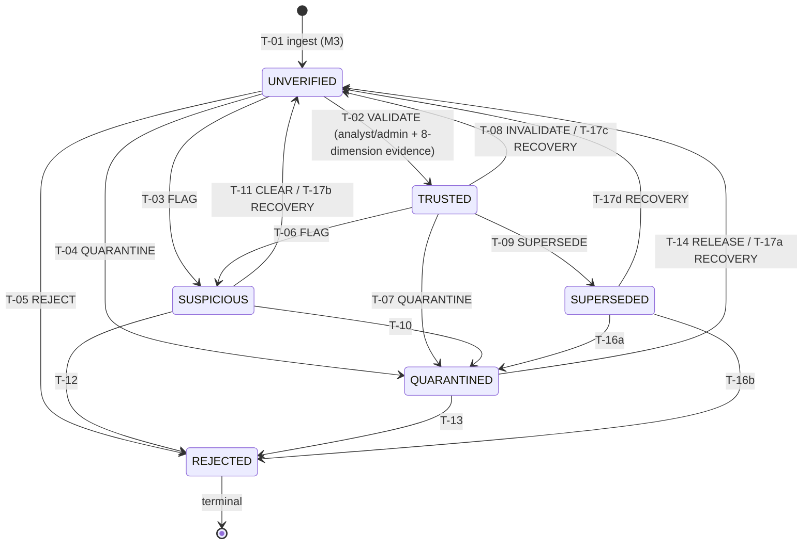

# M4 Day 3 — Memory Trust State Machine & Trust Evaluator

**Document ID:** AMSC-SEC-003
**Owner:** M4 — Security Engine & Incident Response Lead
**Status:** Implemented and tested in M4-owned code.
- Durable decision storage is **blocked on M6**.
- Enforcement of M3's direct transition path is **blocked on M3** (§12).

**Date:** 2026-11-17
**Plan reference:** Doc 06 §3 Day 3, M4 row: *"Implement trust state machine (UNVERIFIED, TRUSTED, SUSPICIOUS, QUARANTINED)"* → *Trust evaluator*. Dependency: *M3 Memory models*. Exit: *State transitions obey valid transition rules*.
**Builds on:** [policy-evaluation-matrix.md](policy-evaluation-matrix.md) §7–§8 (Day 1 design) and [rbac-design.md](rbac-design.md) (Day 2).

| Artifact | Path |
|---|---|
| Evaluator, matrix and decision store interface | `backend/app/security/trust.py` |
| Tests | `backend/tests/security/test_trust_evaluator.py` |

---

## 1. Purpose

A memory record existing in the database is not evidence that it can be trusted (PRD §2; TRD §15.3). The trust state machine is the only component that may change a record's security disposition. It guarantees four things:

1. Promotion to `TRUSTED` happens only through an explicit, authorised, evidence-backed validation of the exact current version.
2. Detection and analysts can always restrict a record.
3. Nothing automated can relax a restriction.
4. Every decision, including denials, is recorded with its actor, reason, evidence, policy version and timestamp.

The protected-tool gateway (Day 4) will consume the resulting state, through `effective_state()`, as one input to the policy engine. Trust state alone never authorises an action.

---

## 2. States

All six schema states are preserved (Doc 05 `memory_records.trust_state`; M3 `TrustState`). Day 3's plan names four of them; `REJECTED` and `SUPERSEDED` are kept with their TRD meanings.

| State | Meaning (TRD §15.3) | Normal retrieval | Can justify an action |
|---|---|---|---|
| `UNVERIFIED` | Default for every ingested record and every new version | No | No |
| `TRUSTED` | Validated for a specific version, with evidence on all 8 dimensions | Yes, subject to policy | Only if all policy checks pass |
| `SUSPICIOUS` | Flagged by a detector or analyst. Not proof of malice. | No | No |
| `QUARANTINED` | Confirmed or high-probability poisoned; isolated | No | **Never** |
| `REJECTED` | Permanently invalid. **Terminal.** Kept as evidence. | No | No |
| `SUPERSEDED` | Replaced by a validated successor; historical only | No | No |

Retrieval eligibility is enforced by M3 (GAP-001/004, verified by regression tests in §11).

---

## 3. Transition matrix

`TRANSITION_MATRIX` in code is keyed by `(operation, from_state)`. Every operation has exactly one resulting state, and **any pair not listed is denied**. The test suite checks all 54 combinations (9 operations × 6 states) against this table, written out independently in the test.

| ID | Operation | From → To | Permitted actors | Required evidence | Relaxes restriction? |
|---|---|---|---|---|---|
| T-02 | `VALIDATE` | UNVERIFIED → **TRUSTED** | User: SECURITY_ANALYST / TENANT_ADMIN | Reason + full validation evidence (§5) | Yes |
| T-03 | `FLAG_SUSPICIOUS` | UNVERIFIED → SUSPICIOUS | User, `SYSTEM_DETECTOR` | Reason + evidence refs | No |
| T-04 | `QUARANTINE` | UNVERIFIED → QUARANTINED | User, `SYSTEM_INTEGRITY` | Reason + evidence refs | No |
| T-05 | `REJECT` | UNVERIFIED → REJECTED | User | Reason + refs + incident | No |
| T-06 | `FLAG_SUSPICIOUS` | TRUSTED → SUSPICIOUS | User, `SYSTEM_DETECTOR` | Reason + refs | No |
| T-07 | `QUARANTINE` | TRUSTED → QUARANTINED | User, `SYSTEM_INTEGRITY` | Reason + refs | No |
| T-08 | `INVALIDATE` | TRUSTED → UNVERIFIED | User, `SYSTEM_UPDATE` | Reason | No |
| T-09 | `SUPERSEDE` | TRUSTED → SUPERSEDED | User | Reason + TRUSTED successor in tenant + `SUPERSEDES` edge (successor → record) | No |
| T-10 | `QUARANTINE` | SUSPICIOUS → QUARANTINED | User, `SYSTEM_INTEGRITY` | Reason + refs | No |
| T-11 | `CLEAR_SUSPICION` | SUSPICIOUS → UNVERIFIED | User | Reason + refs | Yes |
| T-12 | `REJECT` | SUSPICIOUS → REJECTED | User | Reason + refs + incident | No |
| T-13 | `REJECT` | QUARANTINED → REJECTED | User | Reason + refs + incident | No |
| T-14 | `RELEASE_QUARANTINE` | QUARANTINED → UNVERIFIED | User; separation of duties (§4) | Reason + refs + incident | Yes |
| T-16a | `QUARANTINE` | SUPERSEDED → QUARANTINED | User | Reason + refs + incident | No |
| T-16b | `REJECT` | SUPERSEDED → REJECTED | User | Reason + refs + incident | No |
| T-17a–d | `RECOVERY_RESTORE` | QUARANTINED / SUSPICIOUS / TRUSTED / SUPERSEDED → **UNVERIFIED** | User | Reason + `recovery_plan_id` + `checkpoint_id` | Yes (except from TRUSTED) |

"User" always means SECURITY_ANALYST or TENANT_ADMIN, checked through the Day 2 RBAC evaluator.

**Explicitly prohibited:**
- any route to `TRUSTED` other than T-02;
- any exit from `REJECTED`;
- `SUSPICIOUS`/`QUARANTINED`/`SUPERSEDED` → `TRUSTED` directly;
- recovery to `TRUSTED` (`RECOVERY_RESTORE` with target TRUSTED is denied with `TARGET_STATE_MISMATCH`);
- no-op transitions (for example, re-validating a TRUSTED record).

T-01 (ingestion → UNVERIFIED) is performed by M3's `ingest_memory`. It is not an evaluator transition, and the tests verify it.



### Ambiguities resolved fail-closed (need architecture sign-off)

| # | Ambiguity in the approved documents | Decision |
|---|---|---|
| A-1 | The TRD doesn't say who may clear suspicion or release quarantine | Human analyst/admin only; the result is `UNVERIFIED`, never `TRUSTED` |
| A-2 | Day 1 allowed a `SYSTEM_RECOVERY` actor for T-17 | **Tightened:** recovery restore needs an authenticated analyst/admin, because Python has no service-identity mechanism and the Day 5 recovery workflow doesn't exist yet |
| A-3 | Whether `REJECTED` content can be recovered | Not on the same record (terminal). Recovering it means creating a new record that starts `UNVERIFIED` (Day 5). |
| A-4 | Whether `TENANT_ADMIN` may perform analyst operations | Yes, by explicit listing in each rule. There is still no implicit role hierarchy (Day 2). |
| A-5 | PRD Story 3 AC-6: restored records "marked TRUSTED" | Not followed. TRD §15.3/§18 and Doc 03 §10 require revalidation (Day 1 conflict C-3). |

---

## 4. Authorisation rules

- **Who the actor is.** The actor is always resolved server-side.
  - `UserActor` wraps M1's verified `TenantContext`. It must be active and have non-blank tenant and user ids.
  - `SystemActor` is created by server code for one tenant, with type `SYSTEM_DETECTOR`, `SYSTEM_INTEGRITY` or `SYSTEM_UPDATE`. A `SystemActor` with type `USER` is rejected.
- **What the request may contain.** `TrustTransitionRequest` has **no tenant or actor fields**, and `extra="forbid"` rejects any attempt to supply `tenant_id`, `actor_id`, `role` or `actor_type`.
- **User roles.** User transitions require SECURITY_ANALYST or TENANT_ADMIN through `evaluate_role_access` (Day 2). `DEVELOPER`, `AI_DEVELOPER`, `AUDITOR` and any unknown role are denied.
- **Monotone automation.** No system actor appears on any rule that relaxes restriction or reaches `TRUSTED` (a test asserts this).
  - Detectors can only flag.
  - The integrity checker can only quarantine.
  - The update process can only invalidate.
  - A forged system actor can therefore at most restrict a record.
- **Separation of duties for T-14** (release from quarantine):
  - The releasing analyst must differ from the analyst whose decision quarantined the record.
  - `TENANT_ADMIN` may release regardless.
  - If the history has no quarantine decision (the record was quarantined outside M4), only `TENANT_ADMIN` may release.
- **Not enforced: ingester vs validator.** Separation between the ingesting principal and the validator (Day 1 §7.5) is **not enforced**, because M3's `MemoryRecord` doesn't record who ingested it. Tracked as R-5.

---

## 5. Evidence required for promotion (T-02)

`TrustValidationEvidence` is bound to `assessed_version` and `assessed_checksum`. It must contain an assessment for **each** of the eight dimensions (Doc 07 §3.2). Trust is never a single score.

| Dimension | How it is established | Accepted statuses |
|---|---|---|
| `INTEGRITY` | **Computed:** `sha256_hex` is recomputed for every stored version, and the current checksum must equal `assessed_checksum` | PASS (an attestation can't override a computed failure) |
| `LINEAGE` | **Computed:** bounded upstream traversal over `DERIVED_FROM`/`TRANSFORMED_INTO` edges. Every ancestor's effective state must be `TRUSTED`. | PASS |
| `SOURCE_IDENTITY` | **Computed:** if `source_id` is set, the source must exist in the tenant and be `ACTIVE`. If there's no source and no ancestor, the result is `PROVENANCE_MISSING`. | PASS |
| `SOURCE_AUTHORITY`, `FRESHNESS`, `CONTRADICTION` | Analyst-attested with an evidence reference (no schema attribute or repository access yet) | PASS only |
| `SENSITIVITY`, `POLICY_SCOPE` | Analyst-attested | PASS, or `NOT_APPLICABLE` **with an explanatory note**, because no schema attribute exists yet (Day 1 D-08) |

Further rules:
- **Missing evidence is never a pass.** A missing dimension, `UNAVAILABLE` or `FAIL` all deny promotion, and all failing reasons are reported together.
- **Signals can only block.** `TrustSignal` entries (detector or ML output) are recorded. An unresolved `HIGH` signal blocks promotion. Scores are never used to allow, and a 0.999 "benign" score doesn't offset a failed dimension (tested).

---

## 6. Integrity, provenance, freshness and stale-version rules

- **A matching checksum is necessary, not sufficient.** It never promotes on its own (TRD §15.1; GAP-011).
- **Tampering anywhere in the history blocks promotion.** That includes tampering with a historical version.
- **Concurrency.** Each request carries `expected_state` and `expected_version`. A mismatch is denied (`STALE_STATE`, `STALE_VERSION`), so of two identical concurrent requests only the first applies (tested).
- **Version binding.** An assessment made for version N can't promote version N+1 (`ASSESSMENT_VERSION_MISMATCH`). This closes the "validate, then edit" attack.
- **Lineage.**
  - Ancestors that are `SUSPICIOUS`, `QUARANTINED` or `REJECTED` give `LINEAGE_TAINTED`; `UNVERIFIED` gives `LINEAGE_UNVERIFIED`; `SUPERSEDED` gives `LINEAGE_SUPERSEDED`.
  - A trusted source doesn't make derived memory trusted.
  - The traversal shares one visited set and enforces global budgets: depth 5, 50 nodes, 200 edges. This avoids the per-branch budget defect in GAP-005.
  - An exhausted budget, a dangling edge, a cross-tenant edge or an unknown ancestor state gives `LINEAGE_INCOMPLETE`, which is a denial.
- **Supersession** needs a TRUSTED successor in the same tenant **and** a `SUPERSEDES` edge (narrative supersession claims need evidence, per ToxicRAG / Doc 07 §6.4).

### History reconciliation (compensating control)

The evaluator compares each record's stored state with the last **applied** decision in its history:

- **Expected out-of-band change:** history `TRUSTED`, record `UNVERIFIED` at a newer version. This is GAP-002 invalidation by M3's `update_memory`, and it is accepted.
- **Any other mismatch is drift.**
  - The **more restrictive** state is enforced.
  - Relaxing operations are denied with `STATE_HISTORY_MISMATCH`.
  - Restricting operations still work and reconcile the record.

This blocks the **F-1 laundering path** for promotion: M3's update turns QUARANTINED into UNVERIFIED, but the evaluator still treats the record as QUARANTINED. It also refuses direct writes that set `TRUSTED` outside M4.

**Limit:** records with no M4 history (created before M4, or test-seeded) can't be reconciled.

---

## 7. Tenant isolation

- **Tenant source.** The tenant comes only from the actor. Every repository read uses `(record_id, tenant_id)`, and the store is keyed by tenant.
- **No existence oracle.** A cross-tenant or nonexistent record gives an identical `RECORD_NOT_FOUND`, with no state or version leaked (tested). `TENANT_ADMIN` of tenant B can't promote tenant A's record.
- **Related records.** Successors and ancestors must be in the same tenant. A cross-tenant successor gives `SUCCESSOR_INVALID`; a cross-tenant lineage edge gives `LINEAGE_INCOMPLETE`.
- **History access.** `history()` requires a verified tenant context and returns only that tenant's decisions.

---

## 8. Fail-closed behaviour

`evaluate()` and `apply()` never raise. Every failure becomes a `DENIED` decision.

| Failure | Result |
|---|---|
| Repository read error | `REPOSITORY_UNAVAILABLE` |
| Repository write error | Not applied; state unchanged |
| Decision-store read error | `DECISION_STORE_UNAVAILABLE` |
| Decision-store append error after the state write | **State change reverted**, then `DECISION_STORE_UNAVAILABLE`. A promotion without recorded evidence is undone; if the revert itself fails, a critical log asks for manual reconciliation. |
| Unknown stored state or version | `CURRENT_STATE_UNKNOWN` |
| Malformed request, unknown state or operation name, non-request input | `REQUEST_INVALID` |
| Any unexpected exception | `EVALUATION_ERROR` |
| Production with an in-memory store or repository | `TrustEvaluator` refuses to construct (`RuntimeError`) |

`raise_for_decision()` maps denials to M1's existing errors without exposing reason codes:

| Denial class | M1 error |
|---|---|
| Dependency failure | 503 `SECURITY_DEPENDENCY_UNAVAILABLE` |
| Actor or authorisation | 403 `FORBIDDEN_ACTION` |
| Not found | 404 |
| Malformed request | 400 |
| Otherwise | 409 `CONFLICT` |

---

## 9. Audit evidence

Each `TrustDecision` (frozen) records:
- decision id;
- applied / permitted / denied flags and reason codes;
- operator reason (stored, **never logged**);
- record, tenant, operation and transition id;
- effective, stored, target and resulting states;
- record version and current-version checksum (not content);
- actor type, id and role;
- incident id;
- evidence summary: dimension results, lineage ancestors and states, evidence refs, signals, recovery plan and checkpoint ids;
- `policy_version` (`amsc-trust-policy/1.0.0`) and timestamp.

**Denied attempts are recorded too**, which shows repeated promotion attempts. Logs carry only ids and reason codes, never memory content, reason text or notes (tested with seeded PII).

**Durable storage is an M6 dependency.** `TrustDecisionStore` is an append-only protocol (`append`, `list_for_record`). `InMemoryTrustDecisionStore` exists for dev/test only and is refused in production. Required from M6 (Day 1 D-07):
- table `memory_trust_assessments`, append-only with the same trigger approach as `audit_events` in migration 0004, holding the fields above;
- a tenant-scoped repository implementing the protocol;
- a mirrored `audit_events` row per applied transition (`MEMORY_TRUST_VALIDATED`, `MEMORY_FLAGGED_SUSPICIOUS`, `MEMORY_QUARANTINED`, `MEMORY_QUARANTINE_RELEASED`, `MEMORY_REJECTED`, `MEMORY_SUPERSEDED`, `MEMORY_TRUST_INVALIDATED`, `MEMORY_RESTORED_FROM_CHECKPOINT`);
- a `quarantines` row for QUARANTINE.

**Atomicity is not guaranteed yet.** The state write and the evidence append are separate calls, compensated by revert-on-failure. True atomicity needs M6's transaction boundary (GAP-008).

---

## 10. Research alignment (checked 2026-11-17)

| Source | Status | Influence on this design |
|---|---|---|
| [MINJA](https://arxiv.org/abs/2503.03704), Dong et al. | NeurIPS 2025, peer-reviewed | Query-only interaction can inject persistent records, so every write starts UNVERIFIED and promotion needs an independent human validation |
| [MemPoison](https://arxiv.org/abs/2607.14651) | arXiv preprint (Jul 2026) | Write-time filtering misses compositional and dormant poisoning, so lineage is re-checked at promotion and restriction is always possible later |
| [MemSecBench](https://arxiv.org/abs/2607.27080) | arXiv preprint (Jul 2026); 310 cases; authors' results only | Repair is often incomplete, so recovery never auto-trusts and revalidation is mandatory |
| [MemLineage](https://arxiv.org/abs/2605.14421), Ouyang & Hou | arXiv preprint (May 2026) | Chain of custody over derivations: tainted ancestry blocks derived promotion; signing or hashing doesn't cleanse it |
| [TrustMem](https://aclanthology.org/2026.findings-emnlp.2419/) | Findings of EMNLP 2026, peer-reviewed | Transitions can omit, corrupt or invent content, so each decision is bound to an exact version, and a verifier's output is a signal, not a promoter |
| [HaluMem](https://arxiv.org/abs/2511.03506) | arXiv 2511.03506. Doc 07 lists EMNLP 2026; I didn't confirm the venue in this session. | Hallucinations arise at extraction and update time, so a content update invalidates trust (GAP-002 accepted as T-08) |
| AkasicMEM (Doc 07 R-012, arXiv 2609.25563) | **Not found in this session's searches; treated as unverified** | Not relied on. Authorisation continuity is justified by MemLineage instead. |
| AgentGuard (`docs/EVALUATION.md`, per Doc 07 §4.1) | Project-reported, synthetic | Model scores are weak on unseen phrasing, so scores never allow and only HIGH signals block |
| AgentDojo | NeurIPS 2024 | Day 4 evaluation (state-based outcomes); not used on Day 3 |
| [OWASP Top 10 for Agentic Applications 2026](https://genai.owasp.org/resource/owasp-top-10-for-agentic-applications-for-2026/), ASI06 Memory & Context Poisoning | Design guidance | The threat class this state machine addresses |
| [OWASP Authorization Cheat Sheet](https://cheatsheetseries.owasp.org/cheatsheets/Authorization_Cheat_Sheet.html); [NIST SP 800-207](https://csrc.nist.gov/pubs/sp/800/207/final); [CWE-862](https://cwe.mitre.org/data/definitions/862.html) / [CWE-863](https://cwe.mitre.org/data/definitions/863.html) | Standards and guidance | Default deny, per-request evaluation, explicit matrix (no implicit transitions), allow-listed actors |

**AMSC-specific design decisions, not research findings:**
- the operation-keyed matrix;
- monotone automation;
- history reconciliation;
- separation of duties on release;
- the specific traversal budgets.

---

## 11. Test coverage (executed 2026-11-17)

Environment: Python 3.14.5 and the pinned `requirements.txt` (`asyncpg` excluded), on branch `feat/m4-security-ml`.

| Command | Result |
|---|---|
| `pytest backend/tests/security/test_trust_evaluator.py` | **229 passed, 2 xfailed** (strict xfails track the M3 bypasses F-1 and F-2) |
| `pytest --ignore=backend/tests/database` (full suite) | **516 passed, 2 xfailed**; no existing test modified |
| `pytest backend/app/memory/tests -k "gap or quarantin or tenant or tamper"` | 21 passed (GAP-001..004 regression) |
| `pytest backend/tests/database` (M6) | **Not run:** `asyncpg` can't be installed on Python 3.14; it also needs PostgreSQL |
| Mutation check | All 8 injected regressions caught: detector may validate; skip checksum; ignore drift; ignore history; ignore tainted ancestors; ignore staleness; missing dimension treated as pass; DEVELOPER may change trust |

Coverage by area:
- **A. Initialisation:** ingestion is UNVERIFIED; all 6 states exist; unknown stored, target or expected states and operations are denied.
- **B/C. Matrix:** all 54 operation × state pairs; target mismatch; reason, refs and incident requirements; recovery can't reach TRUSTED and requires plan ids; revalidation after recovery.
- **Actors:** non-analyst roles; system actors can't relax; system actors can restrict; forged system actor; separation of duties.
- **D. Evidence and lineage:**
  - each dimension failed, unavailable or missing;
  - NOT_APPLICABLE rules;
  - signals;
  - checksum tampering (current and historical);
  - assessed checksum;
  - stale assessments and versions;
  - concurrency;
  - provenance missing; inactive source;
  - suspicious, unverified or superseded parent; quarantined grandparent;
  - depth, node and dangling-edge budgets;
  - diamond lineage.
- **E. Tenancy:** cross-tenant not-found equivalence; cross-tenant admin; smuggled tenant or actor fields; a system actor bound to another tenant; invalid or missing actor; history scoping.
- **F. Fail-closed:** repository read and write errors; store append failure with revert; store read failure; internal exception; non-request inputs; production guard; dry-run purity; error mapping.
- **G. Audit:** decision fields; denial recording; lifecycle history; immutability; log redaction.
- **H. Reconciliation:** F-1 laundering blocked; suspicion kept after update; out-of-band promotion ignored; GAP-002 accepted.

---

## 12. Known limitations and integration dependencies

| ID | Owner | Item |
|---|---|---|
| R-1 | **M3** | **F-2 bypass still present:** `memory/service.py::transition_memory_trust_state` sets any state with no matrix, evidence, actor or audit, and M3's own tests use it as an evidence-free helper. Proposed change below. Tracked by a strict xfail. |
| R-2 | **M3** | **F-1:** `update_memory` resets QUARANTINED, REJECTED, SUPERSEDED and SUSPICIOUS records to UNVERIFIED. History reconciliation blocks the *promotion* consequence for records with M4 history, but M3 should refuse updates in those states (Day 1 §7.6). Tracked by a strict xfail. |
| R-3 | M6 | Durable append-only `memory_trust_assessments`, mirrored `audit_events` and `quarantines` writes, a transaction boundary (GAP-008), and async session integration (the evaluator is synchronous today, matching M3's repository) |
| R-4 | M3 / M6 | Retrieval reads `memory_records.trust_state` directly. Drift detected by M4 isn't reflected in retrieval until M3 calls `effective_state()` or the record is reconciled. A record forced to TRUSTED outside M4 would still be retrievable. |
| R-5 | M3 | Record `ingested_by` on memory records so validator ≠ ingester can be enforced |
| R-6 | M1 / M6 | Role vocabulary (Day 2 R-1): `AI_DEVELOPER` is denied here as well |
| R-7 | M3 / M6 | Schema attributes for sensitivity, policy scope, `valid_until` and source authority (Day 1 D-08). Until then those dimensions are analyst-attested. |
| R-8 | M4 (Day 5) | HTTP routes (`POST /memory/{id}/quarantine`, `/restore`) aren't wired; they will call `apply()` and then `raise_for_decision()` |
| R-9 | M1 / M7 | `asyncpg==0.29.0` can't be installed on Python 3.14, so M6's DB suite can't run here |

**Proposed M3 change (R-1), for M3 to review.** It removes the second, unguarded trust path:

```python
# backend/app/memory/service.py
def transition_memory_trust_state(*args, **kwargs):
    raise NotImplementedError(
        "Trust transitions are owned by M4: use backend.app.security.trust.TrustEvaluator.apply()."
    )
```

M3's tests that currently call it as setup would instead use a test-only fixture. That fixture would either drive the record through `TrustEvaluator` with full evidence (as `backend/tests/security/test_trust_evaluator.py::Harness.drive` does) or set the state on the in-memory repository directly, as several M3 tests already do. When this lands, the strict xfail `test_m3_direct_transition_path_enforces_matrix` will XPASS and fail, which prompts its removal.
